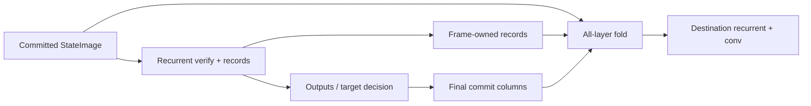

# KDA ReplaySSM implementation design

Nature: a record/fold interface and combination design that still has to land, with dual-Spark
GLM5Next as the first instance. The [design index](README.md) holds the decisions, the implementation
status and the task scope. The [model reference](../../maintainer/glm5next-model.md#3-kda) covers the
model transition and the historical dependencies. The
[numerical policy](../../maintainer/glm5next-quantization.md#4-projection-control-values-and-the-latent-attention-boundary)
covers the representation and the precision.

This design aligns its state management with the
[existing GDN ReplaySSM](../../maintainer/replayssm-gdn.md): verify produces the outputs and the
records from a read-only base state, and after the final accepted length is fixed, the fold completes
inside the round. A committed recurrent state always represents the newest accepted frontier and
keeps no committed log that waits for a cross-round fold.

The compute input keeps the convention of the
[existing KDA mathematical interface](../../../include/ninfer/ops/kimi_delta_attention.h): the caller
still passes BF16 raw forget/beta logits, FP32 A_log/dt_bias and lower_bound, and the gate is
generated inside KDA. Aligning with GDN does not change this boundary and does not require the caller
to prepare FP32 gate tensors. The existing general entry serves algorithm and performance
verification, and its dispatch is not a production constraint. Ordinary decode, verify record and fold
use the recurrent state transition. Decode does not use the chunked path. The algorithm choice for a
long prefill does not converge in this document.

## 1. Split and persistent state

| Layer | Responsibility |
|---|---|
| Core | StateImage fields, the layout of the record planes and the non-owning views |
| KDA input Op | QKV projection/conv/SiLU and the actual conv history records |
| KDA recurrence Op | internal gate generation, recurrent output and transition records |
| KDA fold Op | replay the accepted prefix from the given source and write the recurrent/conv state of the destination |
| RankProgram | holds the frame/records, the prepared plans, the CUDA Graph and the physical execution dependencies |
| ModelSession | selects source and destination, the final adopted length, the frontier, the checkpoint and the cross-rank commit |

Follow [LinearAttentionState](../../../src/core/linear_attention_state.h) and
[StateImage](../../../src/core/state_image.h). Each layer contains:

- an FP32 recurrent `[Dk,Dv,Hv,Slots]`, logically `S[value,key]`, with the key axis contiguous;
- a BF16 conv history `[C,3,Slots]`, with the columns ordered oldest to newest;
- an explicit layer stride and slot stride. Do not assume that different fields or layers are
  adjacent.

One checkpoint saves these two folded states together with the other fields and the historical prefix
that the complete model needs. The records belong to an execution frame that has not retired. They do
not enter a long-term checkpoint and do not enter the growing KV pool. The existing directory still
manages the active image, the immutable checkpoint and the destination image being written
separately.

## 2. Compute inputs, outputs and mathematics

### 2.1 The compute boundary that stays

The table gives the batched view of verify. The ordinary batch update uses `T=1`. Native Tensor
dimension 0 is contiguous, `Hq` means the query/key heads and `Hv` means the value heads.

| Operand | Type and shape | Meaning |
|---|---|---|
| q, k | BF16 `[128,Hq,T,B]` | after conv/SiLU and before L2 normalization |
| v | BF16 `[128,Hv,T,B]` | the value after conv/SiLU |
| g | BF16 `[128,Hv,T,B]` | the raw forget projection logit, not the log-decay |
| beta | BF16 `[Hv,T,B]` | the raw beta logit, not the coefficient after sigmoid |
| A_log | FP32 `[Hv]` | the fixed parameter of each value head |
| dt_bias | FP32 `[128,Hv]` | the fixed parameter of each head/key channel |
| lower_bound | FP32 scalar | finite and inside `[-5,0]`; GLM uses -5 |
| scale | FP32 scalar | `1/sqrt(128)` |
| states | FP32 `[128,128,Hv,Slots]` | the per-layer view of the complete state pool |
| out | BF16 `[128,Hv,T,B]` | the scaled query readout after the state update |

`Hq>=1`, `Hv>=Hq`, `Hv%Hq==0`. Value head h uses the q/k of `qh=floor(h/(Hv/Hq))`. The first
production profile is `Hq=Hv=32`. The output excludes the later gated RMSNorm, the output gate and the
O projection.

### 2.2 Mathematical inputs and actual records

The q/k of section 2.1 are the BF16 values before L2 normalization, and g/beta are raw logits. Complete
the internal normalization, the gate and the state transition by the
[model KDA mathematics](../../maintainer/glm5next-model.md#3-kda). The lower_bound of the interface
replaces the model instance value -5, and the head mapping and the scale use the explicit parameters
of section 2.1. The decay acts on each key channel inside the prediction and must not move outside the
whole reduction as one scalar. The complete formula is not maintained again here.

The correspondence of the two notations is: interface g corresponds to the model forget logit f, and
interface beta corresponds to `W_b*x`. record.log_decay corresponds to the activated g of the model
formula, and record.beta corresponds to its beta after sigmoid.

When verify forms log_decay/beta_value internally, it writes the FP32 words that the transition
actually uses into the records. Fold consumes these words and runs no sigmoid, A_log or dt_bias
computation. The exp from log_decay to alpha still belongs to the recurrent transition and stays
consistent with verify. This internal record does not turn the BF16 input of the external g/beta into
FP32 and does not increase the precision of the projection input.

## 3. Geometry, row identity and record layout

### 3.1 Domain and identity

- `L`: the KDA layer count of this rank, 34 for the first profile; numbered by the order in which the
  KDA layers appear in Main.
- `C=2*Hq*128+Hv*128`: the Q/K/V conv channels; 12288 for the first profile.
- `R=record_capacity`: the physical record row capacity reserved by one frame, in the range 1..8.
- `B`: the row count of this activity, `1<=B<=R`, different from the StateImage slot count.
- `T=width`: the physical window width of this prepared layout, a positive integer.
- `n[b]`: the valid column count of verify, `1<=n[b]<=T`; an empty valid_columns means `n[b]=T`.
- `m[b]`: the final commit column count, `0<=m[b]<=n[b]`.

Do not define the optimization range of a short-window kernel as the semantic upper bound of T. The
startup configuration and the prepared capacity limit the actual window. Each execution variant binds
its own T/record layout. A short row is expressed through the valid column count. Do not reinterpret
the memory of a fixed T directly as a shorter T.

The records own no sequence, frontier or slot policy. ModelSession/RankProgram keeps the mapping from
the original physical row to the sequence and to the source image/version in the frame. After a record
is produced and until the fold retires it, the batch must not be recompressed, the row order must not
change, the source content must not be overwritten and the records must not be reused.

### 3.2 The five independent planes

| Plane | Complete allocation shape | Valid B-row view of one layer | Content |
|---|---|---|---|
| conv | BF16 `[C,T,L*R]` | `[C,T,B]` | the newest Q/K/V history column of each step |
| key | BF16 `[128,Hq,T,L*R]` | `[128,Hq,T,B]` | the actual key words before L2 norm |
| value | BF16 `[128,Hv,T,L*R]` | `[128,Hv,T,B]` | the actual value words |
| log_decay | FP32 `[128,Hv,T,L*R]` | `[128,Hv,T,B]` | the internally generated per-channel log-decay |
| beta | FP32 `[Hv,T,L*R]` | `[Hv,T,B]` | the beta after the internal sigmoid |

The common outer index is `outer=layer*R+b`. The five planes are each contiguous, aligned to a 256 B
start and mutually disjoint. The planning checks the extent/byte size for overflow, and the addressing
products use integers wide enough. `layer(l,B)` selects the rows `[l*R,l*R+B)`. Do not replace the R
in the stride with the current B.

Follow the GDN container structure and add `KdaReplayRecordSpec`, `KdaReplayRecordLayout`,
`KdaReplayRecordLayer`, `KdaReplayRecords` and `plan_kda_replay_records`. The Spec fields have the
same form as GDN: layers, record_capacity, width, conv_channels, qk_heads, value_heads, key_dim and
value_dim. Both state dimensions of KDA are 128.

`KdaReplayRecordLayer` holds the five Tensors above. The record sub-view of the recurrence has only the
last four planes. The conv plane is produced by the input preparation Op. The `[2,Hv,T,B]` scalar gate
plane of GDN is not extended into an ambiguous layout. The log_decay and the beta of KDA are separate,
the 128-channel rows stay contiguous, and beta is not stored twice. The public GDN contract does not
change because KDA is added.

## 4. Conv record production

The interface corresponds to `gdn_input_proj_conv_record` and keeps the projection/convolution
characteristics of KDA:

```cpp
struct KdaConvOutputs {
    Tensor query, key, value;
};

struct KdaConvSourceState {
    Tensor history;      // Read-only BF16 [C,3,Slots].
    Tensor source_slots; // Device I32 [B], absolute source slots.
};

void kda_input_proj_conv_record(
    const Tensor& x, const ProjectionWeights& weights,
    const Tensor& conv_weight, KdaConvSourceState state,
    const Tensor& valid_columns, KdaConvOutputs outputs,
    Tensor& conv_record, MemoryArena& workspace,
    CudaExecutionView execution);

std::size_t kda_input_proj_conv_record_workspace_capacity_bytes(
    const ProjectionProfile& weights, std::int32_t batch,
    std::int32_t min_tokens, std::int32_t max_tokens);
```

The first profile consumes the BF16 x `[4096,T,B]` and an A16Only Q8-G32/FP16 QKV parent
`[12288,4096]`, with the row order `[Q4096,K4096,V4096]`. The conv weight is FP32 `[C,4]`, with the
four taps ordered `t-3,t-2,t-1,t`. The BF16 outputs of Q/K/V are `[4096,T,B]` each, and can be viewed
without a copy as the `[128,32,T,B]` of the recurrence. The KDA output gate belongs to another branch
and Z is not output here.

The mathematics is `p=concat(Wq*x,Wk*x,Wv*x)`. Concatenate the old three-column history with the p of
this window, run a per-channel four-tap causal convolution and SiLU, and split into Q/K/V. A short
history is zero-padded when the request initializes. The conv consumes no future column. The input
preparation and the recurrence use the same physical row, the same valid length and the same source
image.

The numerical behaviour and the effects:

- The projection, the conv and the SiLU form one complete combination. The published history and the
  Q/K/V are BF16. Do not materialize a private BF16 projection intermediate just because conv_record
  is needed.
- conv_record is BF16 `[C,T,B]` and holds the newest history column that each step of the same physical
  execution actually publishes. A record cannot be obtained by shortening T, changing B or rerunning
  the projection.
- The source history is always read-only. The valid outputs/records are written in full. An invalid
  Q/K/V suffix writes exact +0, and an invalid record suffix stays unchanged.
- The projection can process every safe `M=T*B` column, and the caller provides the complete physical
  input. Only the valid prefix takes part in the conv/history semantics. Do not turn padding into
  history.
- Inside each history slot `[C,3]` is contiguous, the slot start is aligned to at least 16 B, and the
  stride is explicit. The other Tensors are contiguous and aligned to at least 16 B. The I32 selectors
  are aligned to at least 4 B.
- Every input, output, record, selector, weight parent and call scratch is mutually disjoint. The
  values of the source slots are inside `[0,Slots)`. Different read-only rows can read the same
  source.
- The caller arena provides the workspace. The capacity query covers the complete combination and the
  given T range. The operator has no persistent allocation and does not decide the adoption or the
  publication of the history.

The conv history is compared word by word against the per-position history reference of the same
complete physical T/B execution. That reference can be snapshot instrumentation in a test or a
measurement. Production does not have to keep a conv trajectory. The source/destination history update
of an ordinary T=1 input preparation must obey the same newest-column definition, and its complete
fusion list is arranged together with the other KDA input preparations.

The query does not enter the recurrent replay record, but the pre-convolution column of Q must enter
conv_record so that a later Q convolution can continue. The FP32 conv weights do not take part in the
fold, and the fold only extracts the history words.

## 5. The Recurrent record interface

```cpp
struct KdaRecurrenceRecords {
    Tensor key;        // BF16 [128,Hq,T,B].
    Tensor value;      // BF16 [128,Hv,T,B].
    Tensor log_decay;  // FP32 [128,Hv,T,B], generated inside KDA.
    Tensor beta;       // FP32 [Hv,T,B], generated inside KDA.
};

void kimi_delta_attention_replay_record(
    const Tensor& q, const Tensor& k, const Tensor& v,
    const Tensor& g, const Tensor& beta,
    const Tensor& A_log, const Tensor& dt_bias,
    float lower_bound, float scale,
    const Tensor& ssm_states, const Tensor& valid_columns,
    const Tensor& initial_state_slots, KdaRecurrenceRecords records,
    Tensor& out, CudaExecutionView execution);
```

The `g/beta` parameters use the BF16 raw-logit input of section 2 strictly. They are not the FP32
control values of the same name in the records. `initial_state_slots` is a device I32 `[B]` and holds
absolute source slots. Valid_columns is empty or a device I32 `[B]`.

Each row starts from the source state, runs n[b] complete recurrent transitions in order and produces
the outputs. The running trajectory can stay in registers or shared memory. The operator writes no
state slot and keeps no per-position recurrent snapshot. The key/value records are a side copy of the
actual BF16 input words. The log_decay/beta records are an FP32 side copy of the internal gate
computation result and pass through no extra low-precision encoding.

The valid record prefix must be covered completely. An invalid suffix stays unchanged, and an invalid
out suffix is BF16 +0. Every valid record element is published by a single writer and does not rely on
several state tiles writing the same value. Different record rows can read the same read-only source,
but they have independent outputs and records.

Inside the state slots `[128,128,Hv]` is contiguous and the slot start is aligned to at least 16 B. The
slot stride is explicit. Q/K/V/g/out and the BF16/F32 vector records are contiguous and aligned to at
least 16 B. beta, A_log, dt_bias, the beta record and the selectors are aligned to at least their
element type. The all-layer planner uses the stronger plane alignment of section 3. Every operand that
has storage is pairwise disjoint, including the source state, the metadata, the records and out.

Do not create a persistent device allocation that the caller cannot see. This recurrent record entry
needs no global workspace. The caller guarantees that the device selectors and valid lengths are
legal. The wrapper verifies the dtype, the shape, the stride, the alignment, the device and the
address domain, and adds no synchronous read to check a device value.

## 6. Ordinary single-column update and the numerical reference

The production ordinary update keeps every compute parameter and only aligns the source/destination
state selection with GDN:

```cpp
void kimi_delta_attention_batch_update(
    const Tensor& q, const Tensor& k, const Tensor& v,
    const Tensor& g, const Tensor& beta,
    const Tensor& A_log, const Tensor& dt_bias,
    float lower_bound, float scale, Tensor& ssm_states,
    const Tensor& source_state_slots, const Tensor& destination_state_slots,
    Tensor& out, CudaExecutionView execution);
```

Here T=1 and B=1..8, and both selectors are a device I32 `[B]`. The same row may have
source=destination. The destinations of the rows are distinct and must not overwrite the source of
another active row. Source slots can repeat, provided every related write satisfies the limits above.
Only the recurrent state of the destination and the out of this row are written. The slots outside
source and destination and the other StateImage fields stay unchanged. The input preparation state
effect handles the conv history. The other compute inputs and outputs, the state stride and the alias
constraints follow sections 2 and 5.

This source/destination extension belongs to the state management alignment and does not modify the
raw gate input. The existing batch entry that accepts only one set of in-place selectors is replaced
together with its callers during implementation, and the old signature is not kept as a compatibility
alias. Production decode does not borrow the automatic dispatch of the experimental general entry.

The record, the ordinary update and the fold share the same KDA finite-precision transition core. Run
a step-by-step ordinary recurrent reference from the actual represented inputs of the same physical
verify, and the valid outputs must agree bit for bit. The record itself does not publish the final
state.

## 7. Prepared all-layer fold

```cpp
struct KdaReplayFoldRow {
    std::int32_t source_state_slot;
    std::int32_t destination_state_slot;
    std::int32_t commit_columns;
};

class KdaReplayFoldPlan {
public:
    KdaReplayFoldPlan(
        const KdaReplayRecords& records,
        LinearAttentionStateAllLayersView states);

    void execute(
        std::span<const KdaReplayFoldRow> rows,
        CudaExecutionView execution) const;
};
```

Construction verifies the geometry, the device, the alignment, the address range, the field/layer
strides and the non-overlap of the fixed records and state. Each execute verifies the active row count,
the source/destination slots and `0<=commit_columns<=T`. The caller also guarantees `m[b]<=n[b]` and
that the source is the same content version as when the records of that row were produced. The plan
borrows existing stable backing and owns no allocation and no record lifetime.

`rows[b]` always corresponds to physical record row b, and rows.size() is inside `[1,R]`. Source and
destination are absolute state slots and do not have to equal b. The state layout matches L, Hq/Hv, C
and Dk/Dv of the records, and conv_width=3. Each layer and field must have a mutually disjoint actual
data block, and an independent layer stride must not be guessed from the size of one layer. The field,
layer and slot starts of the Core plan keep the 256 B alignment.

### 7.1 The accepted prefix

For each row with m>0, at each layer, start from the source recurrent state:

```text
for t in [0,m):
    k_hat = normalize(record.key[t])
    alpha = exp(record.log_decay[t])
    run decay → prediction → delta → rank-one update by section 2

destination.recurrent = the final FP32 state
destination.conv = tail_3(source.conv || conv_record[0:m])
```

The fold reads no q, no raw g/beta logit, no A_log, no dt_bias, no lower_bound, no scale and no
projection weight. It runs no readout, no sigmoid, no conv, no SiLU, no output gated RMSNorm and no O
projection. It recomputes only the key normalization, the exp(log_decay), the prediction and the
update of the state transition. The delta must be recomputed from the current state of the fold. Do
not take the state-dependent delta of verify as an input.

The conv update is an exact word extraction. m=1 takes the last two columns of the old history and
record[0]. m=2 takes the old last column and record[0:2]. m>=3 takes record[m-3:m]. For an in-place
update, keep the needed old columns first and then write.

### 7.2 Zero commit and alias

m=0 is a strict no-op for that row. It reads no record and no state payload and writes no recurrent
state and no conv. Even when source!=destination it does not copy the old state implicitly. That row
keeps using the old image. If another combination operation really needs a copy, the caller arranges
it explicitly. Do not treat an unwritten destination as a valid new state.

A single-row in-place fold is allowed. The destinations of the active rows are distinct and must not
overwrite the source of another active row. The check is the same as in GDN. All five record planes are
read-only and do not overlap each other or any state data block. Only the destination recurrent/conv
of a positive commit row is written. Do not touch the other slots, the Index tails, hidden or the
metadata. A rejected suffix is not read.

One fold call covers every KDA layer and the conv history of this rank. The Host does not submit it
layer by layer. The public contract does not fix the kernel count and introduces no temporary complete
state trajectory. There is no extra global workspace.

## 8. The exact commit contract

Write the internal actual FP32 gate words as d/b and the record as `R_t=(k_raw,v,d,b)`. Write the
finite-precision transition the implementation uses as `F_fp`. Verify and fold must satisfy:

```text
S_verify[0] = S_source
S_verify[t+1] = F_fp(S_verify[t], R_t)

S_fold[0] = S_source
S_fold[t+1] = F_fp(S_fold[t], R_t),  0<=t<m

bits(S_fold[m]) == bits(S_verify[m])
```

The conv must also equal the m-th history words of the same complete physical record-producing block.
The projection/conv before the record runs once under the same T/B. Do not shorten T/B and recompute
the input, and do not treat the result of a shorter forward as the exact prefix reference of that
verify.

The bitwise relation covers the normalization, the exp, the prediction reduction, the multiply-add and
the state-store boundary. The public contract does not specify the CUDA instruction, the warp/CTA or a
reduction tree. The implementation can adjust them, but decode/record/fold must be verified again as
one consistent numerical combination. Do not switch by accepted length to another fold path that is
algebraically equivalent but produces a different represented state.

This exact relation does not replace the mathematical qualification. The production recurrence must
also be verified against an independent mathematical oracle for the complete output and state. A
constant-per-channel decay can degenerate to a scalar GDN in the real domain, but the two Ops are not
required to make their different numerical implementations agree bit for bit. The chunked
implementation of a long prefill is not the numerical reference of decode/verify/fold. The actual FP32
end state it produces can serve as the source of the next round.

## 9. Commit, checkpoint, Graph and TP2



1. The Session keeps the version and the read dependency of the source image and reserves the
   necessary destination image, pages and frame. A retained checkpoint must not be overwritten in
   place. Adopt it in place only when the write is exclusive.
2. RankProgram completes the input records and the recurrent records with the same source, T/B and
   row order. The next layer consumes the output of this layer normally, and the records stay alive
   until the adoption ends.
3. The backend acceptance and the Frontend truncation give the final m. It is the verify input count
   that is adopted and usually contains the old anchor and the accepted drafts, that is
   accepted_drafts+1, further limited by the actual publication boundary.
4. RankProgram folds each positive commit row and completes the accepted-prefix adoption of the other
   model state/cache. The correction/bonus becomes the pending anchor of the next round, and its input
   transition is not committed early in this round.
5. The Session adopts the StateImage, each pool coverage, the input identity and the completion
   dependency as one logical commit. A physical result can be consumed after its dependency is ready.
   The Op does not advance the frontier by itself.
6. The records of the frame can be reused only after the fold, the other consumers and the execution
   dependencies have retired. The next round starts directly from the folded committed state. A
   cancelled row publishes no candidate.

At TP2 each host runs its own record/fold over the local 32 heads and 34 layers and needs no transfer
of KDA records or state. Both hosts adopt the same logical batch and length, and the local physical
state slot can differ. The model layer maintains the mapping from the logical layer number to the
compact KDA layer ordinal. GLM MTP has no KDA. This record storage serves Main verify and adds no MTP
KDA layer. The model's own adoption operation handles the cache and tail of the MLA DP owner.

A StateImage is still charged per active/checkpoint/destination instance. Pause/restore saves the
folded KDA state/conv and the other necessary model state. The records staged in this round do not
become a checkpoint dependency. If a long window produces only the end state, the other checkpoint
boundaries still need a split execution or an explicit capture. Do not infer backwards from a deeper
KDA state by shortening the MLA cache.

The records/state backing, the geometry and the strides of the prepared plan stay stable. Replay reads
the content of the record device selectors and valid_columns. The fold follows the GDN Host row
descriptor capture-by-value semantics: modifying the Host vector does not change an already captured
call, and changing the descriptors requires a new capture or the existing non-captured commit path.
The scheme adds no synchronization to read metadata. Several frames that have not retired each hold
their own records and do not overwrite each other.

The deployment capacity and the snapshot/records cost comparison are collected in the
[parallel resource design](parallel.md#5-kda-records-capacity-and-cost). The complete record layout and
the prepared fold plan of this design still decide the capacity query. Do not replace the actual
sizing with the example table.

## 10. Qualification and performance acceptance

### 10.1 Independent mathematics and exact relations

- Use an independent mathematical oracle to compute the normalization, the bounded gate, the key-axis
  decay, the delta, the update and the readout from the represented BF16 inputs and the FP32
  parameters. Verify against the KDA mathematical error contract. Do not replace it with kernel parity
  or with a readable generated result.
- Check the key/value axis with a non-uniform per-channel decay, covering a zero key, a zero and a
  non-zero initial state, a gate saturation boundary and the real-domain degeneration of a
  constant decay.
- Take the recurrent prefix references from the actual outputs/records of the same complete physical
  T/B producer, and check the fold recurrent/conv for word-by-word agreement at each m.
- Cover m=0/1/2/3, full acceptance, partial acceptance, mixed n/m, in-place and out-of-place,
  non-contiguous slots, a shared read-only source forking to different destinations, and the rejection
  of an illegal cross-row overwrite. Do not call this Op when there is no active row. When an active
  row has m=0, keep the record row and run the strict no-op semantics.
- Check the valid record bits, the zero of an invalid output, the invalid record suffix, the source and
  inactive slots, the other StateImage fields and the protection of the record region. Rewriting a
  rejected suffix must not affect the committed state.
- After the record producer of the Q8 projection plus FP32 conv is connected, compare the actual
  history words of the same physical window, covering the three-column concatenation of the old
  history and the new records.
- Change the adopted length over several rounds and check the state/history each round, including a
  full acceptance, a short acceptance, a cancellation and a round after a restore. The qualification
  covers the production record/fold path and the Graph call directly.

### 10.2 Measurement criteria

The first target is Spark `sm_121a`, 34 layers/32 heads, B=1/2/4/8. The focus windows are
T=1/2/4/6/8/16, and the other widths that the configuration allows are checked as well. The accepted
length covers 0, a short prefix and a full prefix. Uniform and mixed row lengths are reported
separately. These are measurement points, not a public upper bound of T.

The control is a single-window verify with complete state snapshots and reference adoption over the
same represented inputs and the same recurrent numerical trajectory. Fix the projection/conv
computation, the quantization, T/B, the starting state, the adopted length and the run conditions. The
per-token Host call used for qualification is not taken directly as a latency baseline.

Report the input preparation/conv record, the recurrent record, the all-layer fold and the complete
verify plus commit unit separately. Also list the temporary capacity, the actual state traffic, the
Eager/Graph condition, the distribution and the worst change. The workloads, the weights and the
adopted-length distribution used for the sample aggregation are fixed before the measurement. Report
the extra computation of the fold and every degeneration. Do not replace a measurement with a storage
compression ratio.

This stage is a new production ReplaySSM capability. There is no GLM end-to-end result and no
record/fold performance result yet. A later model integration measurement confirms the gain of the
complete Main/MTP cycle.

## 11. Landing locations and later boundaries

| Content | Landing location / reuse |
|---|---|
| Planning and views of the five-plane records | add `src/core/kda_replay_records.*`, reusing the Core Tensor/Layout |
| Persistent state | reuse `linear_attention_state.*`, `state_image.*` |
| Record/update compute contract | `include/ninfer/ops/kimi_delta_attention.h` |
| All-layer fold contract | add `include/ninfer/ops/kda_replay.h` |
| Conv record contract | add `include/ninfer/ops/kda_input_proj.h` |
| Production recurrence/record/fold | organised inside the existing `src/ops/linear_attention/kimi_delta_attention/` family |
| Source/destination, frame and adoption | the native GLM model execution and the Session, reusing the context directory and the completion mechanism |

During implementation, first establish the mathematical qualification of the KDA recurrence and the
shared numerical core, and then connect the record/fold, the conv record and the all-layer combination
verification. The source/destination callers of the ordinary update complete at the same time. GDN and
KDA can share internal logic such as the row descriptor check, the addressing and the conv extraction,
but each keeps its own strongly typed records and entries with an explicit decay meaning. Do not guess
the semantics from a model name or a Tensor shape.

This document does not decide the MLA/Indexer codec, the MTP acceptance policy, the output gated norm
or the final fusion of the whole KDA block. The existing [base Op checklist](op-checklist.md) keeps
executing within its scope. The KDA implementation, verification and tuning that this design needs
form a separate execution task and are not appended automatically to the old checklist. After the
matching interfaces, records and tests land, the actual Op headers, the Core layout and the
qualification tests take over. After the combination execution and the state handoff are connected to
the model, the actual execution code and the current execution note take over. The parts that have not
landed stay in this document. After everything is taken over, delete this document and do not keep the
interface draft as a second long-term specification.

Reference contracts: [GDN recurrence/record](../../../include/ninfer/ops/gated_delta_net.h),
[GDN input record](../../../include/ninfer/ops/gdn_input_proj.h),
[GDN fold](../../../include/ninfer/ops/gdn_replay.h) and
[GDN records](../../../src/core/gdn_replay_records.h). The general ownership and qualification follow
the [Engine architecture](../../maintainer/engine-architecture.md),
[resources and the context cache](../../maintainer/resource-scheduling-and-context-cache.md) and
[Op development](../../maintainer/op-development.md).
