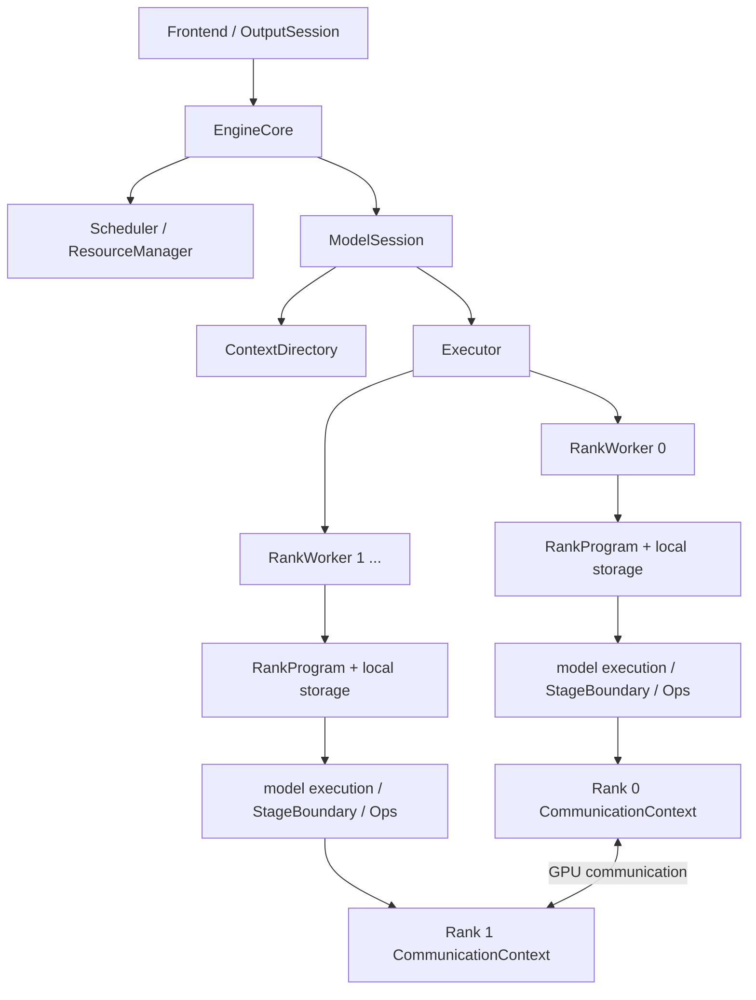

# NInfer Distributed Execution Design

Status: D1 is implemented. D2's deployment resolution, SSH and local launch, control transport, DistributedExecutor,
NCCL collective/P2P and native Work encoding are implemented, and are verified by the independent execution program on two Sparks.
The product worker's model-preparation entry point, the shared resource planning and the Engine wiring still depend on D3's rank materialization;
the Qwen3_5 and Qwen4Exp model-preparation entry points currently support one rank; when a multi-rank request reaches a model's native
preparation entry point, that implementation reports an error. D3-D6 are not implemented yet.
This document defines the multi-machine target contract, ownership and implementation boundaries under centralized scheduling. The implemented LocalExecutor, Session,
RankProgram and context management are maintained by [Engine Architecture](maintainer/engine-architecture.md).

The first distributed deployment is Qwen4Exp on homogeneous DGX Sparks: two ranks, attention/GDN TP2 and routed
experts EP2. The architecture describes ranks and groups of any length, and later four-machine and other parallel combinations reuse these contracts.
Local RTX 5090 and Spark execution continue to use the same model mathematics interface and their own Op dispatch.

## 1. Established architecture decisions

1. Each model replica has exactly one EngineCore, Scheduler, ResourceManager and native ModelSession.
   They produce the scheduling plan, the resource changes and the commit decisions centrally. Workers consume the plan and do not schedule requests independently.
2. Introduce one `Executor<Types>` interface. `LocalExecutor` calls directly in this process;
   `DistributedExecutor` drives a set of rank workers. Both use the same execution and completion contract.
3. Split the current Program into a control-side `ModelSession` and a device-side `RankProgram`.
   The model frontier and the transactions belong to the former; the local weights, the State/KV backing, the workspace and the Graph belong to the instance that hosts the latter.
4. ContextDirectory manages context identity, slots and leases centrally; the Executor manages execution allowance, and RankProgram
   manages frames, workspace and local backing. Session combines the two kinds of reservation, and one ordinary schedule does not query per-page capacity remotely.
5. `ParallelPlan` is an immutable model-parallel plan that drives weight loading, local compute geometry, state layout,
   communication boundaries and capacity planning. The original Config keeps the global model meaning.
6. A layer boundary declares its layout, its partial sum and its residual consumption semantics explicitly, and binds the execution route at preparation time. Ordinary communication and
   communication-compute fusion implementations share the boundary contract, and local Ops keep their own kernel and shape policy.
7. Control messages use an ordered typed protocol, and compute communication goes through the GPU collective/P2P interface.
   The first data-communication backend is NCCL; the group, buffer and completion semantics are independent of the backend.
8. Commit, result availability, logical commit and device completion are modelled separately. Runtime dependencies are expressed by command order and completion receipts,
   and no execution step adds a whole-group Host barrier.
9. The first version allows at most one generation transaction in flight per sequence; the interface expresses the device-result dependencies and the frontier relations
   that limited early execution needs. The in-flight depth is set by the execution policy and the resource capacity, and it is not a permanent interface limit.

Spark keeps GPU model computation and Device State/KV, and uses the existing Device prefix reuse and Replay.
The existing CPU expert, Host cache and transfer functions of the RTX 5090 are still provided by the local execution implementation.

### 1.1 The implemented execution foundation

Error attribution matches implementation ownership: Deployment checks node and rank references, paths and configuration structure; Runtime
orchestrates execution and lifetime; a model-preparation entry point resolves and validates its own parallel strategy; the loader, the communication backend and
each Op validate the actual materialization, communication and computation requirements. CLI and serve own configuration and error presentation. An upper layer does not maintain
a capability list for a lower layer, and it does not reject a whole deployment mode because one model is not integrated yet.

Model definition and preparation come before local CUDA initialization. A single-rank deployment uses LocalExecutor directly on the coordinator node,
with that rank's device, artifact and process environment; the model loader validates the identity of the local artifact against the coordinator-side
Definition. Multi-rank model preparation is taken up by the ParallelPlan of each model later.

`distributed/` holds processes, connections and communicators; `runtime/executor/` holds the ticket and the completion semantics;
`models/qwen4_exp/work.*` and `wire.*` hold the model value contract and the field-by-field encoding. The control header carries the version,
the epoch, the kind and the payload length; the execution envelope further carries the ticket, the CommandSequence,
the plan identity, the owners and the result owner. The ordered members of a physical group are separate from roles such as TP and EP; the same
role may use different groups over disjoint rank sets.

Each process has one I/O owner that serves control connections through poll/eventfd. CUDA calls stay on the execution thread.
Ordinary messages and continuations use separate bounded send capacity, and the prepared `ControlBudget` gives the
payload upper bounds for Work, decision, commit, event and resource reports. Before the Executor accepts a task it
checks the follow-on message allowance of the whole frame pool, and the actual encoding checks the bound again; the queue capacity does not depend on a
temporary request after GPU completion. The current execution protocol has at most one Host decision handover per compute ticket.

A worker applies its own rank's commands in the common command order; a non-owner consumes the envelope and advances its watermark.
The Supply/Commit of a slow rank waits for its local stage. ContextResult and DeviceRetired cover every
required owner, and a compute ResultReady comes from the result owner. A result that depends on decision input is published only after the consumption facts
of that input are aggregated. Resource queries and peak resets actually reach every worker; each rank report keeps its own values, and
the common logical capacity and the aggregated interpretation are provided by the codec after model preparation.

Cancellation runs at a safety boundary that RankProgram defines explicitly; a failure first aborts the communicator, then destroys the Program that may be waiting on
the GPU. The control owner closes the socket, and the coordinator reclaims the process. A normal exit waits for Stopped and lets
Progress already sent arrive. Communication enqueue uses NCCL nonblocking status checks, and device completion is still expressed by
the completion receipt of the calling stream. A collective supports BF16, FP16, FP32 and integers, and U32/U64 preserve
the unsigned semantics of PLE words and candidate keys.

The Vision binding encoding carries the identity of the installed input, and the decoded binding keeps an independent shared owner.
Transport and installation of the actual Vision payload arrive with the D5 item-owner execution integration; this round sends no address to a remote node.

## 2. Ownership and instance structure



| Object | Ownership |
|---|---|
| EngineCore | request lifecycle, cancellation, deadlines, output publication, Engine availability |
| Scheduler | execution members, order, budgets, fairness and preemption choice |
| ResourceManager | prefix index, retention value, source choice and reclamation policy |
| ModelSession | model logical continuation, Main/backend frontiers, execution windows, generation transactions and checkpoint semantics; combines context and execution reservations |
| ContextDirectory | logical State/KV/history identity, slots, references, coverage, ContextLease and ordered context changes |
| Executor | worker lifecycle, command order, execution allowance and frame reservation, input distribution, event aggregation, tickets and failure state |
| RankWorker | one CUDA device, CommunicationContext, RankModelInstance, command execution and completion observation |
| RankModelInstance | immutable ModelShard, const LocalParameters, RankProgram |
| RankProgram | local context storage, frame backing, workspace, caller communication buffers, sampling and spec temporary data, Graphs and resource references held during execution |
| CommunicationContext | communication group, backend instance, internal communication resources; provides registration and completion mechanisms to callers |

The coordinator builds a `ModelDefinition` from the artifact metadata and the Frontend resources. It contains the global
Config, the logical parameter description, the selected components and the public vocabulary, and it holds no GPU weights. Each rank builds its own
`ModelShard` and `LocalParameters`. The Frontend is owned by the coordinator; its tokenizer, matcher,
tool parsing and request output state do not enter a worker.

`ModelSession` and `RankProgram` use native architecture types, such as `qwen4_exp::Session` and
`qwen4_exp::RankProgram`; startup dispatches on the architecture over a finite set, and typed calls continue inside. The Executor is
an abstraction of the execution mechanism; it does not carry GDN/QSA frontier derivation, layer traversal or speculative mathematics.

The `plan_request`, `unit_end` and logical commit and checkpoint decisions of the current Program move into Session;
the device forward, record/fold, physical copies, buffer binding and Graph operations move into RankProgram.
`RuntimeTypes` declares Session, RankProgram and the native execution payloads separately, and EngineCore no longer
reaches through a single Program to obtain the CUDA environment and the physical storage.

A context reservation is computed from the native state requirements of the request; an execution reservation is computed from the variant, T/B and participating ranks
after batching. ContextDirectory does not interpret batch workspace, communication algorithms or kernel shape policy.
RankProgram reports the execution capacity it has prepared, and the Executor uses that to manage the submittable count and the stable frame slots.

## 3. Processes and launch entry points

### 3.1 Process layout

A single-device deployment uses LocalExecutor: the coordination logic and one RankWorker sit in the same process and call directly.
Local execution uses the Engine execution thread, and LocalExecutor binds the device at the owner boundary where it enters RankWorker;
later calls pass the existing execution view.
In a distributed deployment the coordinator process owns Engine and Frontend; each GPU rank uses its own worker process,
including the GPU on the coordinator node. Each worker has one execution thread that owns CUDA submission.

The coordinator-side ExecutionGroup starts, observes and closes out every rank process: the local node uses posix_spawn,
and a remote node uses non-interactive SSH to launch the named executable. A worker receives the bootstrap before CUDA initialization and
obtains its rank identity, control address and process environment. The members, the rank mapping and the model replicas of one deployment are fixed.

`DeploymentOptions` corresponds to `[distributed]` in the launch TOML:

| Field | Meaning |
|---|---|
| `coordinator_node` / `control_host` / `control_port` | the coordinator node and the control-connection entry; port 0 selects automatically |
| `connect_timeout` / `shutdown_timeout` | the deadlines for the startup connection and for execution-group exit |
| `nodes[]` | node ID, SSH target, absolute paths of the local worker and artifact, and process environment |
| `ranks[]` | global rank, node ID, local CUDA ordinal |
| `parallel` | the requested model-parallel configuration, handed to the native parallel planner to resolve |

The coordinator still reads the deployment through `--config FILE`. The model planner produces the complete topology and distributes it, so a worker
does not read the coordinator machine's local configuration file. The global rank, the node ID, the CUDA ordinal and the rank inside a group
are different fields; the TP/EP/DP/PP coordinates come from the plan, the process title shows those coordinates, and the log keeps the NInfer format.

SSH owns process launch and the forwarding of logs and exit status; once the control connection is established, commands travel over Unix or TCP, and GPU
tensors travel over NCCL. The frontend service is exposed only on the coordinator. The state of the product worker model-materialization wiring is in section 1.1;
the two-machine checks and communication measurement commands that can already run are in [Tests](../tests/README.md#distributed-execution) and
[Benchmarks](../bench/README.md#distributed-collective-benchmark).

### 3.2 Launch protocol

Launch advances in coordination under the same phase IDs:

1. **Join**: establish the control connection and exchange the build and protocol versions, the model-definition identity, the rank and device information and the local resource facts.
2. **Resolve**: the native planner produces the complete ParallelPlan, and each rank resolves the local parameters and Op profiles it needs.
3. **Connect**: create the communication groups, initialize the backend, complete a representative communication preparation and take an initial memory snapshot.
4. **Materialize**: load the local weights according to the shard plan, reading each node's own artifact concurrently.
5. **Prepare**: coordinate capacity planning, the necessary Graph calibration and the final backing allocation; each attempt splits into
   local resource preparation, whole-group permission to enter communication, execution and completion publication, see section 10.3.
6. **Ready**: once every rank publishes the preparation result for the same plan version, the Engine accepts requests.

Launch control checks only the deployment, protocol and shard relations it owns. Support for a specific compute format or shape is still decided by the local
Parameters and by the capacity and preparation entry points of the Op, and an error returns with its rank and preparation phase.
Connect follows the same phase advance and failure rules for communication preparation.

## 4. ParallelPlan and local plans

Parallel planning produces two results:

- `ParallelPlan`: address-free and immutable; describes the division of labour of the whole model replica.
- `RankExecutionPlan`: resolved from the ParallelPlan, the actual weight representation and the local device resources; describes one
  rank's local geometry, physical layout, frame capacity and lifetime, workspace, communication buffers and Graph profiles.

ParallelPlan contains at least:

| Part | Content |
|---|---|
| Groups | ordered members, group ID, model role; the same set of ranks may serve different compute divisions |
| Parameters | the local slice or copy of each logical role, the global expert ID and the local bank mapping |
| Geometry | local heads, dimensions, matrix row order, vocabulary range, layer range |
| Activations | the token and feature layout between stages, the partial sum, and the copy and consumption relations |
| State/cache | required fields, the field shard of each rank, the set of pool owners, the logical page-group relations |
| Decisions | the producer and the consumption protocol of shared decisions such as routing, selection and output tokens |
| Execution variants | the finite native execution topologies, command stages and the cross-group communication commit order |

The planner reads the global Config and the bindings and produces the local geometry; it does not write the local head count back into the Config.
One weight slice must correspond to the correct activation, norm and control and State/KV shards at the same time.
A merged matrix is sliced by logical segment, and the encoded planes are materialized into the target layout during loading; execution consumes the stable views directly.

A local Op receives the actual tensors, the weight views and the execution resources. ParallelPlan does not hold their private
kernel choice; after TP changes the geometry, the Spark/5090 shape policy of the owning Op still chooses the implementation.

The engine does not write the rank count as a two-machine constant. With four machines the group construction and the resource protocol stay the same, and the native planner
handles head replication, non-uniform roles and other model placements. A new local geometry still needs the matching Op support.

## 5. Executor and execution messages

### 5.1 Interface

`runtime::Executor<Types>` is the coarse-grained execution interface shared by the Local and Distributed implementations:

```cpp
std::optional<ExecutionReservation> try_reserve(FrameKind kind);
ExecutionTicket submit(ExecutionReservation reservation, Types::Work work);
void supply(ExecutionTicket ticket, DecisionInput input);
CommitReceipt commit(ExecutionTicket ticket, Types::Commit decisions);
void discard(ExecutionTicket ticket);
std::optional<ExecutionEvent<Types>> poll();
void flush();
void drain();
```

`try_reserve` takes the frames and the submission allowance of the participating ranks from the prepared execution profile, uses the control-side
capacity record, and makes no immediate capacity query to a worker. A reservation distinguishes Compute frames from Context frames; every frame already covers
the shape range of the native execution plan. The variant, T/B and the mathematical operations are described by the owning Work and validated at the native entry point of the rank,
and are not described again in the reservation interface. A Compute result needs commit or discard; a Context frame retires directly when it completes.
An ExecutionReservation is an exclusive reservation of uncommitted execution, and abandoning it returns the allowance.

`submit` validates locally and prepares the payload, then atomically accepts the complete command and the reservation, returns a ticket, and does not wait for the
GPU. A failure before acceptance does not dispatch execution; a transport or execution error after acceptance enters the execution-group failure flow.
`supply` supplies the decision inputs, such as constraints, that the same transaction needs.
`commit/discard` resolve a pending transaction and queue it into ordered execution; `poll` consumes completion and demand events.
`flush` sends the accepted commands; `drain` closes the execution entry point and waits for all related work to finish, and may not be used as
the wait interface of an ordinary round. Normal execution advances through completion events.
Initialization, capacity negotiation and shutdown use separate lifecycle entry points and do not go through the model step interface.

The Executor uses a virtual interface to select the Local or Distributed implementation; the native model and the Ops keep direct typed calls.
LocalExecutor moves or borrows objects directly, and only DistributedExecutor encodes. The payload after submission and its
shared large objects stay alive at least until every related consumer ends, and do not depend on the lifetime of the submit call stack.

### 5.2 Identities and payloads

| Identity | Meaning |
|---|---|
| `SessionEpoch` | one execution-group lifetime, fixed after startup |
| `CommandSequence` | the coordinator-side monotonically increasing ordered command number |
| `ExecutionId` | the identity of one model unit, whose several command segments are related by a ticket |
| `SequenceId + generation` | the stable identity of request execution state, independent of the lane |
| `ContextId + generation` | the identity of a logical object such as an image, a history or a checkpoint |
| `FrameId + generation` | the frame identity of an execution reservation, mapped to the stable local slots of the participating ranks |

`ExecutionRequest` consists of the common envelope and the native payload:

- envelope: execution ID, stage, preceding commands and result dependencies, members and order, plan and variant ID, frame and context reservation description;
- request delta: newly added, restored or released state, input token and position changes, sampling configuration changes;
- resource delta: logical page and slot allocation, COW, mapping updates, state source and destination;
- native work: the prefill/Replay window, ordinary and speculative calls, valid extents, backend frontiers and
  execution envelope;
- decision input: known sampling or grammar content, or the follow-on input stage that this execution declares.

A later input that crosses ranks or tickets adds a `DeviceResultRef`, alongside the known tokens. It names the producer ticket, the members, the result
field and its version, and carries no address; the rank resolves it to a local result view or to the communication handover the plan prescribes. A result reference
keeps the related storage alive and establishes a read dependency. Currently the same-ticket stage handover on a single rank is held by RankProgram as
a result and a frame; cross-ticket result references and early execution extend per section 6.3.

Independent context operations such as Bind, Capture, Restore, Pause and Reclaim use the same envelope, and the work
carries a typed `ContextWork`. They may perform only storage actions and do not require a model forward alongside.
The result of such an operation is aggregated over the required owner ranks and then handed to Session to adopt.

A worker keeps an execution copy of the request it has bound and later receives only deltas. The copy records the frontiers and mappings that execution has used;
it owns no scheduling, retention or commit choice. In-process owner pointers, Tensor addresses and callback objects do not enter the protocol.

Native work uses a finite set of typed variants. The architecture encoding and decoding are implemented in the matching model module, and transport
handles only message frames and bytes; it passes no method names, arbitrary functions or model call graphs.

### 5.3 Order and events

Every rank receives the same global command sequence; a command may carry a rank-local payload and a participant set.
The native execution plan also fixes the in-group collective order and the commit order across communicators, see section 8.2.
A worker applies the resource and input deltas first, and then submits the related GPU work.

Events have the following types:

- `DecisionInputNeeded`: native execution needs follow-on input such as constraints; carries the ticket, the stage and small input facts.
- `ResultReady`: the rank that decides the result has produced candidate tokens or acceptance information that the control side can consume.
- `ContextReady`: every shard the context operation needs has reached its publication condition; carries the complete resource-operation result.
- `Progress`: the watermark of the commands this rank has applied and the command segments it has completed, resource retirement results and statistics on demand.
- `Failed`: an error after which the execution group cannot continue.

Ordinary output returns only from the output rank the plan names; a resource operation that needs results from several ranks is aggregated by the Executor.
The progress of other ranks may be reported in aggregate; it does not require a complete result at every step.

A native stage that needs `supply` returns to the worker control loop after the current GPU segment is committed, and does not block the call stack
while waiting for input. The follow-on stages are submitted as ordered commands with a ticket and a stage ID; the participating ranks advance under the same
stage protocol, and work of non-conflicting tickets may interleave between those stages.

A watermark describes numbered command segments and does not wait for later stages of that ticket. For example, the forward of A, the forward of B
and the sampling of A are commands 10, 11 and 12; while A waits for constraint input, command 10 may still complete.
The completion condition of each command segment covers the compute, copy and communication streams it actually uses; a prefix of
continuously completed commands advances the watermark, and a rank with no local work advances through ordered no-ops.
The records and result references of one ticket are kept separately until the last consumer ends; a whole frame may not be returned merely because the forward
command completed. The Executor aggregates retirement facts over the required owners, and the
ResultReady of the output rank does not replace another rank's resource completion.

The execution queue and the frame pool are both bounded, and their capacity enters the launch plan. A new execution reservation also keeps the control-message and
result-handover capacity that the later finite stages of that ticket need. `supply/commit/discard` use the existing reservation and no longer compete for
ordinary execution frames; completion and retirement events have their own progress capacity as well. Ordinary commit backpressure cannot stop an
existing ticket from ending. Messages are still sent in command order, and a terminating action does not wait for the next ordinary execution before it flushes.

Device work advances by default on the ordered compute stream of this rank, and the Host may prepare and submit non-conflicting work ahead of time.
The first version allows at most one generation transaction in flight per sequence; different sequences may interleave on independent frames.
The set of native stages is fixed during preparation, and the Executor does not take on suspension and dependency scheduling of arbitrary tasks.

### 5.4 Execution storage lifetimes

RankProgram divides storage by consumer lifetime and does not copy every temporary datum into every frame:

| Storage | Owner and reuse condition |
|---|---|
| State/KV backing | the context storage of RankProgram; identity and references are managed by the directory, and reuse inherits every consumer dependency |
| compute scratch | RankProgram; shared by stages that execute in order and whose lifetimes do not overlap, and planned separately for an independent parallel path by its peak |
| pending hidden, conditioning, verify records | the matching execution frame; kept until sampling, the accepted-prefix fold or the discard handling ends |
| Host ingress, constraint input staging | the matching stage or frame; kept until the asynchronous transfer ends, and may not be overwritten because the Host submission returned |
| output staging and device results | the matching frame; kept until the device write, the D2H, the Host consumption and the DeviceResultRef consumption end |
| communication call buffers | assigned to a frame or a shared area by the lifetimes above; may not be overwritten before the communication completes |
| backend scratch and registration | CommunicationContext manages scratch and registration, and a registration borrows the actual backing |

Graph preparation binds fixed frame slots and the areas that may be shared, and RankProgram keeps the execution instances and the bindings.
Reusing the same Graph binding must satisfy the lifetimes of those areas; the records, the staging and the Graph instances that several in-flight frames need
count towards capacity. Changing only the FrameId does not change the captured addresses by itself.

When the last consumer of a device slot has been scheduled and no unresolved result borrow remains, the Executor may reserve
that slot, with its generation and the preceding dependencies, for later ordered execution. Physical reuse still queues behind the old consumers, and
no round needs to wait for every rank to report DeviceRetired. Unresolved tickets, queued commands and the actual backing are each limited by their own
capacity, and physical destruction still waits for actual retirement.

Host staging and CPU metadata are kept separately; reusing a device slot may not overwrite early a Host area that a transfer or the device is still reading.
D1 splits the existing single set of pending buffers, ingress and egress, mappings and counters as described in this section,
and fixes the Graph binding of each frame.

## 6. Model transactions, completion and output publication

### 6.1 The four completion facts

| Fact | What it allows |
|---|---|
| Submitted | the Executor owns the command and the payload and may dispatch it asynchronously |
| ResultReady | the Frontend may preview candidate results and Session may form the commit decision |
| LogicallyCommitted | the accepted prefix and every ordered follow-on action are fixed, and OutputSession may adopt and publish |
| DeviceRetired | the required ranks have finished their device consumption of the named resource or command; the backing may be retired once Host consumption and the registered references are released |

A `CommitReceipt` travels between the logical commit and the device completion and names the commit command and its completion dependency. Later execution based on the
committed state inherits that dependency; early execution uses the provisional state and result references of section 6.3.
A consumer on another stream inherits the matching event, and the backing may not be reused without a dependency before the device completes.
These facts act over different scopes: one forward command segment may complete while the whole ticket still waits for sampling or
commit; retiring a ticket needs every stage, every result borrow and the Host consumption to end.

### 6.2 Commit protocol

```text
ResultReady
  → Frontend preview
  → Session checks the accepted prefix and prepares the CommitBatch and the logical directory changes
  → the Executor accepts the complete commit command and returns a CommitReceipt
  → Session atomically adopts the logical frontier, the identities and the directory changes
  → generation budget / OutputSession commit
  → publish the output
```

Before it joins the ordered queue, commit completes every check the Host can decide and prepares the storage the directory changes need;
the logical adoption after acceptance allocates nothing and cannot fail. If the queue rejects the command, neither the logical state nor the
Frontend preview is committed; after acceptance the worker performs the state actions that are already fixed. The logical commit is a promise to
later ordered execution, and the device completion receipt proves that the actual physical work has ended.
The fold, the tail extraction and other commit actions consume the state destination and the execution resources reserved by that ticket, and they do not start, during the worker
commit stage, a request that could legitimately be refused for lack of capacity. A context operation that needs a materialized copy returns
ContextReady separately, and Session then adopts it.

This contract moves the GPU waits in part of the current Program commit to explicit dependency points. Snapshot materialization,
Host replica publication, the end of a cross-stream migration, the settlement of terminal resources and the destruction of backing still wait for the device and
Host consumption each of them needs.

For a GPU commit that is still executing, Session may prepare the follow-on commands; the dependency of the previous commit travels to the worker together with
the resource bindings. A commit may be merged with the next execution message for transport; when there is no next execution it flushes
immediately. A transport or device execution failure invalidates the whole execution group and does not roll back output already published.

The per-row acceptance rules keep the existing convention: a non-terminal row adopts the complete produced span, a terminal row may adopt a prefix of it, and a cancelled row
adopts zero tokens. The members of the whole ticket are resolved together. Cancellation, failure and release actions are issued by the coordinator, and no
rank changes the compute or collective order already scheduled on its own.

### 6.3 Frontiers and limited early execution

Session distinguishes the logically committed generation ledger, the committed execution frontiers of Main and backend, and the
provisional window that has been allowed to execute. The model defines how the three correspond; a window without a device result yet records only dependencies and
the valid range, and does not invent a token count or an acceptance length that is already fixed.

The interface allows the next round to reference the previous round device results and to use provisional State/KV along a bounded dependency chain.
When early execution is enabled, Session adopts each round result in order and guarantees:

- a later result that depends on the previous round may be adopted only once the accepted prefix and the next input hold.
- when a terminal truncation, a cancellation or a tool control changes the input, the affected later results are discarded together; a collective already
  committed still runs to the end in the common order and no single rank may skip it.
- a committed recovery point and the records awaiting a decision are kept until the dependency resolves; an early write may not damage state that must be recovered.
- the RNG, the sampling counters, the grammar and the public output advance only by the prefix actually adopted. Device speculation uses the matching version, and
  provisional state does not enter the shared prefix cache.

The first version allows only one generation transaction in flight per sequence. Later limited early execution is declared by the native execution policy
with its continuation conditions and depth, and is then enabled by frame, state destination and record capacity; when the grammar or the control decision
does not allow continuation yet, the matching input is awaited. PLE local preparation, transport and result consumption advance along the same dependency and are
not omitted because of a device result reference. D1 has separated the stable continuation, the pending execution and the frame lifetime;
the cross-ticket provisional window and its result references are implemented in D6 under this section contract.

## 7. The centralized context directory and local storage

### 7.1 Splitting the existing storage responsibilities

ContextDirectory manages logical identity and allocation, and ContextStorage and ContextMigration perform the local
storage actions. The contiguous StateImage layout, the typed KV planes, COW and the record/fold mathematics keep their own
native contracts. The multi-rank extension adds an owner set and completion aggregation to these actions.

| Control-side ContextDirectory | Worker-side ContextStorage |
|---|---|
| object identity, generation, content epoch | local backing, typed views, CUDA events |
| history directory, prefix references, logical coverage | page-table updates, copies and writes in command order |
| active and checkpoint owners, read leases, destination reservations | physical borrows during execution and the last consumer |
| logical slot allowance, allocation and release order | the binding of a logical slot to a local physical address |
| checkpoint shard manifest and dependencies | the readiness facts of this rank shard |

The centralized logical allocator assigns the common slots to each owner, and each rank resolves addresses with its local schema and stride.
The ResourceManager decides retention and reclamation value, and calls Session or the directory for actual logical feasibility.
ContextDirectory manages only context resources; frames, workspaces and communication resources are managed per section 5.

### 7.2 Capacity and reservations

Every logical pool declares its owner ranks; one page group represents the required shards of the same token range on those ranks.
Startup selects a common logical slot capacity, and each rank allocates backing by its own bytes per slot.
The usable logical capacity is limited by the tightest constraint in the owner set, and the page counts of different ranks may not be added together.

`ContextLease` covers the source read, the destination image and the KV growth or COW. Session first takes the context
permission per row, and then takes an ExecutionReservation from the Executor by the native variant and T/B of the candidate batch.
Only when both are complete does it submit the whole execution; a batching change or a submission failure releases the reservations not adopted. A context lease is
held in the Session transaction, and the worker receives the description of its actions; after submission the execution reservation is held by the ticket.

Compute scratch and communication staging are planned by the actual batch and by their overlap relations; the needs of single rows may not be simply summed
into frame or workspace counts. Both kinds of reservation use the capacity records already established, and ordinary execution starts neither a
remote per-page query nor a temporary Device allocation.

Release splits into logical retirement and the end of physical consumption. When a slot is reassigned to a later ordered command it carries its generation
and the preceding dependencies; rank storage installs new content after the last consumer. Releasing a Host allocation, a
device allocation or a registration window for real waits for DeviceRetired.

A single-machine Host replica uses fixed backing, the ContextDirectory allocates its extent, and ContextMigration
performs the transfer by action; the reservation and the pin are kept until physical retirement. Host and Device buffers and arenas
are held by the local resource owner. With several ranks, the coordinator publishes the complete replica only after each owner has completed its materialization.

### 7.3 Prefixes and checkpoints

A checkpoint manifest records the model logical frontier, the StateImage identity, the prefixes of each pool, the shard
owner set, the input identity and the completion dependencies. Whether fields such as GDN, Indexer tail, PLE and MTP conditioning
are copied or sliced is described jointly by the ParallelPlan and the native state schema.

The prefix index matches once, centrally, and produces one shared recovery plan. The required shards must come from the same logical execution state;
the ResourceManager chooses the retention and the recovery source, Session decides the native recovery and the Replay, and the directory performs the reference,
COW and reclamation changes; every rank consumes the same recovery frontier.
A source that is logically committed and carries its dependencies may be consumed by later ordered commands; a new checkpoint formed by an asynchronous copy or
recovery is published as complete only after the required physical results are done.

The rules for the frontier relation of Main and MTP, the GDN replay fold and the QSA tail extraction continue to be defined by the native Session,
and RankProgram performs the concrete state actions. The same global identity does not require the same actual address on every rank.

## 8. Layer boundaries and the communication implementation

### 8.1 StageBoundary

Every model execution edge describes three kinds of fact explicitly:

| Content | Example |
|---|---|
| layout | token copy or shard, complete feature or head shard, the matching partition ID |
| result meaning | Complete, or `PartialSum(group)` |
| consumption relation | residual update, normalization, transformation order, extra branch contributions and their owner |

The native model declares the producer and consumer contract, preparation generates a `BoundaryPlan`, and it binds the collective,
the necessary layout conversions and the applicable fusion Ops. Execution only chooses among the finite variants prepared and binds the views of this round.
The token-dependent private tuning of each mathematical Op is still maintained by that Op.

For example, `PartialSum(attention_group)` into the complete HC block input may resolve to AllReduce
followed by the HC combine and norm, or bind a fused computation with the same semantics. The ownership of a shared contribution
and the order in which it is added must be fixed in the boundary declaration. A boundary does not assume that a norm, a gate or rounding can be reordered across a reduction.

StageBoundary describes the finite layouts and result semantics that the native model actually uses, and preparation binds the concrete route.
It does not extend into a generic distributed Tensor or model graph; the residual, the temporary Tensors and the actual result state of each round
are bound by the matching execution frame, and the backing is reused per section 5.4. The local shape policy stays inside the Op, and
the concrete fused computation has its own contract for mathematics, representation and state effects.

### 8.2 Groups and the backend

`CommunicationContext` owns the `Group` and the backend. A Group exposes its ordered members, the rank inside the group,
the local device and the resolved capabilities. The ParallelPlan stores the group ID and the members, a rank binds a stable
local Group reference during preparation, and execution does not look up the topology in process globals.

A public collective Op defines the input and output types, the layout, the reduction and the stream effects; the backend provides the concrete
enqueue, buffer registration and capture mechanisms. The first version implements AllReduce, Broadcast,
AllGather, ReduceScatter and the necessary P2P over NCCL. A size-one group resolves to the local semantic route.

The native model uses communication through a collective Op or a complete fused Op. The NCCL handle, the network queue, the registration window
and the protocol choice belong to the internal implementation. Future dedicated communication and device-initiated fusion reuse the same group,
data meaning, lifetime and completion conventions.

The same execution variant fixes the communication commit order of every stage, including the relative order across communicators.
The execution owner of a rank submits the locally participating operations in the common order; a multi-stream execution establishes the
needed dependencies explicitly, and capture and replay use the same order. The rank-local kernel choice may differ, but the
communication protocol, the message geometry and the choice of whether to capture must match between participants. A rank with no local expert
contribution still fulfils the communication contract of that variant.

An NCCL communicator uses the nonblocking configuration. Initialization progress, asynchronous errors and termination are handled by the execution owner
of this rank; the control thread sends the stop intent, and the execution owner stops new submissions after it ends the current Host NCCL call and
terminates the communicator, so that abort and the submission interface are never called concurrently from different threads.
When NCCL returns `ncclInProgress` the backend keeps observing progress, and only after it confirms that the communication operation has been enqueued
may the caller submit a CUDA operation that depends on it or record a completion receipt. What is awaited here is the enqueue completion,
and device execution completion is still expressed by the stream or event; the mechanism is encapsulated inside the communication layer.

### 8.3 Buffers and numerics

The communication input and output come from an execution frame or a persistent area of RankProgram; the backend internal scratch
is owned by CommunicationContext and reports its capacity. Both count towards the launch budget. Registration produces an RAII lease
whose lifetime is shorter than the backing and longer than every Graph and in-flight operation that borrows it.

The sharded Linear and the EP local contribution continue to use the already selected BF16 output contract; communication does not additionally require FP32.
When the communication representation or the numerical strategy must change, state it and verify it in the matching collective or fused Op contract.
The existing GDN FP32 state and controls do not change because of model parallelism.

### 8.4 Distributed execution of MoE

The input exchange, the local expert computation and the result merge of MoE are organized by the MoE execution part on the model side. It owns the
global and local expert mapping, the token permutation, the result backfill and the composition semantics of the shared contribution;
the local expert Op continues to consume its mathematical interface, and the communication backend handles only the communication description.

The first TP2/EP2 route uses a replicated token input; each rank computes its own routed experts, forms
a local weighted contribution and then reduces it. D0 fixes where the shared contribution is computed and the order in which it is added, so that it
counts exactly once. The existing fused expert implementation continues as the local computation route.

If a later version introduces EP with token dispatch, the counting, permutation, completion dependencies and result semantics of dispatch and combine
belong to the same MoE execution boundary, and the communication layer provides the collective or P2P they use. The current version implements neither a general All-to-All
schedule nor a runtime expert redistribution.

## 9. Ordinary execution and speculative execution

### 9.1 Ordinary execution in the first version

```text
The Scheduler chooses the members and the budgets
  → Session takes a ContextLease per row and forms the candidate batch
  → the Executor takes an ExecutionReservation for the whole batch
  → Session submits the complete request, and the Executor dispatches the deltas and the work
  → the ranks apply the input and resource changes and execute the local model and the communication
  → the output rank produces ResultReady
  → preview, logical commit and output publication
  → later execution inherits the commit dependency, and temporary resources retire on completion
```

Prefill, Replay, ordinary decode and forced control share the command and resource mechanisms; their model
calls and state effects are distinguished by the native work. The execution policy still consumes the actual T/B, geometry and semantic parameters.
Later cross-round early execution extends per section 6.3, and the ordinary path continues to use the committed state and explicit commit dependencies.

### 9.2 Sampling and constraint input

The output decision is performed by the owner the ParallelPlan names, and Session advances the logical position of the RNG uniformly.
The argmax over a sharded vocabulary, distributed sampling or the gathering of logits belong to the implementation of that decision route, and the complete
vocabulary may not become a fixed input requirement of the Executor.
Candidate tokens, drafts and valid lengths travel to the next stage over the declared device-result handover route; the Host
result return is used for output and control decisions and does not carry every device intermediate result.

The coordinator-side OutputSession owns the grammar matcher. An ordinary mask may be prepared in parallel with the forward and
supplied to the decision stage through `supply(ticket, input)`. The input holds its own mask data and field description;
DecisionNeeded requests the input, DecisionConsumed confirms that the actual transport is committed, and the Frame keeps the data until consumption ends.

### 9.3 MTP and DFlash transactions

One ticket covers the proposal, the verification, the output decision and the accepted-prefix resolution.
The intermediate tokens, the hidden states and the communication inside the GPU are joined by the native flow of RankProgram.
If the grammar input depends on drafts, the output owner publishes `DecisionNeeded` and the coordinator prepares the
mask; an independent target forward may continue executing, and the decision stage waits for the mask.

The final `CommitBatch` carries the accepted length of each row, the terminal state and the prefix provenance. Each rank commits the same logical prefix over its local
GDN and convolution records, QSA tail, KV and backend state. Different accepted lengths are expressed through the existing valid and accepted metadata,
and no rank produces its own control choice.

MTP executes Draft → Verify → Commit in this round. The Main and backend frontier at a stable boundary is
`F/max(F−1,0)`, and after commit the next stable boundary is established from the actual accepted length; the next round drafts are not generated and stored in advance in the previous round.
The conditioning and context commit of DFlash continue to follow their own mathematical definition.

Acquisition and preprocessing of Vision stay in the Frontend, and the GPU encoding and the feature distribution enter the native work; the
prepared resources and the result consumption of PLE also enter the resource plan of the matching rank. The model-parallel strategy fixes where each owner sits.
CausalScoring uses the same Executor and RankProgram and keeps its own scoring scheduling purpose.

## 10. Capacity planning and CUDA Graphs

### 10.1 Planning order

Each rank's resource report lists weights, State/KV, shared scratch, the records and staging held by the in-flight count,
the capacity related to communication scratch and registration, the Graphs and the known Host preparation areas separately. The frame slot count and the actual
parallel stages determine the peak, an area that may be shared is not counted again for every ticket, and the retention that extra Graph bindings or
instances add counts towards the same plan.
The resident Frontend and media of the coordinator process and its live allowance count towards the physical budget of the node it runs on; Spark
is accounted by the physical memory the node shares.

The communication environment is initialized first, and then the planning snapshot is taken. Explicit communication buffers created later still count towards the plan;
the extra retention and the rebuild amount during Graph calibration use the existing signed measurement method, so nothing is charged twice.

Each rank reports its local capacity constraints, and Session or the native planner resolves the common logical pool capacity. Automatic KV
capacity converges through a common choice inside the group; an explicit capacity keeps the user requirement. The execution profiles give both the frame capacity
available for the Executor to reserve and the upper bound of the stage handover. A preparation failure is handled by the classification of section 10.3.

### 10.2 Graph contract

Each RankProgram owns its Graphs; the Graph profile key contains the ParallelPlan version, the local
execution topology and communication protocol, T/B and the state effects, and an execution instance additionally binds explicit frame slots and backing.
A tuning level of the Context envelope may be an installed local compute profile, and each level is not required to
copy a complete executable; the capacity covers every profile that binding allows.
Each rank's addresses, node and local kernel may differ, but the communication order, the count, the dtype, the
root and peer and the collective semantics of the matching group must match; the commit order across communicators also belongs to the variant.

The capture and replay that involve communication are coordinated per the native plan. CommunicationContext provides the capture
scope and the registration lease, and the Program captures the communication together with the local computation. The concrete eager or graph variant
is resolved before submit and is not switched by each rank on its own because of local cache state.

The already supported local Graph mechanisms, such as the QSA envelope update, are kept. Only a change to the communication contract or to the execution
topology needs a new in-group execution variant; the update rules of a local kernel are still maintained by the owning Op.

The computation and the communication of a complete device segment may be captured in one outer graph; pure local computation that needs an update may be inserted as a child
graph, and only that child is updated, which keeps the captured communication nodes and buffer bindings stable. A child update obeys the
CUDA topology and parameter requirements, the local Graph wrapper provides the binding handle, and the model does not match nodes by kernel name.
This changes neither the mathematical interface of an Op nor the native execution flow into a general model DAG.

The cut points of the graph are decided by the actual external inputs and the state adoption boundaries. Main consumes a stable PLE lookup Tensor,
its readiness dependency and its valid lifetime; the producer manages where the table resides, and that does not decide the graph capture granularity of Main.
A capturable GPU producer can further merge with Main into a whole-round graph; a Host producer can also supply the input of a complete Main
graph. A Host constraint input that depends on drafts is handed over before the output decision, and the target forward may advance first.
The native plan states the in-graph results the Host must observe early, the copy branches and their events, and the staging lifetime.
The concrete composition, table sharding and execution order of Qwen4Exp are in
[Computation and Graph organization](qwen4_exp-parallel-design.md#10-computation-organization-and-graph-assembly).

### 10.3 Coordinated preparation, failure and destruction

Graph calibration uses the finite profile set of the same plan, and each rank may report a different memory result. Every
attempt has a common attempt and phase ID and advances in this order:

1. Each rank finishes preparing its local backing, frames, test inputs and communication call buffers, and reports that it may enter the next stage.
2. Once the coordinator has every required participant preparation result, it allows them all into the matching communication warmup, capture or replay.
3. Each rank executes that stage and reports completion and resource facts; only when all have finished is a usable variant published, or the route enters
   calibration resource release and the final capacity rebuild. Before backing is released, the Graphs that borrow it are destroyed and the registrations withdrawn,
   and after the real addresses are rebuilt the matching Graph bindings are established again.

The first communication, every preparation stage and every retry follow the same order. A local capacity failure before entering communication, and a local capacity failure
after every participant has confirmed its communication complete, may be cleaned up in coordination and retried within bounds. When a preparation error occurs,
the execution group and the communication environment are terminated if the participants may still be inside a collective or the communication state is already affected by the error.
The first version recovers by restarting and does not retry separately on the surviving ranks.

A normal exit first stops new execution, resolves or discards the pending tickets centrally and flushes, then drains every in-flight
consumer, then destroys the Graphs, withdraws the borrowed windows, releases RankProgram and ModelShard, and finally destroys the communication environment
and the DeviceContext. A failed exit first stops submission and handles the communicator abort, so that it does not wait for normal retirement conditions that can no longer
complete; the process closes out and releases resources through the failure lifecycle.

## 11. Control transport, errors and observation

The coordinator uses a Unix domain socket to a local worker and a persistent TCP connection to a remote one; both share the
message frame encoding and the bounded send and receive queues. A later shared-memory control transport may implement the same interface.
GPU tensors travel through CommunicationContext, and the Host control connection carries only the execution description and the necessary
Host inputs and results.
The send and receive queues reserve capacity for continuing execution, termination and completion events per section 5.3, transport backpressure changes no
command order, and it does not make a resource-release message depend on new ordinary execution allowance.

The message header contains the protocol version, the SessionEpoch, the CommandSequence, the message kind and the length.
Integers use an explicit wire format; the payload is encoded field by field and does not copy the memory of C++ objects. The protocol is a repository-internal
contract, one execution group requires a matching build and schema, and no cross-version compatibility branch is maintained.

Transport I/O and CUDA submission are separate. The network thread owns ordered send and receive, and the RankWorker execution thread owns the
native commands, the CUDA submission and the completion observation; the send and receive thread does not modify model state.

Errors distinguish a request-local rejection from an execution-group failure. An input or request output format error keeps the request-level
handling of the Engine; a broken connection, a CUDA error or a corrupted command or state invariant puts the Executor into Failed, and the coordinator
stops new submission, terminates the pending requests, tells every worker to end and cleans up. The first version uses fixed members and performs no
runtime reconfiguration or transparent recovery.

Logs and traces carry the rank, the ExecutionId, the CommandSequence and the stage identity. Public request
latency is measured by the coordinator, the execution and communication times of each rank are reported separately, and the group execution time is
measured by the actual completion boundaries rather than by adding up the device time of each rank. Memory is reported per rank, and also for the
total budget and actual occupancy of the physical-memory node that is shared.

## 12. Code and build organization

```text
apps/worker/                         the node worker launch and close-out entry point
src/runtime/executor/                Executor, tickets, common messages and the Local/Distributed implementations
src/runtime/contract/                the common contracts for scheduling, commit, resources and observation
src/distributed/                     bootstrap, control transport, groups, NCCL backend
src/models/<arch>/work.* / wire.*    the native Work value contract and the field-by-field encoding
src/models/<arch>/session/           ModelSession and the native transactions
src/models/<arch>/parallel/          the parallel strategy, the slicing and the local geometry planning
src/models/<arch>/program/           RankProgram, backing, frames, Graph
src/models/<arch>/execution/         native model execution and stage boundary composition
src/models/common/context/           the centralized logical directory and the shared storage action descriptions
src/models/common/parallel/          the shared layout and boundary descriptions and the binding mechanisms
src/models/common/moe/               shared MoE execution, local computation and input exchange and result merge composition
include/ninfer/ops/collective.h      the collective mathematics and execution contract
src/ops/collective/                  the public entry points, the dispatch and the connection to the communication backend
src/ops/<family>/                    the complete communication-compute fusion implementation of the matching family
src/core/                           the local physical storage and the execution foundation
```

The directories express responsibilities, and the number of files follows the size of the implementation. Reuse the existing layout, the CPU thread foundation, the frame and
arena and the error-handling mechanisms, and do not create a separate file for every type or helper.

Dependency direction: Core → Distributed communication foundation → Collective and Fused Ops → Model execution;
the Runtime executor composes transport, the native Session and RankProgram. Distributed does not depend on
the model or on Runtime scheduling; a model does not receive requests directly through transport.

A separate `NINFER_ENABLE_DISTRIBUTED` build option is added. It is off by default; when it is on, the build discovers NCCL and
compiles the distributed backend, the collective implementations and the worker application. `NINFER_TARGET` still selects only
`rtx5090` or `dgx_spark`; single-machine or multi-machine is a runtime deployment property. The common Executor contract and LocalExecutor
always exist, and the existing Ops-only build does not require NCCL because of this round.

The communication foundation uses its own target that links Core, CUDA and NCCL; Ops and the Engine that enable communication link it explicitly.
The existing CUDA device-link, RDC and non-RDC and shared-library boundaries are kept.

## 13. Implementation stages

### 13.1 D0: the complete model-parallel strategy design

The concrete model choice and the item-by-item feasibility review are maintained in [Qwen4Exp parallel strategy](qwen4_exp-parallel-design.md).

The role placement and the base route of the first Qwen4Exp TP2/EP2 version have converged and are implemented according to the model plan above.
D0 is the model strategy design; its materialization and execution code come in later stages. The design result covers:

| Part | What must be fixed |
|---|---|
| layer computation | the head and projection shards of attention and GDN, the logical segments of the merged matrices, the local controls and norms |
| QSA | the computation and selection division of the Indexer, the score and TopK handover, the sparse GQA and the KV and indexer state owners |
| Residual / MoE | the input and output layout of HC, the reduction boundary, the routed expert mapping, and where the shared contribution is computed and added |
| PLE / Vision | the preparation and encoding owners, the input and result distribution, and the advance and storage lifetime of the local I/O and transport |
| Output / MTP | the division between the head and the output decision, the token, draft and constraint handover, and the verification and accepted-prefix commit |
| State and execution | the Main and backend frontiers, the StateImage and KV schema, the frame lifetime, the cross-communicator order and the Graph segmentation |

Three complete execution flows, ordinary decode, MTP and prefix restore, check that the plan closes, and they fix the input source, the output consumers, the resource reservations and the completion conditions
of each stage. The result converges into a native role and boundary table and an
execution order, which then fixes the concrete payload of the D1 contract; local Op shape tuning keeps its own separate list.

### 13.2 Implementation order

| Stage | Deliverable |
|---|---|
| D0: model-parallel strategy design | complete the native division, the complete execution flows and the resource and communication contracts of section 13.1, as the basis for the later implementation |
| D1: execution ownership | split out Session, RankProgram and LocalExecutor; separate ContextLease from ExecutionReservation, the logical directory from the local storage, and scratch from frame; establish command completion, device-result dependencies and Graph binding lifetimes, and migrate the existing single-machine functions |
| D2: distributed execution foundation | node and rank launch, the control protocol, DistributedExecutor, groups, NCCL collectives, the cross-communicator order, the progress allowance and failure propagation; provide independent two-machine execution |
| D3: parallel materialization and resources | implement the D0 ParallelPlan, the sharded weight loading, and the State/KV, frame and communication capacity and the local bindings, and connect coordinated preparation and the failure classification |
| D4: Eager Text | connect the native layer boundaries of TP2/EP2, the PLE preparation and consumption, and the output decision and commit, and carry ordinary generation, prefix reuse, pause and resume, and Replay end to end |
| D5: complete model flow | connect Vision, MTP, constraint input and CausalScoring, and keep the complete request and speculative commit semantics |
| D6: Graphs and performance | connect coordinated capture and calibration and the existing dynamic profiles under the established frame and communication contracts; after measuring the real cost, advance limited early execution, overlap and boundary fusion |

Each stage checks directly the mathematics, the state and the actual execution route that it changes; new local Op shape tuning follows
its own separate task and is not repeated. The single-machine migration confirms behaviour and performance with the existing inference and caching scenarios; distributed
execution observes the local computation, the communication wait, the Host submission and the actual output speed separately.

When D1 completes, the mixed-ownership interface of the old Program and the direct access of EngineCore to local CUDA resources are removed.
Later stages extend the new contracts, and no Program forwarding layer is kept only for old callers.

The first version uses fixed members, a centralized directory, the one-transaction-in-flight sequence policy and finite execution frames. D1 establishes
the ownership and dependency contracts that later extension needs, and D6 enables cross-round early execution; the Graph address lifetime, the
communication order and the failure rules that D6 uses are already fixed in the D0, D1 and D2 stages.

## 14. Reference implementations

This design is based on reading the local sources. It adopts responsibilities and contracts and does not copy their Python object model:

- `~/vllm/vllm/v1/executor/{abstract,uniproc_executor,multiproc_executor}.py`: the unified
  Executor, direct calls and process execution, the named output rank and asynchronous results.
- `~/vllm/vllm/v1/core/sched/output.py`, `v1/engine/core.py`: centralized scheduling, request deltas,
  the forward, grammar and sampling handover, and the resolution of worker resource reports into the common capacity.
- `~/vllm/vllm/v1/core/sched/async_scheduler.py`, `v1/worker/gpu/input_batch.py`: in-flight
  output placeholders, the continuation of device results and request frontier updates; the first version does not copy all of its asynchronous scheduling policy.
- `~/vllm/vllm/distributed/parallel_state.py`, `device_communicators/cuda_communicator.py`:
  the layering of the group and the concrete communication implementation, and the capture and buffer lifetimes.
- `~/sglang/python/sglang/srt/layers/layer_boundary/`: the input and output layouts, the unfinished reduction,
  the residual update and readout, and the build-time binding of the stage route and the fusion implementation.
- `~/sglang/python/sglang/srt/managers/scheduler.py`: overlap, delayed sampling, the retention of cross-round references
  and the read and write dependencies of a shared area.
- `~/vllm/vllm/model_executor/layers/fused_moe/modular_kernel.py`,
  `~/sglang/python/sglang/srt/layers/moe/token_dispatcher/`: MoE prepare/finalize,
  the division between dispatch and combine and the local expert computation.

The cross-communicator order and the termination of NCCL follow the [communicator contract](https://docs.nvidia.com/deeplearning/nccl/user-guide/docs/usage/communicators.html),
nonblocking enqueue follows the [group contract](https://docs.nvidia.com/deeplearning/nccl/user-guide/docs/usage/groups.html),
and capture and replay follow the [CUDA Graph contract](https://docs.nvidia.com/deeplearning/nccl/user-guide/docs/usage/cudagraph.html).

Local weights and model semantics continue to rest on [Model and weights](maintainer/qwen4_exp-model.md),
[Execution and state](maintainer/qwen4_exp-execution.md) and [Resources and context cache](maintainer/resource-scheduling-and-context-cache.md)
and on the concrete Op contracts.
