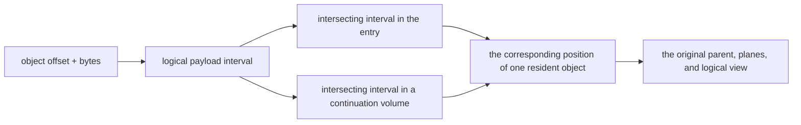

# NInfer v3 Container Specification

This document is the authority for the v3 `.ninfer` container. It is written in English.

A v3 artifact holds a compact model-instance config, the objects, the logical bindings and the
required resources. The model code defines the mathematics, the component handoffs and the state
programs. A reader and a writer can implement the file organisation and the references from this
document alone. The binder of the corresponding architecture then interprets the logical
parameters and the config.

An artifact has one fixed entry and one master catalog. A small artifact is one `.ninfer` file. A
large artifact is the entry plus continuation volumes. Objects use one logical payload offset
space, and file sharding keeps each object's encoding, layout and binding relations.

Top-level sections:

1. Contract and notation: the authority for each part, plus the notation (U64, ID, Shape).
2. File set and address space: entry and continuation volumes, the logical payload, the 32 GB
   per-file cap.
3. Binary framing: the 32-byte entry header, the continuation header, the file directory.
4. JSON master catalog: the root record and the component records (text, vision, mtp, dflash,
   dflash2).
5. Physical objects: tensor objects, resource objects, object ranges and sharing.
6. Number formats and layout names: format names and the allowed format and shape per layout.
7. Logical parameter binding: the two binding kinds.
8. Uses and auxiliary inputs: the `uses` array. Each Use names one read of a parameter.
9. Resources and optional output representations: frontend resource references.
10. Instance data and provenance: the `metadata` and `provenance` objects, including the expert
    tier-plan convention (SP-4).
11. Reading, writing, and error boundaries: the generic reader and its failure rules.
12. Concrete examples: a complete Text-only catalog.

## 1. Contract and notation

| Content | Authority |
|---|---|
| File header, JSON, objects and references, file sharding, v3 persistent names | This document |
| Fixed math, compact config, logical parameter shape, component inputs | the corresponding architecture's [config](../../src/models/qwen3_5/config.h) and [bindings](../../src/models/qwen3_5/load/) |
| Numeric decode of a format, effective codes/scales | [numeric formats](tensor-formats.md); persistent names in section 6 |
| A layout's planes, packing, internal padding, and encoded size | [storage layouts](storage-layouts.md); persistent names in section 6 |
| Native Op parameters, supported range, numerics, and scratch | the corresponding Op contract |
| Residency, state, capacity, CUDA Graph, and result publication | [Engine architecture](engine-architecture.md) and its resource contracts |

The integers in this document are exact integers. Boolean and floating-point values are interpreted
according to their own types.

| Notation | Definition |
|---|---|
| U64 | an integer in `0..18446744073709551615` |
| PositiveU64 | a U64 strictly greater than zero |
| ID | a nonempty UTF-8 string that contains no U+0000, compared exactly by its original character sequence |
| Shape | a list of `0..16` positive integers; the empty list `[]` denotes one scalar |
| `elements(shape)` | 1 for an empty shape, otherwise the product of the dimensions |
| `[begin,end)` | a half-open interval |
| `align_up(x,a)` | `ceil_div(x,a)*a` |

Products, prefix sums, offset additions, and alignment results must lie within the U64 range. The
actual I/O and memory consumers check their own address ranges. The file format uses 64-bit sizes; an
Op's actual shape support is decided by its call entry point.

Header integers are little-endian. JSON is UTF-8, and the member names of each object are unique.
Member order, ordinary string escapes, and JSON whitespace keep their standard JSON meaning. Size
fields are JSON integers; model real parameters are stored and parsed at the precision their contract
requires.

A field table lists the complete member set of a generic record and the optionality of each member. A
generic field that is not listed is a schema error. `config` is handed to the architecture for
interpretation, and `metadata` and `provenance` are the open information objects defined in section
10.

## 2. File set and address space

### 2.1 Entry and continuation volumes

The writer produces the file set from the given entry output path. When the entry is `example.ninfer`,
the file names are uniformly:

```text
example.ninfer
example.ninfer.part-0001
example.ninfer.part-0002
```

The entry stores the header, the JSON master catalog, and the first payload segment. Each continuation
volume stores its own small header and the following payload. The writer names a continuation volume
`<entry file name>.part-<index>`, where the entry file name includes the original extension. The index
equals that volume's subscript in the `files` table, starts at 1, is written in decimal, and is
left-padded with zeros to four digits when shorter than four digits; four digits or more are written
in full. A continuation name is derived automatically from this rule and has no separate naming
parameter. The actual file name is written to `files[i].path`.

The user always opens the entry. The reader locates continuation volumes by the file names recorded in
the `files` table. The generation rule above is not a read-time check; any file name in the directory
that satisfies the path rules of section 3.3 can be read.

One file set shares one 16-byte `artifact_id`. It is used to check that an entry and its continuation
volumes belong together, and a writer is advised to use a new UUID each time it produces a new file
set. It identifies the container set; model-implementation selection still follows the architecture
and the instance parameters. The header stores the raw 16 bytes; printing may use 32 lowercase
hexadecimal characters.

### 2.2 Logical payload

Let `files[i].payload_bytes = B_i`. Define:

```text
P_0 = 0
P_i = sum(B_j, j < i)
payload_bytes = sum(B_i)
```

File i stores `[P_i,P_i+B_i)` of the logical payload. These intervals are ordered and contiguous. An
object's `offset` is always relative to this logical payload. The header, the JSON, and the alignment
region before the payload of each file do not count toward the logical payload.



An object may cross a file boundary. It is still one object, and its format/layout is computed from
the logical start of the whole object. A shard boundary may also lie inside a plane; reads and copies
keep the original byte order.

### 2.3 Default 32 GB shard limit

The writer defaults to a single-file size limit of **32 GB = 32,000,000,000 bytes**, counted over the
file header, the JSON, the alignment region before the payload, and that file's payload. GB here is a
decimal unit.

The writer accepts other explicit limits. The limit is a generation policy; the file stores only the
actual shard result, and the reader reads through the directory. If
`entry_payload_start + payload_bytes <= limit`, the writer produces the entry file only. When the
limit is exceeded, the entry holds the first segment and the remaining data goes into continuation
volumes in order.

For a given entry_payload_start, the current writer's shard capacities are:

```text
entry_capacity = floor((limit - entry_payload_start) / 4096) * 4096
part_capacity  = floor((limit - 4096) / 4096) * 4096
```

When sharding is needed, the writer first checks that the limit can hold the header and that both
capacities are positive. Every segment but the last is filled to capacity, and the last segment holds
the remaining bytes. The number of shards follows from the data size and the capacities. This
placement keeps each segment's logical start aligned to 4096 bytes, which suits direct I/O; the
reader's range mapping also accepts other positive-length segmentation that satisfies this
specification.

## 3. Binary framing

### 3.1 Entry header

The entry header is always 32 bytes long.

| Offset | Bytes | Field | Encoding and meaning |
|---:|---:|---|---|
| 0 | 8 | magic | `4e 49 4e 46 45 52 00 03`, that is `NINFER`, a zero byte, and version 3 |
| 8 | 8 | json_bytes | Little-endian PositiveU64; the length of the complete UTF-8 JSON text |
| 16 | 16 | artifact_id | the raw bytes of the file-set identifier |

```text
json_offset         = 32
metadata_end        = 32 + json_bytes
entry_payload_start = align_up(metadata_end, 4096)
entry_file_bytes    = entry_payload_start + files[0].payload_bytes
```

The reader checks the complete magic, reads the JSON in `[32,metadata_end)`, and checks that the
actual file length equals entry_file_bytes. `[metadata_end,entry_payload_start)` is the file alignment
region, which the writer fills with zeros.

Legal trailing whitespace in the JSON counts toward json_bytes. The writer can use it to reserve a
definite catalog space and then plan the payload capacity in the entry; this keeps a change in the
shard-table length from moving the payload repeatedly. The reader parses this text as standard JSON.

### 3.2 Continuation header

The continuation header is also 32 bytes, and the payload always starts at file offset 4096.

| Offset | Bytes | Field | Encoding and meaning |
|---:|---:|---|---|
| 0 | 8 | magic | `4e 49 4e 50 52 54 00 03`, that is `NINPRT`, a zero byte, and version 3 |
| 8 | 8 | part_index | Little-endian PositiveU64; the corresponding subscript in the `files` array |
| 16 | 16 | artifact_id | byte-for-byte identical to the entry's |

```text
part_payload_start = 4096
part_file_bytes    = 4096 + files[part_index].payload_bytes
```

The writer fills `[32,4096)` with zeros. When the reader opens a continuation volume, it checks the
magic, part_index, artifact_id, and actual length. The entry and a continuation volume have different
magics; a continuation volume takes part in reading through the entry's directory.

### 3.3 File directory

The root field `files` is a nonempty array. Item 0 describes the entry, and the remaining items
describe continuation volumes.

| Field | Type | Meaning |
|---|---|---|
| path | null for item 0; a string otherwise | a sibling file name relative to the entry's directory |
| payload_bytes | PositiveU64 | the number of logical payload bytes this file stores |

```json
[
  {"path": null, "payload_bytes": 31999934464},
  {"path": "example.ninfer.part-0001", "payload_bytes": 4096}
]
```

A continuation path is a nonempty file name, taken as its original character sequence. It contains no
`/`, `\\`, or U+0000, and the name is neither `.` nor `..`. Continuation file names are pairwise
distinct and differ from the name of the entry opened in this run. The directory can be moved as a
whole.

The numeric example above uses entry_payload_start=65536, so the entry file is exactly 32,000,000,000
bytes. The actual size of the second file is 8192 bytes.

## 4. JSON master catalog

### 4.1 Root record

| Field | Type / requiredness | Meaning |
|---|---|---|
| components | Object, required and containing text | the model components actually provided, with their compact configs |
| objects | nonempty Array<ObjectDescriptor>, required | the physical objects, ordered by logical payload offset |
| bindings | Object, required | the map from a complete logical parameter name to a Binding |
| uses | Array<Use>, required | the compute licenses and auxiliary inputs, expanded by mathematical use position |
| files | nonempty Array<File>, required | the file directory of section 3.3 |
| metadata | Object, optional | the information of section 10, such as the public name |
| provenance | Object, optional | the source, training pairs, and conversion notes |

The framing version already fixes the JSON syntax, and the root record uses the fields above directly.
See section 12 for a complete JSON example.

### 4.2 Component records

The keys of `components` are component IDs. `text` is the main model; the currently optional
components use `vision`, `mtp`, `dflash`, and `dflash2`. A new actual architecture or backend can use
the same record structure, and the corresponding compiled code interprets its ID and config.

| Field | Type / requiredness | Meaning |
|---|---|---|
| config | Object, required | the architecture identifier and the few instance parameters of this component |
| target | component ID, optional | the target component this component is associated with |
| resources | Object, optional | the map from a resource role to a resource object ID; omitted means an empty map |
| proposal | Object, optional, text only | the optional proposal output representation attached to the main model; see section 9.2 |

A config uses the standard architectures/model_type and reserved fields of the corresponding
architecture. For example, Qwen Text contains architectures, model_type, hidden_size, and so on;
Vision uses its own standard model_type; the config of the current Qwen MTP needs only architectures,
because the geometry comes from target. The source adapter interprets the upstream organization such
as `text_config` and `vision_config`, and then writes the normalized result into the config of the
corresponding component. The component's target, resources, and proposal are placed separately
according to the field table in this section.

```json
{
  "config": {"architectures": ["Qwen3_5MTP"]},
  "target": "text"
}
```

A target reference must resolve to the corresponding component, and the architecture binder checks the
mathematical association. The target of the current Vision and spec is text in both cases. The
component's code defines the fixed feature-capture positions, the state operations, and the feature
preparation flow.

A component declaration means the artifact provides that component. The startup options decide which
components this run enables; text, the selected components, and the data they actually share take part
in loading. The writer is responsible for the data completeness of the declared components, and the
binder checks the mathematical and data requirements of the features selected at startup.

## 5. Physical objects

### 5.1 Tensor objects

| Field | Type | Meaning |
|---|---|---|
| id | ID | the object reference name, unique within this artifact |
| kind | `tensor` | the object category |
| shape | Shape | the logical shape of the stored object, in C-order element coordinates |
| format | ID | the numeric format of section 6 |
| layout | ID | the layout of section 6 |
| offset | U64 | the byte offset of the object's start within the logical payload |
| bytes | PositiveU64 | the byte count of the object's complete encoding |

```json
{
  "id": "w.attn.qk",
  "kind": "tensor",
  "shape": [7168, 5120],
  "format": "q4_g64_fp16",
  "layout": "row_split_k128_v1",
  "offset": 0,
  "bytes": 19496960
}
```

Shape describes the object's logical value domain; the layout itself computes the physical padding,
the planes, and the encoded size. For example, row_split_k128_v1 computes the K-dimension padding of
Q4. An object can hold several projections or several experts, and section 7's bindings give its
mathematical uses.

An encoded object contains every plane and every object-level scalar that its codec/layout requires.
The block scales and the weight divisor of the current NVFP4 live inside the object; the row scales of
the current per-row FP8 also live inside the object. The separate pointers an Op needs come from this
object's established layout. The activation divisor of a use position is bound separately; see section
8.

### 5.2 Resource objects

| Field | Type | Meaning |
|---|---|---|
| id | ID | shares one unique namespace with all tensor/resource objects |
| kind | `resource` | the object category |
| encoding | `raw_bytes_v1` | the complete interval is raw resource bytes |
| offset | U64 | the logical payload byte offset |
| bytes | PositiveU64 | the raw resource length |

```json
{
  "id": "r.chat_template",
  "kind": "resource",
  "encoding": "raw_bytes_v1",
  "offset": 19496960,
  "bytes": 4096
}
```

The interpretation of a resource is decided by its use role. The content rules of a JSON file, a UTF-8
template, or another resource belong to the corresponding Frontend; the resource object itself
provides only raw bytes.

### 5.3 Object ranges and sharing

All objects are ordered by increasing offset, their IDs are unique, and their byte intervals are
pairwise non-overlapping and lie within the logical payload. A tensor offset satisfies the layout's
256-byte object alignment, and a raw resource has an alignment of 1. Tensor bytes equals the encoded
size of the corresponding `(format,layout,shape)`.

Gaps between objects and unreferenced logical payload bytes at the end have no load semantics. A
regular writer leaves space only for alignment and truncates at the end of the last object. Padding
inside a completely encoded object still follows its layout contract.

When several logical uses share one object, they all reference the same ID, and the materializer
builds one backing from that. An object that no use in this run references stays non-resident. Object
IDs, ordering, and file positions take part only in loading and diagnostics; the binder resolves the
weight references used during execution once.

A complete parent is the unit of materialization and residency. The converter must organize the trunk
parameters, the private parameters of each independently enableable component, and the private data of
an independently selectable proposal representation as separate objects, so that the private data of a
disabled feature stays non-resident. Data that is genuinely shared can be referenced by different
features through the same object; for example, Text and MTP use the same embedding/head, or a proposal
references an existing representation of the Text head. Packing Text parameters and MTP private
projections into one parent violates this generation rule; placing their separate objects in the same
file satisfies it. The converter checks the object merge boundaries against the architecture's feature
dependencies, and the reader continues to read through the directory.

## 6. V3 numeric formats and layout names

### 6.1 Numeric formats

V3 canonical names use lowercase snake_case. Each name points to one codec in the code with an exact
meaning; that codec defines the fixed group size, the scale type, and the decoding rules directly.

| Name | Numeric meaning |
|---|---|
| bf16 | a raw Bfloat16 word |
| fp32 | a raw IEEE binary32 word |
| int32 | a signed 32-bit integer |
| q4_g64_fp16 | signed 4-bit codes, G64, FP16 multiplier |
| q5_g64_fp16 | signed 5-bit codes, G64, FP16 multiplier |
| q6_g64_fp16 | signed 6-bit codes, G64, FP16 multiplier |
| q8_g32_fp16 | codes `[-127,127]`, G32, FP16 multiplier |
| nvfp4 | E2M1 codes, a G16 E4M3FN block scale, an FP32 weight divisor |
| fp8_e4m3fn_row_bf16 | E4M3FN codes, one BF16 multiplier per row |

The FP16/BF16 at the end of a quantization name denotes the scale type. The activation compute license
is expressed in uses. The code range, special floating-point values, rounding, and exact reconstruction
are interpreted according to the [numeric contract](tensor-formats.md). In particular, NVFP4
reconstruction uses `code_value * block_scale / weight_divisor`, and per-row FP8 uses its established
`code_value * row_scale` reconstruction rule.

When the same numeric meaning changes encoder or calibration process, the format name stays the same
and the generation method is recorded in the recipe/provenance.

### 6.2 Layouts and resource encodings

| Name | currently allowed format / shape | object alignment |
|---|---|---:|
| contiguous_le_v1 | bf16/fp32/int32, rank 0..16 | 256 |
| row_split_k128_v1 | q4_g64_fp16, q5_g64_fp16, q6_g64_fp16, q8_g32_fp16, positive rank-2 `[N,K]` | 256 |
| block_scale_k16_m128x4_v1 | nvfp4, `N%128=0`, `K%64=0` | 256 |
| row_scale_v1 | fp8_e4m3fn_row_bf16, positive rank-2 `[N,K]` | 256 |
| raw_bytes_v1 | Resource, a nonempty byte string | 1 |

Byte packing, planes, internal padding, swizzle, and the encoded-size formulas are defined by the
[storage layout contract](storage-layouts.md).

The v1 of a layout is the layout's own version, managed separately from container v3. Adding a
different byte arrangement adds the corresponding layout definition; adding an actual numeric encoding
capability adds a codec definition, and an ordinary object record keeps using the same structure.

## 7. Logical parameter binding

### 7.1 The two Binding forms

The root `bindings` is the map from a complete logical parameter name to a Binding. The architecture
code defines the names, for example `text/layers/3/attention/query`. The code and the compact config
derive the logical parameter shape. Each logical name has one Binding. The architecture defines
different logical names for training-parameter uses that need separate representations; each Binding
may reference the same object or a different object, and the architecture/config defines the training
sharing relations.

A Binding has two mutually exclusive forms:

| Form | complete fields | Meaning |
|---|---|---|
| whole object | `object: ID` | the whole tensor object corresponds to one logical parameter; object.shape equals the parameter shape |
| ordered parts | `parts: nonempty Array<Part>` | concatenates the logical elements of the parts in order, covering that parameter's C-order element sequence |

The complete fields of a Part are:

| Field | Type | Meaning |
|---|---|---|
| object | tensor object ID | the part's physical parent |
| range | `[U64,U64]` | the flat interval `[begin,end)` of the object's logical elements |

Range satisfies `0<=begin<end<=elements(object.shape)`. The sum of the parts' element counts equals
the logical parameter's element count. The array order is the target element order; the target offset
is the accumulated length of the preceding parts. Intervals of one object can be referenced by
different uses or different parts, and the corresponding model mathematics interprets the actual
meaning of the repetition.

```json
{
  "text/final_norm": {"object": "w.final_norm"},
  "text/layers/3/attention/query": {
    "parts": [{"object": "w.attn.qk", "range": [0, 31457280]}]
  }
}
```

**A range is measured in logical elements; object.offset/bytes is measured in bytes.** The logical
element sequence excludes the padding the layout introduces and does not treat quantization scales as
weight elements. It keeps the parent's numeric decoding rules.

### 7.2 Axes, reshape, and row order

C-order means the last dimension varies fastest. For shape `[N,K]`, element coordinate `(n,k)`
corresponds to `n*K+k`. A run of complete rows `[r0,r1)` therefore corresponds to range `[r0*K,r1*K)`.

The whole-object form expresses a complete binding of the same shape. The ordered-parts form
interprets the target shape by explicit element correspondence, and it can express a contiguous
reshape, a subregion of a fused parent, a split object, and a row-block rearrangement. For example,
one expert interval of a rank-2 expert bank can correspond to one rank-2 logical projection; the
parameter's own shape interprets higher-order logical axes.

If a parent stores two groups of projections interleaved, the converter can write Parts in order for
each head's contiguous region. A regular artifact prefers to prepare, at conversion time, the grouping
and row order that existing Ops consume easily.

### 7.3 Binding to native Ops

The binder checks the logical coverage and the correspondences, and keeps each Part's parent, original
shape, format/layout, range, and owner. One logical parameter can be composed of several
representations, and one native Op can consume several logical parameters.

For example, when Q/K and gate/V come from a q4 and a q5 parent respectively, parameter preparation
can enter the implemented two-weight entry; when all four come from one nvfp4 parent, it can enter the
corresponding single-weight entry. The code organizes these calls according to the actual grouping,
ranges, and geometry.

A zero-copy view is decided by the actual layout and the consumer's addressing capability. A run of
logical rows in RowSplit involves several plane intervals such as base, the optional high-bit, and
scale; an NVFP4 view also keeps the original parent's scale swizzle and weight divisor. The
materializer uploads the parent's original encoding, and the Op prepares the view it can actually
consume. Work that must change packing or reorganize the encoding is done by the converter.

File sharding affects only how the parent's bytes are obtained. Even when a parent crosses several
files, the logical references and Op parameter relations above still hold.

## 8. Use licenses and auxiliary inputs

The root `uses` is an array of Uses, and each `(parameter,input)` combination is unique. Each Use
consumes the Binding its parameter names; several Uses of the same parameter share that representation
and provide the license and auxiliary values of their own input positions.

| Field | Type / requiredness | Meaning |
|---|---|---|
| parameter | ID, required | an existing logical parameter name of the root bindings |
| input | ID, required | a complete mathematical input position defined by the architecture code |
| activation_policy | enum, optional | required for a use that has this license contract |
| auxiliaries | Object, optional | the map from an auxiliary input role to a Binding; omitted means empty |

The exact spellings of the licenses and their allowed sets are:

| activation_policy | allowed set |
|---|---|
| A16Only | A16 |
| AllowA8 | A16, A8 |
| AllowA4 | A16, A8, A4 |
| AllowA16 | A16 |

The writer writes an explicit result for a projection use position that needs a license. An encoder's
default rule belongs to the recipe and is already expanded when it enters uses. When one activation
quantization is shared, the license is the intersection of the licenses of the relevant uses, and the
auxiliary input relations are satisfied.

```json
{
  "parameter": "text/layers/3/attention/query",
  "input": "text/layers/3/mixer_input",
  "activation_policy": "AllowA4",
  "auxiliaries": {
    "activation_input_divisor": {"object": "a.attn.query.input_divisor"}
  }
}
```

The auxiliary object in this example is `format=fp32, layout=contiguous_le_v1, shape=[]`, and its
value is checked to be positive and finite as the consumer requires. A Part can also reference a
single element of an FP32 vector, keeping the same scalar meaning. The corresponding use contract
defines the expected shape, type, and role of an auxiliary Binding.

DFlash/DFlash2 query K/V use `attention/key` and `attention/value`, and context K/V use
`attention/context_key` and `attention/context_value`, each with its own Binding and Use. The two sets
of bindings can share parent regions or choose representations independently; see section 12.5. The
weight divisor and the block scales belong to the weight codec, and the activation divisor belongs to
that use position.

## 9. Resources and optional output representations

### 9.1 Frontend resource references

The resources keys of a component are interpreted by the corresponding Frontend contract, and a
common upstream file role can use its original file name directly:

```json
{
  "tokenizer.json": "r.tokenizer",
  "tokenizer_config.json": "r.tokenizer_config",
  "chat_template.jinja": "r.chat_template",
  "generation_config.json": "r.generation_config"
}
```

All of these values reference resource objects. They are object references, and the actual resource
bytes are stored with the artifact. Vision processor resources can be placed in vision.resources and
are obtained by dependency when the feature is enabled.

V3 can carry a custom chat template in the corresponding resource object. The resource stores raw
bytes, and the current [Frontend](../../src/models/qwen3_5/frontend/chat_template.cpp) and its actual
capabilities decide template recognition and rendering. The complete tokenizer resources together
decide the token domain, and the fixed model config keeps its own weight vocab_size.

### 9.2 Optional proposal output representation

The complete record of `text.proposal` is:

| Field | Type / condition | Meaning |
|---|---|---|
| domain | `full` or `indexed` | the proposal row domain |
| rows | PositiveU64, indexed only | Ns; the logical row count of an indexed head |

Its parameters still live in the root bindings, under the already defined names `proposal/head` and
`proposal/token_ids`. A full domain takes its row count from the Text vocab_size; an indexed domain
needs an explicit token ID map. The main output head is always provided by Text's own bindings. When
proposal is omitted, the current backend uses the target's complete output representation as its code
defines.

## 10. Instance data and provenance

`metadata` is an open JSON object. The optional `name` member is a nonempty public name string;
the remaining members are for display and tool records. `provenance` is an open JSON object that
may record the source checkpoint/revision, component training pairs, encoder/recipe notes, and
conversion information. Both are treated as empty objects when omitted.

Numbers required for execution, licenses, and resources go into config, objects, bindings, uses,
and resources respectively. The frontend reads EOS from generation_config; mode sampling presets
come from the architecture implementation, and applications and requests can override them.
Sampling numbers in resources are stored verbatim; the current frontend does not use them to
replace mode presets — see the [CLI sampling notes](../cli.md). Provenance records the source of
training pairs; the binder checks each component's actual target, dimensions, and input
relations; quality and acceptance rates are established by artifact evaluation.

Artifact_id verifies the shard set, the public name carries product semantics, architecture and
config select the fixed model implementation, and object bindings provide the actual
representations. Each consumer reads data for these uses.

### Expert tier plans (strategy SP-4)

The `metadata` object may carry an optional `tier_plan` member declaring the expert-tiering
placement plan for routed expert banks. A version-1 plan is an object:

```json
{
  "version": 1,
  "banks": [
    {
      "object": "text/layers/0/moe/routed_gate_up",
      "experts": 256,
      "rows_per_expert": 1024,
      "tiers": { "hot": [], "warm": [], "cold": [] },
      "activation_profile": [0]
    }
  ]
}
```

Each bank names one tensor object by id and declares its expert geometry (`experts` by
`rows_per_expert`), the hot/warm/cold expert assignment, and an optional per-expert activation
profile (conversion-time calibration, for hot-set seeding). The three tier arrays must
disjointly and completely cover `[0, experts)`; an activation profile, when present, carries one
nonnegative count per expert. The loader (`src/artifact/tier_plan.{h,cpp}`) parses the block,
rejects malformed plans at load, and checks that every named bank resolves to a tensor whose row
count is exactly `experts * rows_per_expert`. The load summary reports the plan
(`tier_plan_banks`, `tier_plan_warm_experts`).

Version 1 is declarative: the plan describes placement and is validated and reported, but the
materialization honors it only when the tiered execution path consumes it; an absent or partial
plan changes no serving behavior. The tiered path (SP-4 phase 2b) consumes the hot/warm lists
directly and per expert: the hot experts form a compact device mini-bank in expert id order,
the warm and cold experts share the pinned-host warm mini-bank in expert id order (the pinned
host tier is the only host tier), and per-expert residency tables map every expert to its
compacted rank and tier at execution time — so arbitrary scattered hot sets work without any
artifact permutation. The device mini-bank additionally carries a cache tail of equal slot
count across each layer's paired banks (SP-4's adaptive cache): sized by the engine's
device budget after the hot mini-banks, and populated at startup by promoting warm experts
into tail slots — each promotion is one plane-aligned copy per bank plus a residency-table
flip, and a promoted expert reads exactly like a hot expert at rank `hot_experts + slot`.
`tools/annotate_tier_plan.py` annotates an existing v3
artifact without re-conversion: it rewrites the directory JSON with the plan, shifts file zero's
payload region (logical payload offsets and continuation shards are untouched), and preserves
every payload byte.

## 11. Reading, writing, and error boundaries

### 11.1 Generic reader

The reader first reads the entry header and the JSON, and completes the following structural checks:

1. Framing, the field set, the types, member uniqueness, and integer ranges.
2. The order, paths, positive lengths, and logical prefix sums of the files; the actual entry length.
3. Object IDs, shapes, byte ranges, order, and non-overlap.
4. The Binding/Use/resource/target references exist, the referenced object categories are correct,
   and the Part ranges are legal.

The reader may keep an architecture config and format/layout names that it has not yet interpreted,
for inspection. When a tensor must be read, the generic codec/layout facility parses its format and
checks the encoded size and the alignment; a selected resource is read according to its encoding. An
unknown encoding is reported when the object is actually requested to be interpreted.

A complete distribution contains every file the directory declares. One run opens only the files that
the selected objects involve; the remaining continuation volumes may stay unfetched. When any required
segment is missing, or a header belongs to a different set, or a length does not match, the relevant
read fails. When a component is disabled, the selected requirements decide the read scope, and other
objects in the same file stay unuploaded.

### 11.2 Range reads and materialization

For a logical read of `[offset,offset+length)`, the reader takes its intersection with each file's
payload interval in turn. The read range must lie entirely within `[0,payload_bytes)`; when length=0,
offset may sit at the end and the read returns an empty result. A range read must obtain every declared
byte, and an early EOF or an I/O failure inside the declared interval is treated as a read error. If
the intersection is `[a,b)`, the corresponding read is:

```text
source_file_offset = file_payload_start(i) + (a - P_i)
destination_offset = a - offset
copy_bytes          = b - a
```

The I/O layer may split these segments further into transfer blocks and write them at their original
offsets into the same destination object. The file header and the file alignment region take no part
in the copy; cross-file data reaches the materializer through the range mapping above.

The materializer deduplicates by the parent actually used, arranges the device/host backing, and then
obtains a typed view. A use that needs an owning Host value, such as an auxiliary scalar or an index,
can read the corresponding element interval through its Binding and keep its numeric type. The
reader's JSON and symbolic index serve cold loading; at run time the resolved references and direct
calls are used.

### 11.3 Semantic and support checks

| Situation | Owner |
|---|---|
| header, directory, reference, and range errors | Generic reader |
| the encoding geometry of a format/layout, a missing or mismatched actual file | object reading and materialization |
| the compact config, the logical parameter shape/coverage, the component relations, missing data for a selected feature | the corresponding architecture binder |
| codes/scales, encoding padding, and the correctness of the source numeric conversion | the converter, the codec, and the corresponding verification |
| the actual native parameters, insufficient format/layout/shape/phase support | Op preparation, the capacity query, warmup, or execution |
| state storage, actual capacity, and lifetime | the Program and the state implementation |

At run time the necessary checks follow the actual consumers, using the converted payload; a regular
upload relies on the codes/scales contract the producer established. Numeric qualification
verification follows the existing Op/codec rules. A warmup result covers the actual execution path, and
a failed round is handled by the existing state transaction.

### 11.4 Writer

The writer receives the already fixed component configs, the object/binding/use descriptions, and the
actual conversion job:

1. It receives the objects that the converter organized by the feature dependencies of section 5.3,
   obtains each encoded size from its codec/layout, and arranges the object alignment and order within
   the logical payload.
2. It stores the components, bindings, uses, and resource references the converter provides, and
   checks the generic catalog structure and the reference relations.
3. It chooses the limit and the reserved JSON space, generates the continuation names per section 2.1,
   and computes the files table so that each file's final size satisfies the generation limit.
4. It serializes the JSON; if the JSON exceeds the reserved space, it enlarges the space, recomputes
   the shard table, and then starts writing.
5. It generates artifact_id and writes the entry and continuation headers.
6. It streams the conversion result in at the logical payload positions; an object that crosses files
   continues in the same byte order.
7. It checks the complete coverage of the declared intervals and the actual file lengths, and publishes
   the continuation volumes first, then the entry.

The current writer completes generation in temporary files, cleans up this run's files on failure, and
does not overwrite an existing target. The writer can use JSON trailing whitespace to keep the
reserved json_bytes stable. The reservation policy and the transfer block size are implementation
choices, and the reader uses only the actual framing and files values. When the shard limit changes,
the writer can copy the same logical payload, keep the objects, bindings, and use records, and produce
a new files table and file-set identifier.

## 12. Concrete examples

### 12.1 A complete Text-only catalog

The [single-file example](examples/artifact-v3-text.json) contains a complete small Qwen3.5 Dense Text
config, all the logical parameters of one attention layer and one FFN layer, the four Text Frontend
resources, and every projection use record. The config and the model parameter geometry serve
specification verification; it is a synthetic instance, and whether the current Ops qualify for
execution at this size is decided separately.

The example uses H=128, I=256, Nq=Nkv=1, D=128, L=1, and R=248320, and every weight object uses bf16.
Q/K/gate/V live in one `[512,128]` parent, and FFN gate/up live in one `[512,128]` parent. Norm,
embedding, the main head, attention output, and FFN down are bound to their own objects.

The lengths of the four resources are taken from locally verified Qwen3.8 Text resources. The example
JSON provides the complete catalog, and the resource and weight payloads themselves are not
documentation attachments. Encoding that catalog uses json_bytes=65504, pads the actual JSON with
legal whitespace, and yields entry_payload_start=65536. The example generates a single file under the
default 32 GB limit.

### 12.2 Mixed formats and file sharding for the same model

The [mixed-format sharded example](examples/artifact-v3-mixed-sharded.json) reuses the config, resource
roles, and logical parameters above. Attention changes to a q4 Q/K parent and a q5 gate/V parent; uses
keeps A16Only. The example sets the file limit explicitly to 64,000,000 bytes to demonstrate sharding;
the production default remains 32 GB.

The entry payload_start is again 65536, and a continuation volume is 4096. Objects such as the
embedding cross a file boundary; their object shape and format/layout stay complete. The differences
between the two examples fall in the object representations, the Part references, and the files table
respectively.

### 12.3 Attention with one parent and with two parents

Take the actual 27B with H=5120, Q=6144, and K=1024; the ranges below are all in logical elements:

| Logical parameter | two parents: Q4 A + Q5 B | one parent: FP8 or NVFP4 P |
|---|---|---|
| Query | A `[0,31457280)` | P `[0,31457280)` |
| Key | A `[31457280,36700160)` | P `[31457280,36700160)` |
| Gate | B `[0,31457280)` | P `[36700160,68157440)` |
| Value | B `[31457280,36700160)` | P `[68157440,73400320)` |

The shapes of A and B are both `[7168,5120]`, and P is `[14336,5120]`. Their complete encoded sizes
are:

| Object | Format / layout | Bytes |
|---|---|---:|
| A | q4_g64_fp16 / row_split_k128_v1 | 19,496,960 |
| B | q5_g64_fp16 / row_split_k128_v1 | 24,084,480 |
| P | fp8_e4m3fn_row_bf16 / row_scale_v1 | 73,428,992 |
| the other representation of P | nvfp4 / block_scale_k16_m128x4_v1 | 41,287,684 |

The binder obtains the same four logical parameters, and the actual Op preparation sees one parent or
two. The activation auxiliary values of NVFP4 are associated with the corresponding use positions per
section 8. If P crosses two files, it still provides one physical parent.

### 12.4 Row-block rearrangement, reshape, and sharing

Suppose a bf16 parent has shape `[8,4]` and stores Q0, gate0, Q1, and gate1 in order, each taking two
rows. Query `[4,4]` and gate `[4,4]` can be expressed respectively as:

```json
{
  "query": {
    "parts": [
      {"object": "interleaved", "range": [0, 8]},
      {"object": "interleaved", "range": [16, 24]}
    ]
  },
  "gate": {
    "parts": [
      {"object": "interleaved", "range": [8, 16]},
      {"object": "interleaved", "range": [24, 32]}
    ]
  }
}
```

A `[4,4]` object can also use a single Part `[0,16)` to correspond to the logical `[2,2,4]`, expressing
an explicit C-order reshape. Consumption of the actual view still follows that object's layout and the
Op's addressing capability. A tied embedding/head can use the same whole-object Binding under two
logical names; the two Uses describe each separately.

### 12.5 Different uses of one training parameter

Take layer 0 of DFlash2, with Hd=5120, Qd=4096, and Kd=1024. The two uses of K below are excerpted:
query uses the K region of `w.draft.qkv [6144,5120]`, and context uses a separate
`w.draft.context_key [1024,5120]`. Both can use q8_g32_fp16 / row_split_k128_v1.

```json
{
  "bindings": {
    "dflash2/layers/0/attention/key": {
      "parts": [{"object": "w.draft.qkv", "range": [20971520, 26214400]}]
    },
    "dflash2/layers/0/attention/context_key": {
      "object": "w.draft.context_key"
    }
  },
  "uses": [
    {
      "parameter": "dflash2/layers/0/attention/key",
      "input": "dflash2/layers/0/query_projection_input",
      "activation_policy": "AllowA8"
    },
    {
      "parameter": "dflash2/layers/0/attention/context_key",
      "input": "dflash2/context_input",
      "activation_policy": "AllowA8"
    }
  ]
}
```

The source adapter hands the same training K parameter to these two logical roles, and the recipe can
generate each representation separately. The fixed query execution consumes key, the context
materialization consumes context_key, and the Op parameter preparation obtains the corresponding
parent/view in each case. To choose a shared representation, change the Binding of context_key to the
same Part as key and drop the separate object; the two Uses still keep their own license and auxiliary
inputs. Value/context_value follow the same rule.

### 12.6 Parameter integrity and encoding failures

| Input | Result |
|---|---|
| the same object ID appears twice | a catalog error |
| the byte ranges of two physical objects overlap | a range error; sharing is expressed by referencing the same object |
| a Part end exceeds the source object's logical element count | a reference error |
| the total Part length does not match the required parameter | the binder reports a parameter coverage error |
| an object uses an unimplemented format/layout | it fails when the object's encoding is requested to be interpreted |
| a scalar activation divisor references a non-scalar or an unexpected numeric representation | a binding error at the corresponding use |
| the second continuation volume that a required parent crosses is missing | a range read failure |
| a continuation volume of the same index from another artifact is obtained | artifact_id mismatch |
| a Vision/spec that the file does not provide is enabled | the selected component is missing |
| the metadata and the representation are legal, but the native Op lacks the corresponding grouping or shape entry | the actual Op preparation, warmup, or call fails |
