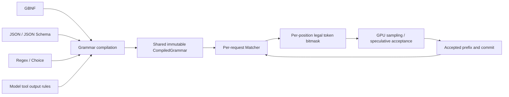
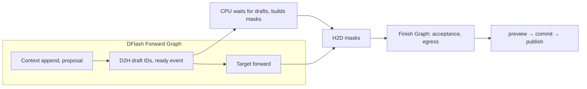

# Constrained Decoding Design

This document defines the architecture, functional semantics, and execution contract of NInfer
constrained decoding. GBNF, JSON object, JSON Schema, choice, regex, and tool constraints are
implemented for the Qwen3.5 family and cover ordinary decoding, MTP, DFlash, and DFlash2. Content
constraints are used through `RequestOptions::constraint`, the CLI, and the three HTTP protocols;
tool declarations belong to the prompt, and the call policy belongs to
`RequestOptions::tool_choice`. The independent Qwen3.8 Flash-Next family has no token-mask
execution; see [§2.3](#23-model-family-scope).

The goal is one token-constraint mechanism shared by GBNF, JSON, JSON Schema, and tool calls,
integrated with the existing ordinary sampling, MTP, DFlash, DFlash2, thinking, streaming output,
and context-cache/prefix-reuse paths. NInfer keeps one GPU, fixed resident lanes, and native
C++/CUDA execution.

Overall choices: vendor the XGrammar CPU core; the Frontend builds grammars that match the model's
output semantics; the request owns the matcher; the Program owns the bitmask buffers and execution
timing; the Sampling Ops build the target distribution over the legal set. Model state, grammar
state, and user-visible output advance across the same commit boundary.

This is the English, fork-adapted form of the upstream NInfer design, ported together with the
feature (upstream commit `81c8ce09`). Where the fork differs from upstream (model-family scope, no
request preemption, the mask region layout, and the observability names), this text states the
fork's behavior.

## 1. Function and semantics

### 1.1 One underlying mechanism, several constraint entry points



GBNF is the direct grammar input and is the smallest complete use of the underlying mechanism. JSON
Schema and tool rules build the same runtime objects through compilation; the sampling Ops do not
branch on JSON, GBNF, or tool type.

A constraint controls the legal set of next tokens. The complete bytes of a candidate token must be
acceptable from the current grammar state; a token may span several punctuation marks, rules, or
output phases, and may also contain only part of a UTF-8 sequence.

An output that completes normally under a constraint must belong to the declared language or schema
subset. A length limit, context exhaustion, or cancellation can leave an unfinished result.
Structural conformance and factual correctness of the content are different properties.

### 1.2 Scope of a constraint

| Request form | Constrained object | Initialization point |
|---|---|---|
| JSON, schema, GBNF, regex, or choice for a new Chat reply | Final content | Start of the newly added content; thinking is carried by the model's outer rule |
| Direct grammar on a raw token/text continuation | All newly added text | After the prompt; the prompt is not automatically treated as a grammar prefix |
| ContinueFinalAssistant | Concatenation of the existing final assistant content and the newly generated suffix | The matcher is initialized with the final content prefix |
| Tool constraints | The model's native tool envelope, the call policy, and the argument values | Start of this assistant output, including the permitted thinking/content |

Constraints belong to Generation requests. Ordinary CausalScoring does not enter this path. Vision
only affects prompt construction; afterwards the same output constraints apply. Every request form
above applies to Qwen3.5-family models; [§2.3](#23-model-family-scope) defines what Flash-Next does
with them.

### 1.3 Completeness and sampling semantics

Three facts are recorded separately:

- the current token prefix can still be continued by the grammar;
- the current content is already in a state that allows ending;
- whether the request ended through normal constrained completion.

For example, the grammar `root ::= [0-9]+` allows ending after generating `1` and still allows more
digits. "Allowed to end" must not be equated with "forced to end now".

Constrained decoding defines a new per-token distribution. It is not the original model's global
distribution conditioned on "the whole final text satisfies the grammar". Speculative decoding
preserves the per-token target distribution exactly as defined for ordinary constrained sampling.

## 2. Source and module boundaries

### 2.1 Vendored XGrammar

The source lives in `third_party/xgrammar/` and is maintained the same way as
`third_party/llama-jinja/`: a fixed source version, retained provenance and license information,
NInfer-maintained modifications where needed, and upstream changes absorbed on demand.

The starting point is the CPU core and its dependencies: grammar parsing and compilation, JSON
Schema/regex conversion, vocabulary indexing, the matcher, the bitmask, and rollback. The recursion,
Unicode, and token-level rule capabilities that GBNF needs are kept. Python/TVM bindings, the
upstream CUDA/Triton integration, examples, and unrelated build branches do not enter the product
target.

The product build uses an explicit source list and a dedicated CMake target (`ninfer_xgrammar`).
Small dependencies the core currently needs, such as picojson and DLPack, are managed inside that
boundary; DLPack only adapts the library's CPU tensor view and does not enter the NInfer public API
or any CUDA Op contract.

Direct customization is allowed for:

- making the compiler return a structured error for an assertion it cannot execute, instead of
  emitting a warning and relaxing the semantics;
- providing a caller-owned bitmask view and reducing intermediate allocations and format
  conversions;
- exposing what a reliable mark/rollback/preview requires;
- optimizing vocabulary handling, temporary state, and the compilation cache for real workloads.

Source trimming keeps the complete dependencies of the selected CPU functions. The library's
internal types do not all need to become NInfer contracts.

### 2.2 Ownership

| Owner | Responsibility |
|---|---|
| Third-party CPU core | Grammar, tokenizer-aware compilation, matcher, legal sets, and rollback |
| NInfer public request contract | User constraint types, content constraints, tool selection, and strict intent; no third-party type is exposed |
| Generic text-constraint adapter | Schema validation and composition reduction, source locations, shared compilation resources, CPU bitmasks, and temporary matcher operations |
| Model Frontend | Raw vocabulary and control tokens; thinking/content/tool envelopes; continuation prefixes; tool value representation |
| Request OutputSession | Mutable matcher, output parsing, preview, and formal commit |
| Engine | Request lifecycle, per-round request/row mapping, the call-scoped mask provider, batch commit, and result publication |
| Program | Device/pinned buffers, per-position data layout, fixed execution composition, CUDA Graphs, and physical state commit |
| Sampling / Speculative Ops | Legal-candidate filtering, probability normalization, p/q acceptance, residuals, and sampling results |
| Gateway / CLI | File acquisition, protocol field translation, protocol errors, and response encoding |

The generic adapter lives in `src/text/` (`grammar.h`, `json_schema.h`, `schema_composition.h`);
Qwen output semantics live in `src/models/qwen3_5/frontend/`. The execution data contract
(`TokenMaskProvider`, `CommitDecision`, `CommitDisposition`) belongs to `src/runtime/contract/`; the
physical consumers are owned by the Program and the Ops.

### 2.3 Model-family scope

Token-mask execution exists only in the Qwen3.5 family (`src/models/qwen3_5`). Every rule in this
document about matchers, masks, constrained sampling, and speculative acceptance applies to
Qwen3.5-family models, and "all requests" in this document means all Qwen3.5-family requests.

The independent Qwen3.8 Flash-Next family (`src/models/qwen3_8_flash_next`) samples without token
masks. Its family trait `FlashNextInstance::kOutputConstraints` is `false`
(`src/runtime/engine/model_instance.h`), and the Engine compiles the constraint paths (constraint
observation, matcher discard, and the single-row constraint failure of
[§10.2](#102-no-legal-token-at-a-reachable-position)) out with `if constexpr` in
`src/runtime/engine/engine_core.h`. Flash-Next does not answer an enforceable request unconstrained;
its Frontend (`make_output_session` in `src/models/qwen3_8_flash_next/impl/frontend/frontend.cpp`)
refuses:

- every explicit content constraint: JSON object and JSON Schema with `UnsupportedJsonSchema`,
  choice with `InvalidChoice`, regex with `InvalidRegex`, and GBNF with `InvalidGrammar`;
- with declared tools, every tool requirement it cannot enforce: a strict tool, a `tool_choice` mode
  other than Auto, `allowed_names`, or `parallel=false`, with `InvalidToolConstraint` and source
  `Tools`.

The default Basic tool mode therefore runs as free generation on Flash-Next: tool calls are parsed
from unconstrained output.

`LoadSummary::output_constraints` (`include/ninfer/types.h`) tells serving whether the loaded family
enforces constraints; serving carries it as `ResolvedPromptSemantics::output_constraints`
(`src/serve/translate.cpp`). On an enforcing family every tool declaration and its cache marker
stays in the prompt and the grammar applies the selection ([§4.3](#43-tool-constraints)). On a
non-enforcing family serving honors `tool_choice` none and an `allowed_tools` subset by declaring
only the selectable tools, and then drops `allowed_names` before handing the request to the Engine.

## 3. Request input and compilation

### 3.1 Request representation

A public request owns an optional content constraint that expresses one of:

- a JSON object;
- a JSON Schema document;
- GBNF text, with entry rule `root`;
- a regex;
- a finite set of string choices.

The content constraint is the `OutputConstraint` in `RequestOptions::constraint`. An enum
distinguishes Grammar, JsonObject, JsonSchema, Choice, and Regex, and the value owns its source text
or its literal list. The runtime does not read files. The CLI reads grammar/schema files while it
prepares the input; HTTP converts the field content directly into request data.

Tool constraints come from the owning tool definitions and the tool policy: each tool's name,
parameter schema, and strict flag, plus auto/none/required/named and whether several calls are
allowed. They come from the same request facts as the tool definitions the template receives;
execution never extracts a schema back out of the rendered prompt text.

The division between `prepare(PromptInput)` and `submit(PreparedPrompt, RequestOptions)` is kept.
The PreparedPrompt stores the parsed tool definitions, the starting output phase, and any necessary
continuation prefix; at submit, the tool selection policy and the content constraint combine with
these facts to build the OutputSession. The CompiledGrammar and the matcher are held by that
OutputSession; ordinary `count_tokens` does not compile output constraints.

JSON object / JSON Schema can be combined with an active tool set. The output language of Auto is
the union of the JSON content and a complete tool sequence; Required / named allow only the tool
sequence this turn; None allows only content. Combinations of GBNF, choice, or regex with an active
tool set are refused at preparation.

### 3.2 Preparation flow

```text
protocol/CLI translates the owning request
  → prepare: the Frontend renders the prompt and fixes the output phase and continuation prefix
  → submit: reserve an outstanding slot and prepare the OutputSession on the calling thread
  → validate the constraint kind and feature combination; look up the cache by source content and
    model output envelope
  → on a miss, validate the schema, convert it, and compile an immutable grammar
  → create and initialize the request matcher
  → join the existing waiting queue
```

Compilation happens at the calling-thread preparation boundary where `make_output_session` already
runs, outside the Engine worker; it does not hold the queue/execution mutex while compiling. It
occupies the existing outstanding slot and releases it on failure. Cold compilation latency counts
toward request preparation; a compilation cache hit reuses the grammar and creates a new matcher.
The parameter-representation analysis of strict tools belongs to request preparation and uses the
same schema reduction result as the grammar.

Submit still creates the request synchronously and returns a handle; a cold compilation can lengthen
that call. The pending deadline is not moved later because of compilation; after the library call
returns and before enqueueing, the deadline and the Engine state are checked again. Cancellation of
generation uses the existing handle/consumer mechanism; no scheduler for preemptible compilation
tasks is added.

The initial mask can be checked and cached at preparation. If a generation request has no legal
token at its initial position, a request error is returned. An empty set on a temporary speculative
branch later must not fail the whole request early; see [§7](#7-bitmask-and-sampling-data-contract).

### 3.3 Vocabulary adaptation

The adapter uses the raw bytes of `decoded_token(id)` and the valid/special flags already resolved
by the model Frontend, so the token domain matches the sampling Ops. The vocabulary is adapted once:

- no display-level decode first, no replacement of incomplete UTF-8, no NFC renormalization;
- padding, invalid IDs, Vision-only tokens, and other non-generatable tokens do not enter the
  ordinary text candidates;
- ordinary text tokens match by their bytes;
- EOS is a completion control; necessary special tokens such as thinking markers are allowed only in
  the corresponding model rule;
- an ordinary token spelling and a special token identity with the same visible string are handled
  separately.

NInfer supplies these classifications explicitly. The upstream `TokenizerInfo` default judgment of
special tokens does not replace the model Frontend's facts. The adaptation may pass explicit
classifications through the vendor interface; it does not infer semantics by treating every control
token as an ordinary string.

### 3.4 Compilation sharing and memory

Each Frontend holds a compiler/cache bound to its current vocabulary. A CompiledGrammar is
immutable, and an OutputSession holds a shared reference to it.

The constraint vocabulary index and the compiler are initialized thread-safely on the first use of a
constraint; that time belongs to that prepare. The ordinary tokenizer keeps its existing
initialization. Requests that use no constraint trigger no extra CPU index construction.

The cache key is formed jointly from the constraint kind and source content, the compilation
options, and the model output envelope. Different starting content phases can produce different
envelopes; the concrete content prefix of a continuation only advances the new matcher and is not
part of the compiled grammar's identity. Different vocabularies use different compiler instances.

JSON sources are parsed and serialized order-preserving; the declared property order is part of the
generated layout and must not be sorted arbitrarily to raise the hit rate while pretending the
semantics are identical. A regex uses its source text and compilation options as the key.

One thread-safe compilation cache of the library is reused. Concurrent cold compilations of the same
key share one build result; the cache lock does not cover the whole compilation of different keys.
At most two cold compilations run at once per model, each on its submit calling thread and each
single-threaded inside; a cache hit does not take a cold-compilation slot. GBNF, JSON object, JSON
Schema, and regex use the kind, the source text, and the model output envelope as the cache key;
choice uses the normalized literal set. Validation, conversion, envelope construction, and
vocabulary compilation all happen inside the same bounded build of a cache miss; a hit does not
parse or convert again. Continuation bytes are used only to initialize the matcher.

The default compilation cache budget is 256 MiB, configured by the Engine startup option
`grammar_cache_bytes`. The budget limits the compiled results the cache retains; an object still
used by a request survives eviction from the cache, so it is not a hard upper bound on total process
RAM. The vocabulary index, active matchers, and temporary compilation memory are accounted
separately and are not charged to the KV/GDN Host cache quota.

## 4. GBNF, JSON Schema, and functional semantics

### 4.1 GBNF, regex and choice

GBNF uses the EBNF/GBNF text syntax supported by the vendored version, with `root` as the entry. It
supports literals, character classes, sequences, alternatives, repetition, and recursion. Syntax
errors carry line/column locations.

The first public grammar contract is the language constraint itself. Library extensions that can
change the temperature, add a token budget, or alter generation behavior are not implicit runtime
parameters; those capabilities stay under NInfer's sampling and budget contracts. Token-level
terminals are checked against the current model token domain and the control-token rules.

Token terminals use the vendor's `Token(id, ...)` / `ExcludeToken(id, ...)` notation. The GBNF entry
does not expose the upstream `TagDispatch`, `TokenTagDispatch`, `Regex`, or `Substring`
constructors. XGrammar's `(= ...)` lookahead annotation syntax is kept to describe the legal suffix
after a rule and to help token-mask compilation; the complete language is defined by the rule
bodies, and the annotation should agree with the following rules. It keeps the upstream semantics of
a compilation hint and is not an independent regex lookahead constraint. A user's direct grammar can
reference ordinary generatable tokens; EOS and the reserved model control tokens are owned by the
outer completion/phase rules and are not visible content terminals. The model envelope may use the
exact IDs of the corresponding control tokens.

Choice is built from literal grammar alternatives and preserves the case, whitespace, and Unicode of
each string exactly; multi-token options and shared prefixes are supported. The candidate list must
not be empty; the empty string is allowed, duplicate candidates are deduplicated, and candidate
order carries no weight. When a short candidate is also a prefix of a longer one, matching the short
candidate allows both EOS and further generation. The public interface is
`OutputConstraint::choice(vector<string>)`.

Regex matches the complete content; the public interface is `OutputConstraint::regex(string)`. An
empty expression allows only empty content. It supports literals, Unicode characters, character
classes, groups, alternatives, and the repetitions `*`, `+`, `?`, and `{m,n}`. Greedy and lazy forms
describe the same legal set; no capture values are returned. Character classes follow ECMAScript
semantics: `\d`/`\w` are ASCII ranges, `\s` includes Unicode whitespace, and `.` excludes `\n`,
`\r`, U+2028, and U+2029. Escapes such as `\xNN` and `\uNNNN` are supported; non-BMP characters are
written directly. The output contains only Unicode scalar values.

`^`/`$` are accepted only at the two ends of the expression or of a top-level alternative; any other
position, backreferences, lookahead/lookbehind assertions, word boundaries, Unicode property
classes, flags, surrogate escapes, and unknown escapes return a request error. `regex_converter`
shares the character and escape normalization logic: regex uses a full match, and JSON Schema
`pattern` keeps a search match. Invalid candidates or expressions use `InvalidChoice` /
`InvalidRegex` respectively; a generation prefix that cannot continue uses `ConstraintDeadEnd`.

Both share the existing compilation cache and matcher. The cache identity of choice is built from
the deduplicated literal set and does not depend on token segmentation; full matching and the JSON
Schema search use different entry identities. The runtime, sampling, and speculative backends keep
consuming the same mask contract.

A raw grammar is not injected into the prompt automatically. The constraint owns the candidate
space; the user prompt owns the task and the meaning of the fields.

### 4.2 JSON and schema execution contract

`json_object` compiles to a language whose root is an object; it is not an arbitrary JSON scalar.
`json_schema` uses the root type the user explicitly gives, which can be an object, an array, or
another supported type.

`src/text/json_schema.cpp` validates the source schema, and `src/text/schema_composition.cpp`
reduces the supported compositions to a compilable schema graph while keeping source locations. The
vendor owns the string automata, the JSON / Qwen parameter representations, and grammar
construction. The supported scope is:

| Category | Semantics |
|---|---|
| Basic types | object, array, string, integer, number, boolean, null; a type array expands by the assertions applicable to each branch |
| Objects | properties, required, additionalProperties (boolean or sub-schema); required names must be declared in properties; declared fields are generated in a deterministic order |
| Arrays | homogeneous items, or positional prefixItems, trailing items, minItems/maxItems; the draft-07 items array and additionalItems reduce to the same positional contract |
| Strings | minLength/maxLength and pattern can be used together, and several patterns intersect; format is not supported yet |
| Numbers | integer and number support minimum/maximum/exclusive bounds; integer ranges reduce to signed 64-bit, and bounds may be converted from fractional values; a bounded number uses an int64 integer or a finite binary64 representation of at most 17 significant digits; multipleOf is not supported yet |
| Finite values | const, enum; integer literals are limited to signed 64-bit; candidates are filtered by the supported sibling assertions, including type, range, string, object/array, and logical composition |
| Composition | anyOf is a union after distributing the common assertions; oneOf requires proving that the branches are mutually exclusive; allOf supports intersection of types, ranges, strings, object fields/required/additionalProperties, per-position array and trailing rules, and local references |
| References | in-document `$ref`, `$defs`/definitions, including recursion and 2020-12 sibling assertions next to a reference; external documents are never fetched |
| Annotations | title, description, default, examples, `$comment`, readOnly/writeOnly, deprecated, and similar are kept as descriptive information and are not sampling assertions |

Validation traverses only schema positions; business objects inside const/enum stay values.
Composition reduction memoizes by node and intersection, and recursion stays represented as a
reference graph. Object intersection applies properties and additionalProperties per branch: a
closed object in one branch cannot be reopened by a property that another branch adds. If, after
merging required, some field can never appear, the whole object branch is unsatisfiable.

prefixItems constrains only the positions that actually appear; the length is determined by
minItems/maxItems. items applies only after the prefix of the same schema object. When a position is
false or its intersection is unsatisfiable, the array can end before that position. Only when the
minimum length requirement crosses that position is the array branch unsatisfiable. Per-position
intersection keeps each branch's original prefix length and trailing rule.

A bounded number constrains both the generated decimal value and the value after protocol parsing
and reserialization. The compiler compares the range by decimal digits and exponent, and tightens
the floating-point generation language by the rounding boundaries of publishable binary64 values;
integers keep an exact int64 path. Decimals support scientific notation, and common magnitudes also
allow ordinary decimal notation, with at most 17 significant digits. A mathematically empty range is
reported as unsatisfiable; a non-empty range without a publishable value is reported as unsupported.
Numeric assertions or const/enum values in the schema that JSON parsing would round are refused at
the source input stage; annotation fields and non-strict tools are not subject to this restriction.

After the common assertions are merged, oneOf proves branch exclusivity by type domains, finite
value sets, or the finite values of a common required discriminator. Type-domain reasoning includes
that integer is a subdomain of number; combinations that cannot be proven return unsupported.

An empty schema means any JSON value. Without `$schema`, 2020-12 semantics apply; the supported
subset of explicit draft-07 is also accepted. Draft-07 sibling assertions next to `$ref` return
unsupported; use allOf to express the intersection explicitly. A root `$id` serves only as the
document identity; nested `$id` is currently refused. A boolean sub-schema is interpreted by its
position, for example additionalProperties=false.

Specific rules:

- Standard defaults are interpreted according to the schema. For example, an omitted
  additionalProperties must not be silently changed to false because of the library's internal
  strict_mode. The protocol's `strict` and the library's compilation option of the same name are
  handled separately.
- A `oneOf` whose exclusivity cannot be implemented is refused, not downgraded to anyOf.
- XML excludes and schema pattern/length combinations must hold together; when the intersection
  cannot be compiled, unsupported is returned.
- Conditionals/dependencies, uniqueItems, contains, multipleOf, patternProperties/propertyNames,
  minProperties/maxProperties, unevaluated*, and other assertions outside the basic contract above
  are refused explicitly.
- Unrecognized assertion keywords and combinations that would be ignored return an error located by
  JSON Pointer. There is no relaxed route that "compiles successfully and only prints a warning".
- The `any_order` option, which would lose required/duplicate-key semantics, is not enabled. The
  generated language may use a deterministic property order, and the output value must still satisfy
  the schema.

The schema semantics of `pattern` is a match against the string value and must not reuse the
matching mode of the full-text regex entry. Length counts decoded Unicode characters, and the
escaped form does not change the length of a value; control characters, quotes, and backslashes in
JSON strings must be legally escaped. A finite const/enum whose candidates are empty after
filtering, a recursive definition with obviously no generating branch, and similar cases return
unsatisfiable at compilation or at the initial mask check instead of removing the constraint.

JSON uses the compact `,` / `:` separators and the declared field order. The string-length and
pattern grammars use canonical JSON escaping; a continuation must be a prefix in this generated
language. `pattern` searches the string value and supports character classes, groups, alternatives,
repetition, and `^` / `$` at the two ends of a top-level alternative. The dot and whitespace classes
follow ECMAScript character sets; backreferences, zero-width assertions, Unicode property classes,
surrogate escapes, and unrecognized escapes return unsupported; Unicode characters may be written
directly.

Composition compilation has explicit limits: one reduction performs at most 16384 intersection
merges; finite-value recursive checking goes at most 256 deep; the explicit length bound of a
string-automaton intersection is at most 8192 Unicode characters, and the intersection result has at
most 65536 states. Exceeding a limit returns unsupported. Direct filtering of finite enumerations
and plain length constraints keep their own paths and do not build a string intersection automaton.

These rules are the contract shared by response schemas and strict tool parameters. The supported
scope may be extended later; each extension adds both the semantics and independent verification,
without changing the runtime structure.

### 4.3 Tool constraints

Tool constraints split into three independent choices: the basic structure (envelope, names), the
per-tool strict parameter schema, and the call selection and count. `ToolChoice` owns Auto/None/
Required, optional `allowed_names`, `parallel`, and Automatic/Basic; the three HTTP protocols map
their fields onto this common contract.

The default Basic enables structural constraints for requests with tools, including plain Auto with
non-strict tools. The model chooses content or a tool call by itself; once it enters a call, the
function name and the envelope are constrained. Explicit Automatic enforces only the requirements
the request states, such as strict, `allowed_names`, Required, None, or `parallel=false`; plain Auto
with non-strict tools may generate freely.

The non-strict basic parameter language allows any order and any representable parameter name; it
does not close the parameter set by properties and does not enforce required or parameter value
assertions. Complex root schemas and open objects do not trigger the strict compiler. Parameter
values keep the existing normalization hints; a repeated parameter takes the last value and keeps
the field position of its first occurrence, so every key appears once in the published object.
Strict parameters keep generating in declared order and forbid repetition.

Auto allows zero or more calls; Required at least one; `parallel=false` sets the upper bound to one.
OpenAI named maps to Required + a single name + `parallel=false`; Anthropic named uses a single name
and honors `disable_parallel_tool_use`. None keeps the prompt declarations and forbids generating
`<tool_call>`; combined with a content constraint, the content constraint owns the output language.
On an enforcing family, every selection keeps the complete declarations and cache marker positions
and is never implemented by editing the prompt's tool list; a non-enforcing family follows
[§2.3](#23-model-family-scope).

Under Auto, ordinary content may precede the tool sequence; Required starts with a call directly.
After entering the call sequence, only further calls and EOS are allowed; calls are separated by a
single newline. The final `arguments_json` of each strict tool satisfies its parameter schema.

When JSON output is also specified, Auto chooses between JSON content and the tool sequence and does
not mix the two outputs in one turn; even with `constraints=Automatic`, the tool branch still uses
the basic envelope constraint. Required / named generate calls this turn, and after the tool results
are committed the next turn may switch to Auto to generate JSON. The supplied JSON schema is still
validated every turn.

The combination builds only one CompiledGrammar and one matcher; the thinking envelope lies outside
the union. The OutputSession selects the publication branch at the first content character of the
formal commit: the JSON start characters and `<tool_call>` are disjoint. The JSON branch bypasses
tool parsing, so a `<tool_call>` inside a string stays as written. Preview/discard does not change
the branch; a continuation initializes it from the existing content prefix.

The Qwen tool syntax uses the existing `<tool_call>`, `<function=...>`, and `<parameter=...>`
representation. The Frontend builds two products from the same parsed tool definitions: the
generation grammar and the output value decoding contract, so the two sides never interpret types
separately.

The physical text of strict parameters uses explicit framing. The following shows a string parameter
in escaped form:

```text
<parameter=city>\nShanghai\n</parameter>
```

The two `\n` above are actual framing newlines. Decoding removes only this pair of newlines; leading
and trailing whitespace of the string itself is preserved. Numbers, booleans, objects, and arrays
use valid JSON value text; nested values remain constrained by the schema.

The choice between a Qwen raw string and a JSON value must be unambiguous. A pure string parameter
uses a raw string; a type union without string uses a JSON value. When the same raw parameter
includes string and other types and the model format cannot determine the branch, the strict
combination is refused at preparation; the existing "interpret everything as string whenever string
is allowed" rule must not be used to claim that the other branches are also enforced correctly.

The parameter end delimiter of a raw string is `\n</parameter>`, and this text cannot appear in the
value. The grammar and the parser use the same delimiter rule, and strict output generates only
losslessly representable values; when a value required by const/enum or similar cannot be
represented, an explicit error is returned and the value is not modified. A string's pattern/length
and the delimiter exclusion hold together. The surrounding framing has no optional whitespace, so
the value's whitespace is never classified outside the schema. Nested JSON uses the template's `, `
/ `: ` separators, including in const/enum objects; integer is limited to signed 64-bit, and number
uses a finite binary64-parsable representation.

The parameter root of a tool must reduce to type=object, possibly through a local `$ref` or a
supported allOf composition. The strict route uses the declared finite parameter names and property
order: it requires additionalProperties=false; a root that is still const/enum/anyOf/oneOf after
reduction returns unsupported. Ordinary JSON responses support additionalProperties as defined in
the table above. Duplicate names in the tool definitions are refused at preparation. Tool names are
validated by the tool contract (non-empty and unique) and by the protocol's name rules; there is no
separate output-side length bound.

The structured events of a constrained tool come from completely parsed and committed calls. Tool
results are parsed and published at the terminal state; on truncation, completed calls and the
actual interruption reason are kept, and an unfinished call produces no `arguments_json`.

On a constrained route, a complete call that the grammar confirmed but the parser cannot interpret
under the same contract is an implementation inconsistency and must not fall back to ordinary
content to hide it. Free-generation routes keep the existing malformed-text handling.

Implementation ownership: `tool_contract` parses the declarations and selects the current contract;
`tool_grammar` compiles the contract into the model language; `tool_call_parser` decodes committed
text by the same parameter encoding rules (all under `src/models/qwen3_5/frontend/`). Compiled
grammars use the Frontend's shared budget and cold-compilation limit. The identity of a non-strict
grammar uses only the names and the envelope/call policy; the schema normalization hints stay in the
per-request contract and do not enter the semantics of the shared grammar. A continuation can
advance up to the first unfinished call; a raw assistant prefix containing completed calls is
refused, so historical calls are never republished.

## 5. Thinking, content, and continuation

### 5.1 Shared output envelope

The Frontend owns the Qwen output-phase rules, and the grammar and the OutputSession's publication
decoding use the same rules. The runtime does not guess whether thinking has ended with a separate
set of independent booleans.

For constrained Chat:

- if the prompt is already in the content phase, the content grammar starts directly;
- if the prompt is still in thinking, free reasoning is allowed, followed by the model's agreed
  close sequence, and then the content or tool rules;
- early EOS inside that reasoning branch must be forbidden, otherwise a JSON request could "complete
  normally" with nothing but thinking.

The constrained route uses Qwen's existing canonical reasoning close, `"\n</think>\n\n"`
(`kCanonicalReasoningCloseSerialization`). The end marker and its fixed separating newlines are the
model envelope, not user content. The grammar and the decoder recognize this framing together; after
it, the content bytes are published as they are, with no unbounded stripping of leading whitespace.

Free reasoning must not reach a different close spelling that lets the decoder and the matcher enter
different phases. The model envelope rules compose at the token-byte level and support both closes
that cross token boundaries and a single token that contains the end of the close sequence together
with the start of the content.

For example, if the user grammar requires the content to start with one space, the space after the
canonical framing belongs to the content and must be kept. JSON mode uses the same boundary and does
not rely separately on "JSON may ignore whitespace" to avoid the problem.

Only constrained requests use this exact framing. In
`src/models/qwen3_5/frontend/output_session.cpp`, `find_reasoning_close` and `reasoning_close_size`
switch to the canonical serialization when the request has a grammar; free (unconstrained)
generation keeps the fork's tolerant boundary scan, which accepts `</think>` followed by format
whitespace or by the implicit end of the turn.

With a content constraint, tool-marker extraction is disabled, and a legal `<tool_call>` string in
the content is published as content. Chat content/tool constraints are not combined with
`output.raw=true` or with options that publish special-token text; a raw token/text grammar is
published under its all-newly-added-text contract and hides the terminating EOS.

### 5.2 Thinking budget and forced control

The existing thinking budget is kept. Before execution, `model_token_budget_remaining()` bounds the
length the current round may produce, and the control string is injected after committed rounds.

Fixed control tokens advance through the same matcher's preview/commit: first the control string and
the close boundary are checked, and the matcher and decoder state are confirmed only after the
Program appends successfully. A control string does not call the sampler and does not consume the
sampling RNG; it counts toward the total output budget under the existing contract.

The grammar does not add a second thinking token count. Phase transitions inside lookahead can be
undone; the formal budget advances only through real commits.

### 5.3 ContinueFinalAssistant

The product allows continuing when thinking is closed and the final assistant message is plain text.
Constrained mode keeps this capability: the matcher first accepts the provided prefix of that
content and then constrains the new suffix.

The prefix is determined by the source regions and message layout the Frontend already has for the
template rendering. The Frontend must confirm that this sequence is exactly the content the caller
wants to continue; when the template changes the content or inserts a content wrapper it cannot
explain, request preparation fails, rather than guessing from the user string or a token length.

Initialization is a byte-prefix operation: a BPE token of the prompt may contain bytes outside the
content start, so the whole prompt token sequence is never fed into the matcher. This initialization
belongs to the request start, consumes no generation budget or RNG, and happens exactly once: a
request's matcher lives in its OutputSession for its whole life, and restoring model state from the
context cache never re-runs it.

The result publishes only the newly generated suffix. The completeness contract applies to "provided
content + new suffix"; for example, the prefix `{"name":` and the suffix `"Shanghai"}` together form
a complete object, and the suffix alone need not be JSON.

Raw token/text input has no assistant source semantics, so the grammar starts from the newly added
text. Ordinary prefix reuse, session continuation, and ContinueFinalAssistant are different
concepts; a cache hit by itself never initializes a matcher that is already halfway through.

## 6. Matcher transactions and lifetime

### 6.1 Request-owned state

The matcher belongs to the OutputSession and follows the Request from waiting through
materialization, prefill, and decode to its terminal state. Only the Engine worker advances the
matcher of an active request. The matcher created at preparation is handed over after submit and is
never modified again by the consumer or the compiling thread.

The CompiledGrammar is shared; matchers, decoders, and temporary previews are never shared between
requests. A lane, KV row, or compact row is only the current execution mapping and must not serve as
the identity of grammar state.

### 6.2 Three operations

| Operation | Creates temporary state | When it becomes formal state |
|---|---|---|
| Lookahead for mask construction | Temporarily accepts drafts and rolls back at the end | Never commits by itself |
| Output preview | Accepts the actually produced prefix and previews the decoder, EOS, and budget | After a successful Program commit |
| Forced-control preview | Accepts the fixed control string and previews the phase change | After a successful Program append |

The implementation uses a mark/rollback transaction within one call and does not deep-copy the whole
matcher history every round. Lookahead always returns to the baseline; an output preview may leave
the matcher in a provisional state, a commit confirms only the advance already made, and a discard
returns to the mark.

Preview and lookahead are mutually exclusive: the next round's mask must not start while an
uncommitted preview exists. Every token acceptance, structural check, and allocation that can fail
happens in the preview; the matcher commit after Program success is an allocation-free confirmation
without grammar checks.

When one token crosses the boundary between the model framing and the content, the transaction
records the complete state change caused by that token. It must not roll back by "the number of
tokens sent to JSON" alone and thereby miss boundary-matching progress.

### 6.3 Alignment with PendingBatch

Ordinary successful rows still follow the rule: a nonterminal row accepts everything produced; a
terminal row may accept only a non-empty prefix. A cancelled row accepts zero tokens. Switching
between thinking and content is not terminal, and per-position constraints must let the remaining
tokens of the round continue normally.

```text
the Program produces a PendingBatch
  → preview the real output of every row and fix the accepted prefix
  → the Program commits the same prefix of KV/GDN, ledger, RNG/penalty state
  → confirm the matcher, decoder, and budget for that prefix
  → publish user events
```

If a preview fails, every unconfirmed matcher preview of the batch is restored first, and the
Program's PendingBatch is aborted under the existing transaction. If the Program commit fails, the
grammar state is not confirmed and nothing of the round is published.

### 6.4 Request lifetime, context cache, and release

The fork has no request preemption: the Engine runs a startup-fixed one to eight active requests
with bounded FIFO ingress, and an admitted request stays resident until it finishes. There is
therefore no pause, Snapshot, or Replay of an active request, and a matcher never has to survive
one. A request keeps the same matcher for its whole life, and the next round's mask is always built
from the matcher's committed state.

The context cache (prefix reuse, retained checkpoints, and Host restore) stores and restores only
model state, never matchers. Restoring model state for a new request, or rebuilding it from a
checkpoint, does not call grammar accept, output preview, or forced-control publication; the
request's matcher starts from its own initialization ([§5.3](#53-continuefinalassistant)).

When the request ends, its matcher and its request references are released; the compilation cache
may keep retaining the compiled grammar.

XGrammar's current Earley implementation retains parse history, so the `max_rollback_tokens`
parameter can no longer serve as a memory bound. NInfer requests only bounded lookahead/preview
rollback, but does not claim from that an O(K) matcher memory. Active parse state grows with the
request's output length and the grammar's complexity; the history is not forked every round, and old
charts still referenced by the parse state are never deleted arbitrarily.

## 7. Bitmask and sampling data contract

### 7.1 Layout

Let V be the token domain, B the number of rows in the batch, and K the maximum draft count. Each
position of the bitmask stores `ceil(V/32)` 32-bit words, and bit 1 means allowed.

```text
mask[region, position, word]
word = token_id / 32
bit  = token_id % 32
```

An ordinary position needs one mask; K proposals need at most K+1, including the bonus when all are
accepted. Each row carries its real proposal extent; the valid length must not be inferred from the
fixed stride.

Within a word, the least significant bit corresponds to the smaller token ID, and the bits of the
last word beyond V are cleared. The logical position under the fixed stride is `region × (K+1) +
position`; the vocabulary dimension of the mask uses the token domain, not the physical padded width
of the logits.

The draft list the provider receives contains only new proposals, not the anchor of the target
verify input. Position 0 is based on the frontier of the request's committed output; the Program's
current physical execution frontier can be one token behind the accepted ledger, and that already
accepted anchor must not be fed into the matcher again.

At startup capacity planning, a sampling (non-CausalScoring) Program allocates pinned Host and
Device mask buffers with fixed addresses, holding `max_concurrency + 1` regions of `(K+1)` positions
× `ceil(V/32)` words, where K is the planned draft window (zero without a speculative backend).
Decode row r owns region r; the prefill lane owns the dedicated region at index `max_concurrency`.
Prefill and decode do not share a region: the fork's chunked prefill does not synchronize between
non-final chunks, so prefill and decode mask staging are not mutually exclusive. DFlash/DFlash2
additionally get pinned Host draft IDs and a ready event
(`src/models/qwen3_5/program/grammar_masks.cpp`, `planning/startup.cpp`). Mask capacity is part of
the Device/Host resource statement, and no Device allocation is created per schema at run time.

A fully unconstrained batch does not call the provider, passes no mask, and runs no mask-checking
kernel. In a mixed batch, unconstrained rows use an explicit disabled descriptor, and no all-ones
full-vocabulary bitmask is materialized.

### 7.2 Per-position state

| State | Meaning | GPU consumption |
|---|---|---|
| Unconstrained | The row has no grammar constraint | Original sampling route |
| Ready | The current prefix is legal and an allowed mask has been generated | Applied before candidate filtering |
| DeadEnd | This hypothetical prefix has no legal next token | Becomes a request failure only when verification actually reaches this position |
| Unreachable | An earlier draft was already grammatically illegal or EOS was already accepted; further lookahead is meaningless | A safe placeholder is used and does not affect the final commit |

`Unreachable` does not mean that the kernel never reads that column: existing batched candidate
construction may precompute several columns. Every field that a fixed buffer exposes to reads must
be valid; the placeholder distribution never enters the visible accepted prefix.

The implementation expresses an unconstrained row with a nullable `SamplingMask`, Ready with packed
words, and records DeadEnd positions in a Host bit set. The device columns of DeadEnd/Unreachable
are filled with safe placeholders; the Program checks by the actually licensed extent whether a
DeadEnd was passed, and hands the result to the Engine as a PendingBatch single-row failure. The
failed row does not commit placeholder tokens; the other rows commit normally.

The predicted position of the first illegal draft is itself still Ready and holds the mask of the
legal prefix before it. What is illegal is the proposal token, not the target distribution used to
reject it.

If a lookahead prefix can be accepted but can no longer produce any token, its next position is
marked DeadEnd. If the target rejected an earlier draft leading to that state, the request continues
normally; the whole request must not be ended while the CPU fills masks.

### 7.3 Ordinary sampling

The logits are read over the vocabulary and the existing presence/frequency penalties are applied.
Illegal tokens take no part in argmax, top-k, or the subsequent probability normalization. Legal
candidates are sampled under the existing temperature, min-p, top-p, tie-break, and counter-based
RNG contracts.

Mask consumption is fused into the existing argmax/candidate construction, covering multi-block and
fallback paths. Filtering only the already selected top 20 does not satisfy this contract; a legal
token can rank below the original 20th place.

When there are fewer real legal candidates than top-k, the support uses the actual count. Negative
infinity entries used to fill the sorting capacity must not be treated as samplable tokens. An empty
mask and non-finite model values are reported separately; generation never continues through token 0
or NaN.

The fork's Qwen3.5 targets publish no per-token log-probability reports (startup refuses
`token_logprobs` for Qwen3.5; see [serving](../serving.md#per-token-log-probabilities)), so the
constrained sampler and token log-probability reports never coexist.

### 7.4 P, Q, and history

The target distribution at position i is determined by `committed prefix + draft[0:i]`: the matching
grammar state, penalty history, and model logits must all use the same hypothetical prefix.

Let z be the penalized logit and A the legal set. First the existing top-k candidates C are selected
over `v∈A`. With a positive temperature, the weights are `exp(z_v/T - max_C(z/T))`, which are then
truncated by the existing min-p and top-p order and normalized to p; greedy takes the largest z in
A, breaking ties toward the smaller token ID. This definition applies both to ordinary sampling and
to every speculative target position.

GBNF/JSON and similar own no RNG. Mask generation, temporary rollback, and compilation consume no
sampling random numbers. The existing RNG partitioned by seed, logical position, and purpose
continues to be used, and a compact-row change never resets a request's random stream.

### 7.5 Prefill, ordinary, and control

| Execution point | Mask and matcher behavior |
|---|---|
| Intermediate prefill chunk | Produces no new output; takes no mask and does not advance the matcher |
| Prefill finalization | A prefill step that can reach the prompt frontier (`cursor + prefill_chunk >= prompt_tokens`) synchronizes the device before rewriting the pinned sources, fills the prefill region, and copies a masked `SamplingConfig` from the pinned `PrefillRoundHost` into the lane's `sampling_config` slot before the first token is sampled; the bitmask checked at preparation may be reused |
| Exact prefix hit | The zero-suffix path `sample_from_hidden()` reads the same lane `sampling_config` slot, so it uses this request's mask and never reuses the cache creator's sampling choice |
| Ordinary decode | The worker first fills the one mask of each constrained row in its decode region, uploads it, and then runs the existing whole graph; every request may have a different grammar |
| Forced control | No sampling; matcher preview per [§5](#5-thinking-content-and-continuation), committed with the physical append |
| Context-cache restore | Executes no output constraint and accepts no history; the first new output after the restore takes the normal mask route |

For ordinary graphs containing constrained rows, mask addresses and row descriptors use stable
buffers; the graph topology distinguishes only the limited consumer routes that are truly necessary,
and does not vary with grammar content or per-request output length. Intermediate prefill does not
pay the matching cost of a first-token mask in advance.

## 8. Speculative decoding

### 8.1 Per-position mask lookahead

```text
mark = the matcher's current committed position
for i in 0..K:
    mask[i] = the set of next tokens allowed by the current state
    if the set is empty: mark DeadEnd and stop further lookahead
    if i == K: stop; the current one is the bonus mask
    if draft[i] is not in mask[i]: stop; mark later positions Unreachable
    temporarily accept draft[i]
    if EOS has been accepted: mark later positions Unreachable and stop
rollback to mark
```

Lookahead advances only along the actual chain of the proposals. Different requests are looked ahead
independently; NInfer's current backends use bounded-length chains, and no general tree planner is
introduced.

One constrained token lookahead covers the reasoning/content/tool rules; rolling back only the
innermost JSON matcher while keeping an outer state that has already switched is not allowed.

### 8.2 Acceptance distribution

The implementation uses a target-only constraint; proposals use each backend's original
distribution:

| Backend | Proposal distribution | Positive-temperature acceptance |
|---|---|---|
| MTP | Greedy, one-hot q | p(draft); after rejection, sample the residual |
| DFlash | Greedy, one-hot q | Same as above |
| DFlash2 | The actual sparse q over 16 candidates | min(1, p(draft)/q(draft)); after rejection, sample the positive part of p-q |

p is the normalized target distribution after applying the grammar and the existing sampling
transforms. q is the distribution that actually generated the draft; q is never modified
retroactively at verification, and the old q is never used after replacing a draft ID.

A greedy target selects the argmax among the legal candidates; the unconstrained argmax already
produced by the target forward must not be reused as the final answer of a constrained row. Purely
unconstrained rows may still use the original fast path.

After all proposals are accepted, the bonus is sampled from the target p of their complete prefix.
The first rejection produces a correction and ends the round; only the next round generates masks
from the actual history including the correction.

### 8.3 An illegal proposal must still go through rejection

If d_i is illegal, p(d_i)=0. That position keeps the real proposal and q and goes through the
original rejection; it is not deleted and treated as an ordinary bonus.

For example:

```text
p(a)=0.5, p(b)=0.5, p(x)=0
q(a)=0.5, q(b)=0,   q(x)=0.5
```

In the correct algorithm, proposal a is accepted, proposal x is rejected and b is chosen from the
residual, giving 0.5 each. If x were deleted and a bonus drawn from p, the result would become
a=0.75, b=0.25. DFlash2 must keep the former behavior.

After EOS has been temporarily accepted, the terminated matcher is not called again. A fixed-width
GPU unit may precompute extra columns; the final OutputSession terminates at EOS, and later
candidates, grammar progress, penalties, and model state do not enter the commit. If those columns
are optimized away on the GPU in the future, their acceptance semantics must be equivalent.

### 8.4 MTP

MTP's drafts for the current round return to the Host with the previous round's egress and are kept
in the sequence (`mtp_drafts`). The Forward stage runs the target forward with these drafts; the
Finish stage completes acceptance, MTP state alignment, and the next round's proposal. The next
round's proposal stays unconstrained. The first token, extent=0, and the tail of the output budget
use their own valid row counts.

## 9. Speculative CPU/GPU timing

### 9.1 Two-stage execution

Every decode unit of MTP, DFlash, and DFlash2 consists of a Forward and a Finish stage. Graph and
eager execution use the same native calls; constrained, unconstrained, and mixed batches use the
same two-stage graphs, held in two graph families (`speculative_forward_graphs` and
`speculative_finish_graphs`).

| Stage | MTP | DFlash / DFlash2 |
|---|---|---|
| Forward | Upload the round's inputs, run the target forward | Upload inputs, append the draft context, generate drafts, D2H the draft IDs, ready event, target forward |
| CPU mask | Use the draft IDs already in the sequence | Wait for the draft-ready event of the Forward stage and read the pinned IDs |
| Finish | Acceptance, MTP state alignment, next-round proposal, egress | Acceptance, egress |

The Engine passes a mask provider that borrows the batch's OutputSessions and maps compact rows to
requests. The Program uses it synchronously on the worker call stack for lookahead, mask filling,
and rollback; the provider's borrow ends when decode returns. `Program::decode()` returns a
PendingBatch, after which the Engine still performs the preview, the Program commit, and the output
commit.

### 9.2 Submission and dependencies

Before Forward, the Program binds the Device mask address, stride, and per-row enable state in the
sampling configuration. The CPU fills the content after Forward is submitted and then uploads the
masks on the same compute stream; Finish is ordered after the upload.

The DFlash Forward graph records an external event (`cudaEventRecordExternal`, through
`CudaCompletionEvent::record_external` in `src/core/device.h`) after the draft D2H, and then
continues with the target forward. The CPU only needs to wait for that event to read the round's
drafts, so mask computation can overlap the target forward. Eager execution records an ordinary CUDA
event at the same point. MTP drafts are already on the Host, so masks can be computed as soon as
Forward is submitted.



An unconstrained batch submits both stages back to back and skips the CPU wait and mask processing.
DFlash's small draft copy and event stay inside the fixed Forward graph. A mixed batch keeps the
same membership, and the masks of unconstrained rows are marked disabled.

Graphs are captured per exact B and per the actual topology of each stage. DFlash Forward keeps the
draft-context profiles; DFlash Finish does not depend on context length and has one profile per B.
MTP Finish aligns and proposes over the context, so it uses the same context profiles as MTP
Forward, captured as separate Finish executables. Schema content, request IDs, and mask bytes are
all execution inputs. Startup validates profile coverage, applies every profile update once, and
warms the graphs in Forward→Finish pairs.

### 9.3 Ownership and lifetime

The Program holds both graph families, the pinned draft IDs, the Host/Device masks, and the ready
event. A graph is destroyed before the events and buffers it references. Repeated launches, profile
updates, and cleanup after construction failure follow the same lifetime.

From the unit's admission until the PendingBatch is consumed, membership, sequences, block tables,
and buffers stay stable. Target logits, hidden states, ReplaySSM records, and proposal data are kept
until their respective last consumers; the temporary workspaces of the two stages each use the arena
from its start independently. The Host mask stays valid until its H2D completes, and the Device mask
is kept until Finish ends. DFlash2's q and candidate IDs always stay on the GPU.

When CPU lookahead fails, the matcher's temporary state is restored first; the Program drains the
GPU work already submitted before releasing the unit. DFlash pending features update the context by
the actually committed prefix, and the next round's MTP drafts follow the existing commit and
invalidation rules.

## 10. Errors, termination, and single-row failure

### 10.1 Request preparation errors

An invalid grammar, unsupported schema assertion, conflicting feature combination, illegal token
reference, or invalid continuation prefix returns a request error before entering the execution
queue. Schema errors distinguish content from tool-parameter sources; reduction diagnostics map back
to the source schema, and the protocol layer completes the original field path, including the
Responses namespace and Anthropic `input_schema`.

Runtime integrity errors are not wrapped as user schema errors. For example, a corrupted row
membership, a matcher that cannot roll back, or a GPU physical commit that cannot complete follows
the existing boundary that makes the Engine unavailable.

### 10.2 No legal token at a reachable position

If the CPU already knows that the next ordinary position is DeadEnd, the request can end directly
without committing a meaningless sample. For DFlash or speculative lookahead, the actual
verification path must decide whether DeadEnd is reached.

For that, the PendingBatch carries an explicit per-row result (`PendingBatch::constraint_failed`)
that distinguishes normal production from a request-level constraint failure. The Engine turns it
into `CommitDecision{.terminal = true, .failed = true}`; the failed row commits zero tokens this
round, and the Program reclaims the row with its zero-acceptance release semantics
(`CommitDisposition::FailedReleased`, `src/runtime/contract/execution.h`). The Engine completes the
request with `RequestErrorKind::ConstraintDeadEnd` ("output constraint has no valid next token"),
counted separately from user cancellation. The other normal rows finish this batch's commit.

Even if the failed row internally verified several drafts, this round's uncommitted result is not
published; output committed earlier is kept. The failed row consumes no public generation budget
this round and does not update the formal matcher. This extension only adds the per-row result
discrimination and does not change the nonterminal/terminal accepted-prefix rules of successful
rows.

Non-finite logits, illegal indices, or inconsistent mask/position metadata on the device are
implementation or numerical errors and must not be uniformly interpreted as "the user grammar has no
solution". Every path avoids normalizing over an all-negative-infinity support.

### 10.3 Normal completion and explicit interruption

Normal termination uses the Frontend's explicit EOS set; the matcher opens EOS only when the output
language allows ending and is terminated after accepting EOS. EOS is not published as ordinary text
and keeps the existing StopToken completion semantics.

Terminal observation distinguishes whether the constraint was enabled, whether the content is
complete, and whether the request ended normally through EOS. For example, a complete JSON that
stops exactly at the length limit can be recorded as complete content, but the finish reason stays
the length limit; the finish reason must not be rewritten as an ordinary stop.

Guaranteed content/tool constraint requests require these model termination rules and refuse extra
stop strings, custom stop token IDs, and options that publish EOS text. Raw grammars use the same
completion convention. Users can interrupt through the generation limit or cancellation; the result
is then explicitly incomplete, and streaming receivers identify it by the existing finish/error
events.

A request with no token budget keeps the existing behavior; empty output is never automatically
marked as a successfully completed schema. A grammar that can accept the empty string may allow EOS
as the first generated token.

On normal completion, constrained content stays complete UTF-8. When a length interruption falls in
the middle of a multi-byte character, the existing display-level terminal handling applies, but the
result is only a truncated display and is not claimed to belong to the complete grammar language.

## 11. External interfaces

Every entry point maps onto the owning request of [§3](#3-request-input-and-compilation); no
third-party object or executable callback is exposed to users. On a non-enforcing family the
constraint-bearing entries are refused as described in [§2.3](#23-model-family-scope).

| Entry point | Supported capabilities |
|---|---|
| Public Engine Generation | Content constraints and tool policy; raw token input can also use a direct grammar |
| CLI (`apps/cli`) | `--grammar-file`, `--json-schema-file`, `--json-object`, `--regex`, repeated `--choice`; the content constraint options are mutually exclusive |
| Inference benchmark (`ninfer_bench`) | The same constraint options, plus `--concurrency` and `--mixed-constraints` (constraints on alternate requests; requires a constraint and concurrency of at least 2) |
| OpenAI Chat | `response_format` json_object/json_schema; tool strict and `tool_choice` |
| OpenAI Responses | `text.format` json_object/json_schema; tool strict and `tool_choice` |
| Anthropic Messages | JSON Schema in `output_config.format`; tool definitions, strict, and `tool_choice` use the common tool contract |
| NInfer HTTP extensions | `structured_outputs` with exactly one of `grammar`, `regex`, or `choice`, for direct language constraints with no standard protocol field; top-level `tool_constraints` = `basic` (default) or `auto`, mapping to Basic/Automatic of [§4.3](#43-tool-constraints) |

A content constraint has only one source. Specifying both a standard response format and a NInfer
extension is an error. The HTTP extensions explicitly use NInfer's own contract and do not claim to
be OpenAI/Anthropic standard fields; no duplicate aliases are added, and the aliases `grammar`,
`guided_json`, `guided_regex`, `guided_choice`, and `guided_grammar` are rejected
(`parse_structured_outputs` in `src/serve/request_validation.cpp`).

An explicit JSON Schema response request enforces its supported assertions. The protocol's strict
flag is not a switch for "ignore some keywords". A tool with strict=false keeps the existing
non-strict parameter semantics of [§4.3](#43-tool-constraints); the two uses are handled separately.

No hidden system message is inserted into the prompt automatically. Tool definitions are given to
the model under the existing template behavior; when the prompt must explain the meaning of response
fields, the caller provides it. On an enforcing family, the choice of constraint itself does not
change the existing prompt cache identity.

## 12. Performance and observability

### 12.1 Cost model

The capacity of one mask buffer copy is:

```text
(max_concurrency + 1) × (K+1) × ceil(V/32) × 4 bytes
```

The extra region belongs to the prefill lane ([§7.1](#71-layout)). With V=262144, one position is 32
KiB; with max_concurrency=8 and K=15 a copy is 9 × 16 × 32 KiB = 4.5 MiB. The Host and Device copies
are allocated separately, plus a small amount of position state and draft IDs. This is a capacity
estimate, not a transfer time.

Core optimization choices: vocabulary and compilation reuse; per-request matcher advancement; no
full-output replay each round; preallocated mask buffers; direct bitmask consumption on the GPU;
speculative CPU masks overlapping the target forward; constrained and unconstrained batches sharing
the two-stage execution.

The masks of the rows are generated sequentially on the worker. Ordinary decode prepares masks
before sampling; speculative decode prepares them after Forward is submitted. Compilation threads
and active matcher advancement each hold their own objects.

Drafts stay unconstrained, which can lower the acceptance rate of constrained workloads. Report the
actual accepted length and total time; the target constraint is never relaxed to recover the
acceptance rate. Jump-forward and dynamically skipping deterministic grammar strings are not part of
this design's basic execution contract.

### 12.2 Statistics

`GenerationResult::constraint` (`ConstraintObservation`) is present when a matcher was enabled and
records the formally committed state: `branch` is undecided/content/tools, `complete` means the
current language allows ending, and `terminated` means EOS has been accepted. A continuation prefix
participates in both states. Complete content that stops at the output limit can have complete=true
and terminated=false, and the finish reason keeps its value.

The same object records the compilation cache access (hit/built/waited), the number of positions for
which a mask was actually computed, and the mask H2D bytes of successful submissions. When
`phase_timings` is enabled, it also records the CPU seconds of OutputSession preparation,
mask/lookahead/rollback, and matcher accept/discard. Rolled-back lookahead is still work paid for,
and work counts are not rolled back. All three HTTP entry points (OpenAI Chat, OpenAI Responses, and
Anthropic Messages) and `ninfer_bench` enable these phase timings.

The DFlash draft-ready wait is a sub-interval of the existing device wait. The Program records it
once per batch, and the Engine's global cumulative counter (`constraint_draft_wait_ns` in the
host-work statistics) is the only total; the per-request `constraint_draft_wait_exposed_seconds` in
the engine timing (`GenerationEngineTiming`, `include/ninfer/types.h`) is the wait this request
experienced and must not be summed across requests of the same batch.

HTTP aggregate results, the SSE terminal state, the `request_done` log, and the benchmark JSON use
the same constraint representation. The Prometheus `/metrics` endpoint
(`src/serve/server_metrics.cpp`) aggregates the request/cache/work counts when a request settles,
including cancellations and length interruptions; preparation failures and execution exceptions
still go through the existing error counts. It renders:

| Metric | Labels | Content |
|---|---|---|
| `ninfer:constraint_requests_total` | `outcome` = `terminated`, `complete_interrupted`, `incomplete_interrupted` | Settled constrained requests by termination state |
| `ninfer:constraint_branch_total` | `branch` = `undecided`, `content`, `tools` | Settled constrained requests by committed output branch |
| `ninfer:constraint_cache_total` | `result` = `hit`, `built`, `waited` | Grammar compilation cache access |
| `ninfer:constraint_mask_positions_total` | none | Evaluated constrained prediction positions |
| `ninfer:constraint_mask_upload_bytes_total` | none | Submitted token-mask payload bytes |
| `ninfer:constraint_prepare_seconds_sum` | none | Constraint preparation, including compilation |
| `ninfer:constraint_mask_seconds_sum` | none | CPU mask work, including rolled-back lookahead |
| `ninfer:constraint_matcher_seconds_sum` | none | Matcher accept and discard work |
| `ninfer:constraint_draft_wait_seconds_sum` | none | Constrained DFlash wait for Host-visible drafts, once per batch, read from the Engine global counter |

The phase-second sums are non-zero only for requests that collected phase timings. Metric labels use
fixed enums and never contain grammar/schema content.

Input prepare and the constraint prepare inside submit are timed separately, and the total prepare
includes both; the request queue wait starts when the grammar is ready and the request enters the
waiting queue. The submit entry time is still used for the pending deadline and publication order.
In the end-to-end composition of the first token, the preparation interval inside submit is counted
only once and must not be both added to prepare and left unchanged in the subsequent wait/execution
intervals.

CPU mask work time may overlap the GPU forward, and matcher work is already included in the existing
Host time; these breakdowns are not added to the total wall time again. Mask uploads record bytes;
no CUDA event or device synchronization is added for statistics. The compiled-cache quota limits
only retained compilation results.

## 13. End-to-end walkthroughs

### 13.1 GBNF and ordinary sampling

The user supplies `root ::= "status=" ("ok" | "error") "\n"`. The CLI reads the source text, and the
Frontend compiles it and initializes the matcher. The first token's mask allows every token whose
complete bytes can match a prefix of this rule; the GPU selects from the legal set. After generating
`status=ok\n`, EOS is allowed and the request ends normally. All content bytes are published as they
are.

### 13.2 Exact prefix hit with two different schemas

A and B use the same prompt and require an object field and a finite enumeration, respectively. Each
can reuse compilation resources; the two matchers start from their own origins. When both requests
hit the same model prefix, `sample_from_hidden()` still reads this request's mask from the lane's
`sampling_config` slot. The hidden state in the old cache carries no output choice of the old
request.

### 13.3 MTP rejects an illegal field value

The current grammar allows only `ok/error`, and the Host draft gives another value. The CPU
generates a legal mask at its predicted position and marks later positions Unreachable. The GPU's
constrained p is 0 for that draft, and one-hot rejection produces a correction. The OutputSession
accepts only the really committed prefix and the correction, and the next round looks ahead again.

### 13.4 DFlash2 stochastic rejection

Use the a/b/x distribution of §8. The proposals and the real q are produced on the GPU first; the
CPU mask forbids x, and the target forward overlaps the mask work. When the GPU meets x, it still
uses q to compute the residual and selects b. x is never cut into an ordinary bonus, and the final
distribution is 0.5 each.

### 13.5 Thinking, exact whitespace, and control strings

The request requires the content to start with a space, and the model is currently in thinking. The
grammar contains the canonical close and the content rules; the space after the close framing
belongs to the content and is kept. If the budget runs out, the fixed control string is injected
after a complete round; its matcher preview contains the whole string and is not limited by K+1. A
forced close and a natural close enter the same content state.

### 13.6 Strict tool and whitespace strings

The tool `lookup(city:string, days:integer)` is selected by a named choice. The generated language
constrains the tool name, the required parameters, and the parameter types. city uses the canonical
framing, and spaces and newlines in the value are preserved; days is a JSON integer. The parser
produces the argument JSON under the same contract. If a required const value contains the raw
parameter end delimiter that cannot be represented, preparation returns a representation-unsupported
error.

### 13.7 Assistant continuation across the request lifetime

The final assistant content is `{"name":`. The Frontend confirms the exact rendered content region
and initializes the matcher. The request's prompt hits a retained prefix in the context cache, which
restores only model state; the matcher is not touched by the restore and does not accept the prefix
a second time. The request stays resident until it finishes (there is no preemption), generating
`"Shang`, then `hai"}`, and EOS over successive rounds from the same matcher. The public result is
only the new suffix, and prefix plus suffix satisfy the schema.

### 13.8 Unreachable errors and cancellation in a mixed batch

The batch contains constrained and free-generation requests. The hypothetical suffix of one draft
reaches DeadEnd, but the target rejects at an earlier position, so that request commits its
correction normally. Another row actually reaches DeadEnd; it commits zero tokens this round and
returns the request error, while the other rows keep committing. A cancelled row also commits zero
tokens, but its terminal classification is cancellation. All temporary matcher states are handled by
each row's result and are never bound to a reused lane.

## 14. Design verification basis

Verification is organized around the following contracts, not by the number of internal files:

| Dimension | Independent basis and key scenarios |
|---|---|
| Language and tokenizer | Enumerated results of known small grammars; cross-token punctuation, UTF-8, control tokens, shared-prefix choice |
| JSON Schema | An independent schema validator checks the promised subset; semantics of composition and references; error locations of unsupported assertions |
| Sampling | A small-vocabulary FP64 oracle computes penalty, mask, top-k, and normalization; legal candidates outside the original top 20, insufficient support, and empty sets |
| Speculative probability | Independent p/q and residuals; one-hot and real sparse q; illegal proposals, bonus, rejection at each position, and the counterexample of §8 |
| State transactions | Lookahead has no persistent side effects; preview/discard; EOS prefix; forced control; cancellation and single-row failure in mixed batches |
| Request lifecycle | First token, exact hit, ContinueFinalAssistant, context-cache restore; the matcher agrees with the really committed prefix |
| Final protocol results | JSON, exact GBNF bytes, the thinking boundary, tool arguments, stream termination and truncation |
| Model-family scope | Flash-Next refuses explicit content constraints and unenforceable tool requirements with the error kinds of §2.3 |
| Performance | Cold/hot compilation, ordinary/MTP/DFlash/DFlash2, mixed batches; CPU work, extra waits, accepted length, TTFT, and throughput |

Different numerical routes of the real model are not required to produce identical logits or
token-by-token outputs. Sampling mathematics uses an independent oracle; model routes are verified
by structure, transactions, and protocol results. Performance comparisons use the same model,
constraint, sampling configuration, and comparable workloads, and disclose each route's gains and
costs.

## 15. Relationship to the existing implementation and references

This design reuses the worker, request ownership, PendingBatch, and publication order of the [Engine
architecture](engine-architecture.md), and the context-cache, retention, and Host-restore contracts
of [resource scheduling and context cache](resource-scheduling-and-context-cache.md); the fork has
no request preemption. [DFlash](dflash.md) and the existing Sampling/Speculative Ops keep owning the
proposals and the mathematical execution.

The constraint execution contract concentrates on the mask data flow, constrained sampling, the
call-scoped provider, matcher transactions, and the single-row constraint failure. Artifacts, weight
binding, model formulas, and KV/GDN cache identity carry no request constraint configuration.

This feature supersedes three earlier fork paths, which are removed:

- prompt-guided JSON `response_format`, which appended a JSON instruction (and any schema) to the
  prompt and tolerant-cleaned the output; JSON formats are now enforced by the constraint;
- the prompt-appended `tool_choice:"required"` directive; tool requirements are now enforced by the
  tool constraint;
- the `OutputOptions::tool_name_max_length` bound; tool names are validated by the tool contract
  (non-empty and unique) and the protocol's name rules, with no separate output-side length bound.

The fixed source and local changes of XGrammar are described in the [vendor
notes](../../third_party/xgrammar/README.ninfer.md).

Main references: [XGrammar C++ compiler](../../third_party/xgrammar/include/xgrammar/compiler.h),
[matcher](../../third_party/xgrammar/include/xgrammar/matcher.h),
[EBNF/GBNF](https://xgrammar.mlc.ai/docs/latest/defining_structures/ebnf_grammar.html), [engine
integration](https://xgrammar.mlc.ai/docs/latest/using_xgrammar/engine_integration.html).
