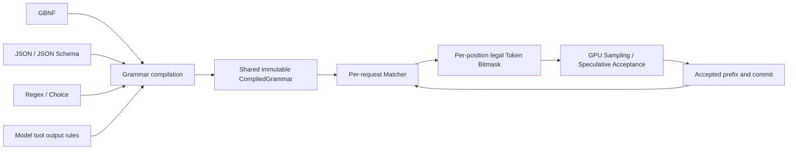

# Constrained decoding design

This document defines the architecture, functional semantics and execution contract of NInfer constrained decoding. GBNF, JSON object, JSON Schema, choice, regex and tool constraints are implemented today, and they cover ordinary decoding, MTP, DFlash and DFlash2. Body constraints are used through `RequestOptions::constraint`, the CLI and three HTTP protocols; tool declarations belong to the Prompt, and call policy belongs to `RequestOptions::tool_choice`.

The goal is to let GBNF, JSON, JSON Schema and tool calls share one token-constraint mechanism, and to integrate it with the existing ordinary sampling, MTP, DFlash, DFlash2, thinking, streaming output and preemption recovery. NInfer keeps single-GPU execution, fixed resident lanes and native C++/CUDA execution.

Overall choice: vendor the CPU core of XGrammar; the Frontend builds a grammar that matches the model's output semantics; the request owns the matcher; the Session manages logical commits, and the RankProgram manages the bitmask buffers and execution timing; Sampling Ops build the target distribution inside the legal set. Model state, grammar state and user-visible output advance along the same commit boundary.

## 1. Function and semantics

### 1.1 One underlying mechanism, several constraint entry points



GBNF is the direct grammar input, and it is the smallest complete way to use the underlying mechanism. JSON Schema and tool rules build the same runtime objects through compilation; the sampling operators do not branch on JSON, GBNF or tool type.

The constraint controls the legal set of the next token. The complete bytes of a candidate token must be accepted by the current grammar state; a token can span several punctuation characters, rules or output stages, and it can also contain only part of the UTF-8 bytes.

A constrained output that completes normally must satisfy the declared language or the declared schema subset. A length limit, context exhaustion or cancellation can leave an incomplete result. Structural conformance and factual correctness of the content are different properties.

### 1.2 Scope of the constraint

| Request form | Constrained object | Initialization point |
|---|---|---|
| JSON, schema, GBNF, regex, choice for a new Chat reply | Final content | Start of the body text added by this request; thinking is covered by the model's outer rules |
| Direct grammar for a raw token/text continuation | All added text | After the prompt; the prompt is not automatically treated as a grammar prefix |
| ContinueFinalAssistant | The join of the existing last assistant body and the newly generated suffix | Initialize the matcher with the last body prefix |
| Tool constraint | The model's native tool envelope, call policy and parameter values | Start of this assistant output, including the allowed thinking/content |

The constraint belongs to the Generation request. Ordinary CausalScoring does not enter this path. Vision only affects the construction of the prompt; the same output constraints are used afterwards.

### 1.3 Completeness and sampling semantics

Three facts must be recorded separately:

- The current token prefix can still be continued according to the grammar.
- The current content is already in a state where ending is allowed.
- Whether the request ends in the normal constrained-completion way.

For example, the grammar `root ::= [0-9]+` already allows ending after generating `1`, and it still allows more digits. "Ending is allowed" must not be equated directly with "ending is now forced".

Constrained decoding defines a new per-token distribution. It is not equal to the global conditional distribution of the original model under "the whole final text satisfies the grammar". Speculative decoding preserves the per-token target distribution defined in the same way as ordinary constrained sampling.

## 2. Source and module boundaries

### 2.1 Vendor XGrammar

The source is in `third_party/xgrammar/`, maintained in the same way as `third_party/llama-jinja/`: pin the source version, keep the provenance and licence information, have NInfer maintain the modifications it needs, and absorb upstream changes as needed.

The starting point is the CPU core and its dependencies, including grammar parsing and compilation, JSON Schema/regex conversion, vocabulary indexing, matcher, bitmask and rollback. Keep the recursion, Unicode and token-level rule capability that GBNF needs. Python/TVM bindings, upstream CUDA/Triton integration, examples and unrelated build branches do not enter the product target.

The product build uses an explicit source list and a separate CMake target. The small dependencies that the core needs today, such as picojson and DLPack, are managed inside that boundary; DLPack is used only for the library's CPU tensor view and does not enter the NInfer public API or the CUDA Op contract.

The following parts may be customised directly:

- Make the compiler return a structured error for assertions it cannot enforce, instead of warning and then relaxing the semantics.
- Provide a caller-owned bitmask view, and reduce intermediate allocations and format conversions.
- Expose the capabilities needed for reliable mark/rollback/preview.
- Optimize vocabulary processing, temporary state and compile caching for real workloads.

Source pruning follows the rule of keeping the complete dependencies of the selected CPU features. Not every pre-existing type inside the library needs to become part of the NInfer public contract.

### 2.2 Division of responsibility

| Owner | Responsible for |
|---|---|
| Third-party CPU core | Grammar, tokenizer-aware compilation, matcher, legal set and rollback |
| NInfer public request contract | User constraint types, body constraints, tool selection and strict intent; third-party types are not exposed |
| Generic text constraint adaptation | Schema validation and composition reduction, source location, shared compile resources, CPU bitmaps and temporary matcher operations |
| Model Frontend | Raw vocabulary and control tokens; thinking/content/tool envelope; continuation prefix; tool value representation |
| Request OutputSession | Mutable matcher, output parsing, preview and formal commit |
| Engine | Request lifecycle, frozen request/row mapping, decision input preparation, batch commit and result publication |
| Session | Native generation transaction, logical frontier, accepted prefix and adoption of execution results |
| Executor / RankProgram | Owning decision messages, Device/pinned buffers, per-position permutation, CUDA Graph and physical commit |
| Sampling / Speculative Ops | Legal candidate filtering, probability normalisation, p/q acceptance, residual and sampling result |
| Gateway / CLI | File acquisition, protocol field translation, protocol errors and response encoding |

Generic adaptation lives in `src/text/`; Qwen output semantics live in `src/models/common/qwen/frontend/`. The execution data contract belongs to `src/runtime/contract/`, and the physical consumers are owned by the RankProgram/Ops.

## 3. Request input and compilation

### 3.1 Request representation

The public request owns an optional body constraint, expressing one of the following:

- JSON object;
- JSON Schema document;
- GBNF text, with `root` as the entry rule;
- regex;
- finite string choice.

The body constraint uses `OutputConstraint` inside `RequestOptions::constraint`, distinguishes Grammar, JsonObject, JsonSchema, Choice and Regex with an enum, and owns the source text or the literal list. The runtime does not read files. CLI grammar/schema files are read during input preparation; HTTP converts the field content directly into request data.

The tool constraint comes from the owning tool definitions and the tool policy: the name, parameter schema and strict flag of every tool, plus auto/none/required/named and whether several calls are allowed. It comes from the same request facts as the tool definitions the template receives; execution does not extract the schema backwards from the rendered prompt text.

Keep the division between `prepare(PromptInput)` and `submit(PreparedPrompt, RequestOptions)`. The PreparedPrompt holds the parsed tool definitions, the starting output stage and the necessary continuation prefix; the tool selection policy and the body constraint are combined with these facts at submit time to build the OutputSession. The CompiledGrammar and the matcher are held by that OutputSession, and ordinary `count_tokens` does not compile the output constraint.

JSON object / JSON Schema can be combined with an active tool set. The output language of Auto is the union of the JSON body and the complete tool sequence; Required / named allow only the tool sequence in this round; None allows only the body. The combination of GBNF, choice or regex with an active tool set is rejected at preparation time.

### 3.2 Preparation flow

```text
Protocol/CLI translation of the owning request
  → prepare: the Frontend renders the prompt and determines the output stage and the continuation prefix
  → submit: reserve the outstanding slot and prepare the OutputSession on the calling thread
  → validate the constraint type and the feature combination, and query the cache by source content and model output envelope
  → on a miss, validate the schema, convert it and compile the immutable grammar
  → create and initialize the request matcher
  → join the existing waiting queue
```

Compilation happens at the calling-thread preparation boundary where `make_output_session` already lives, outside the Engine worker; it does not compile while holding the queue/execution mutex. It occupies an existing outstanding slot and releases it on failure. Cold compile latency counts towards request preparation; a compile cache hit reuses the grammar and creates a new matcher. The parameter-representation analysis for strict tools belongs to request preparation, and it uses the same schema reduction result as the grammar.

submit still builds the request synchronously and returns a handle, and a cold compile can lengthen that call. The pending deadline does not move later because of compilation; the deadline and the Engine state are re-checked after the library call returns and before enqueueing. Cancelling generation is handled along the existing handle/consumer mechanism, and it does not add a scheduler for preemptible compile tasks.

The initial mask can be checked and cached at preparation time. If a generation request already has no legal token at the initial position, return a request error. An empty set on a later temporary spec branch must not fail the whole request early; see section 7.

### 3.3 Vocabulary adaptation

Use the raw bytes and the valid/special flags of `decoded_token(id)` that the model Frontend has already parsed, so the token domain stays consistent with the sampling operators. The vocabulary is adapted only once:

- Do not run a display-layer decode first, do not replace incomplete UTF-8, and do not re-normalize with NFC.
- Padding, invalid IDs, Vision-only and other non-generatable tokens do not enter the ordinary text candidates.
- Ordinary text tokens match by their bytes.
- EOS is the completion control; necessary special tokens such as thinking are allowed only in the corresponding model rules.
- Ordinary token spelling and special-token identity for the same visible string are handled separately.

NInfer provides these classifications explicitly. The upstream `TokenizerInfo` default judgement for special tokens cannot replace the model Frontend's facts. The adaptation can receive explicit classifications through the vendor interface; it does not infer semantics by treating every control token as an ordinary string.

### 3.4 Compile sharing and memory

Each Frontend holds a compiler/cache bound to the current vocabulary. The CompiledGrammar is immutable, and the OutputSession holds a shared reference.

The constrained vocabulary index and compiler are initialized thread-safely on first use of a constraint; their cost belongs to that prepare. The ordinary tokenizer keeps its existing initialization. Requests that do not use constraints do not trigger extra CPU index construction.

The cache key consists of the constraint type and source content, the compile options and the model output envelope. The body start stage can produce a different envelope; the specific body prefix of a continuation only advances the new matcher and does not enter the compiled grammar identity. Different vocabularies use different compiler instances.

JSON sources are parsed and serialized in an order-preserving way; the declared property order is part of the generated layout, and it must not be sorted arbitrarily and then presented as semantically identical in order to raise the hit rate. regex uses the source text and the compile options as its key.

Reuse the library's thread-safe compile cache. Concurrent cold compiles with the same key share one build result; the cache lock does not cover the whole compilation of different keys.
At most two cold compiles run at the same time per model, each on its own submit calling thread, single-threaded inside; a cache hit does not occupy a cold-compile slot.
GBNF, JSON object, JSON Schema and regex use the kind, the source text and the model output envelope as the cache key; choice uses the normalized literal set. Validation, conversion, envelope and vocabulary compilation all complete inside the same bounded build on a cache miss; a hit does not re-parse or re-convert. The continuation bytes are used only to initialize the matcher.

The design default compile cache budget is 256 MiB, configured as the Engine startup option `grammar_cache_bytes`. The budget limits the compiled results retained in the cache; an object that a request is using can survive after being evicted from the cache, so it is not a total hard cap on process RAM. The vocabulary index, active matchers and compile temporary memory are accounted separately and are not deducted from the KV/GDN Host cache quota.

## 4. GBNF, JSON Schema and functional semantics

### 4.1 GBNF / regex / choice

GBNF uses the EBNF/GBNF text grammar supported by the vendor version, with `root` as the entry. It supports literals, character classes, sequences, alternatives, repetition and recursion. Syntax errors carry a line and column location.

The first public grammar contract adopts the language constraint itself. Extensions in the library that can change temperature, add an extra token budget or change generation behaviour are not implicit runtime parameters; those capabilities remain under NInfer's sampling and budget contract. Token-level terminals are validated against the current model's token domain and control-token rules.

Token terminals use the vendor's `Token(id, ...)` / `ExcludeToken(id, ...)` notation.
The GBNF entry does not expose the upstream `TagDispatch`, `TokenTagDispatch`, `Regex` or `Substring` constructors.
Keep XGrammar's `(= ...)` lookahead annotation syntax, which describes the legal suffix after a rule and helps compile the token mask;
the complete language is defined by the rule body, and the annotation should be consistent with the following rules. It follows the upstream compile-hint semantics and is not an independent regex lookahead constraint.
A user's direct grammar can reference ordinary generatable tokens; EOS and the reserved model control tokens are owned by the outer completion/stage rules and are not visible body terminals. The model envelope can use the exact ID of the corresponding control token.

Choice is built from literal grammar branches, preserving the case, whitespace and Unicode of the strings exactly, and it supports multi-token options and shared prefixes. The candidate list must not be empty; the empty string is allowed, duplicate candidates are deduplicated, and candidate order does not affect weights. If a short candidate is also a prefix of a long candidate, matching the short candidate allows both EOS and continued generation. The public interface is `OutputConstraint::choice(vector<string>)`.

Regex matches against the complete body, and the public interface is `OutputConstraint::regex(string)`; an empty expression allows only an empty body. It supports literals, Unicode characters, character classes, groups, alternatives and `*`, `+`, `?`, `{m,n}` repetition. Greedy and non-greedy forms describe the same legal set; no capture values are returned. Character classes follow ECMAScript semantics: `\d`/`\w` are ASCII ranges, `\s` includes Unicode whitespace, and `.` excludes `\n`, `\r`, U+2028 and U+2029. Escapes such as `\xNN` and `\uNNNN` are supported; non-BMP characters are written directly. The output contains only Unicode scalar values.

`^`/`$` are accepted only at the two ends of the expression or of a top-level branch; other positions, backreferences, lookahead and lookbehind assertions, word boundaries, Unicode property classes, flags, surrogate escapes and unknown escapes return a request error. `regex_converter` shares the character and escape normalization logic: regex uses full matching, and the JSON Schema `pattern` keeps search matching. Invalid candidates or expressions use `InvalidChoice` / `InvalidRegex` respectively; a generation prefix that cannot continue uses `ConstraintDeadEnd`.

Both share the existing compile cache and matcher. The cache identity of Choice is built from the deduplicated literal set and does not depend on token splitting; full matching and JSON Schema search use different entry identities. The runtime, sampling and speculative backends continue to consume the same mask contract.

A raw grammar does not automatically inject a prompt. The constraint is responsible for the candidate space, and the user prompt is responsible for the task and the meaning of the fields.

### 4.2 Execution contract for JSON and Schema

`json_object` compiles to the root object language; it is not an arbitrary JSON scalar. `json_schema` uses the root type that the user explicitly gives, which can be an object, an array or another supported type.

`src/text/json_schema.cpp` validates the source schema, and `schema_composition.cpp` reduces the supported combinations into a compilable schema graph while keeping source locations. The vendor is responsible for the string automata, the JSON / Qwen parameter representation and grammar construction. The supported range is as follows:

| Category | Semantics |
|---|---|
| Basic types | object, array, string, integer, number, boolean, null; a type array is expanded by the assertions that apply to each branch |
| Object | properties, required, additionalProperties (boolean or sub-schema); required names must be declared in properties; declared fields are generated in a deterministic order |
| Array | homogeneous items, or positional prefixItems plus trailing items, minItems/maxItems; the draft-07 items array and additionalItems reduce to the same positional contract |
| String | minLength/maxLength and pattern can be used together, and several patterns are intersected; format is not supported yet |
| Number | integer and number support minimum/maximum/exclusive bounds; integer ranges reduce to signed 64-bit, and the bounds can be converted from decimals; a bounded number uses int64 integers and a finite binary64 representation with at most 17 significant digits; multipleOf is not supported yet |
| Finite values | const, enum; integer literals are limited to signed 64-bit; candidates are filtered by the supported assertions at the same level, including type, range, string, object/array and logical combinations |
| Combination | anyOf is distributed over common assertions and then unioned; oneOf must prove the branches mutually exclusive; allOf supports intersection of type, range, string, object fields/required/additionalProperties, per-position array rules, trailing rules and local references |
| Reference | in-document `$ref`, `$defs`/definitions, including recursion and 2020-12 sibling assertions on a reference; external documents are not fetched |
| Annotation | title, description, default, examples, `$comment`, readOnly/writeOnly, deprecated and similar are kept as descriptive information and are not sampling assertions |

The check only traverses schema positions, and business objects inside const/enum are kept as values. Composition reduction is memoized by node and intersection, and recursion is still represented as a reference graph. An object intersection applies properties and additionalProperties branch by branch: a closed object in one branch cannot be reopened by properties added by another branch. If a field cannot possibly appear after merging required, the whole object branch is unsatisfiable.

prefixItems constrains only the positions that have already appeared, and the length is decided by minItems/maxItems; items acts only after the prefix of the same schema object. When the position is false or the intersection is unsatisfiable, the array can end before that position. Only when the minimum length requirement crosses that position does the array branch become unsatisfiable. The per-position intersection preserves the original prefix length and trailing rules of every branch.

A bounded number constrains both the generated decimal value and the value after protocol parsing and re-serialization. The compiler compares ranges in decimal digits and exponent, and tightens the floating-point generation language according to the rounding boundary of publishable binary64 values; integers keep the exact int64 path. Decimals support scientific notation, and common magnitudes also allow ordinary decimal notation, with at most 17 significant digits. A mathematically empty range returns unsatisfiable; a non-empty range with no publishable value returns unsupported. Numeric assertions or const/enum values in the schema that JSON parsing would round are rejected at the source input stage; annotation fields and non-strict tools do not apply this restriction.

After merging the common assertions, oneOf proves the branches mutually exclusive by type domain, finite value set, or the finite values of a common required discriminator. Type-domain judgement includes that integer is a subdomain of number; a combination that cannot be proven returns unsupported.

An empty schema means any JSON value. When `$schema` is not specified, 2020-12 semantics apply, and the supported subset of an explicit draft-07 is also accepted. Draft-07 sibling assertions on `$ref` return unsupported; allOf can express the intersection explicitly. A root `$id` serves only as document identity, and a nested `$id` is currently rejected. Boolean sub-schemas are interpreted by their position, for example additionalProperties=false.

Specific rules:

- Standard defaults are interpreted according to the schema. For example, when additionalProperties is absent, it must not be silently changed to false because of the library's internal strict_mode. The protocol's `strict` and the library's compile option of the same name are handled separately.
- `oneOf` is rejected when exclusivity cannot be implemented, and is not downgraded to anyOf.
- XML excludes combined with schema pattern/length and similar must all hold at the same time; when the intersection cannot be compiled, return unsupported.
- Conditional/dependency keywords, uniqueItems, contains, multipleOf, patternProperties/propertyNames, minProperties/maxProperties, unevaluated* and other assertions outside the basic contract above are explicitly rejected.
- Unrecognised assertion keywords and combinations that would be ignored return an error located at the JSON Pointer. There is no relaxed route of "compiles successfully but only prints a warning".
- Do not enable the `any_order` option, which would lose required/duplicate-key semantics. The generated language can use a deterministic property order, and the output value must still satisfy the schema.

The schema semantics of `pattern` is matching against the string value, and the matching mode of the full-text regex entry cannot be applied to it directly. Length counts decoded Unicode characters, and escape forms do not change the value's length; control characters, quotes and backslashes in a JSON string must be escaped legally. An empty result after filtering finite const/enum candidates, or a recursive definition with no obvious generating branch, returns unsatisfiable at compile or initial-mask check time, instead of removing the constraint.

A pure string length constraint uses counted repetition of the JSON scalar, with the closing quote and the repeated body in the same rule. The compiler normalizes repeated bodies with a determinable unit boundary into a byte DFA, and precomputes a dense bitmap or sparse set for the repetition quota the token needs, including UTF-8 and escape intermediate states; dynamic counts are still owned by the parser history and take part in the same rollback. Different length upper bounds share the repeated body, and the number of rules and bitmap buckets does not expand with the bound. Tokens that cross out of the string and consume following syntax keep exact matching. The combination of pattern, length and tool-end-marker exclusion continues to use the constraint-intersection automaton.

JSON uses the compact `,` / `:` separators and the declared field order. String length and pattern grammar use canonical JSON escaping; a continuation must be a prefix of this generated language. `pattern` searches against the string value and supports character classes, groups, alternatives, repetition and `^` / `$` at the two ends of a top-level branch. The dot and whitespace classes follow the ECMAScript character sets; backreferences, zero-width assertions, Unicode property classes, surrogate escapes and unrecognised escapes return unsupported, and Unicode characters can be written directly.

Combined compilation has explicit limits: at most 16384 intersection merges per reduction; a finite-value recursion check depth of at most 256; the explicit length bound for string-automaton intersection is at most 8192 Unicode characters, and the intersection result has at most 65536 states. Exceeding a limit returns unsupported. Finite enumerations are filtered directly and pure length constraints follow their own path, so no string-intersection automaton is built for them.

These rules are the contract shared by response schemas and strict tool parameters. The supported range may be extended later, and each extension adds both semantics and independent verification; the runtime structure does not need to change.

### 4.3 Tool constraints

Tool constraints split into three independent choices: the basic structure such as the envelope/name, the per-tool strict parameter schema, and the call selection and count. `ToolChoice` owns Auto/None/Required, the optional allowed_names, parallel and Automatic/Basic; the three HTTP protocols map their fields onto this common contract.

By default Basic enables structural constraints for requests that have tools, including ordinary Auto + non-strict. The model chooses the body or a tool call by itself; once it enters a call, the function name and the envelope are constrained. An explicit Automatic enforces only the strict, allowed_names, Required, None or parallel=false requirements that the request states, and ordinary Auto + non-strict can generate freely.

The basic parameter language for non-strict tools allows any order and any representable parameter name; it does not close the parameter set according to properties, and it does not force required or parameter-value assertions. Complex root schemas and open objects do not trigger the strict compiler. The top-level parameter names of each call must be unique, compared exactly by the name bytes; different calls may reuse a name. The static grammar constrains the envelope and the encoding, and the request-exclusive name state tightens the bitmap before sampling, preventing a duplicate parameter header from closing. Strict parameters continue to be generated in declared order and forbid duplicates.

The parameter encoding is decided at preparation time by the shared contract. In non-strict mode, a type hint that explicitly allows string keeps the raw string representation; a type hint that explicitly excludes string uses the JSON value encoding. Basic only requires the latter to have legal JSON syntax and allows a JSON value that does not match the type hint, for example `"tomorrow"` under an integer hint. Bare text `tomorrow`, an empty block or `True` are not JSON encoding, and no quote insertion, empty-parameter omission or boolean case conversion is performed. Parameters with an unknown name or an undeterminable type use buffered normalization: after the current parameter ends, strip the outer formatting whitespace; legal JSON keeps its original text and other text becomes a JSON string.

Auto allows zero or more calls; Required at least one; parallel=false sets the upper bound to one. OpenAI named maps to Required + single name + parallel=false; Anthropic named uses a single name and honours disable_parallel_tool_use. None keeps the prompt declaration and forbids generating `<tool_call>`; when combined with a body constraint, the body constraint owns the output language. Every choice keeps the complete declaration and the cache marker positions, and none is implemented by deleting or editing the prompt tool list.

The ordinary body of Auto can come before the tool sequence, and Required starts the call directly. After entering the call sequence, only subsequent calls and EOS are allowed; a single newline separates calls. The final `arguments_json` of every strict tool satisfies its parameter schema.

When JSON output is also specified, Auto chooses between the JSON body and the tool sequence, and the two outputs are not mixed in the same round; even with `constraints=Automatic`, the tool branch still uses the basic envelope constraint. Required / named generate calls in this round, and after the tool results are committed the next round can switch to Auto and generate JSON. The supplied JSON schema is still validated every round.

The combination builds only one CompiledGrammar and matcher, and the thinking envelope sits outside the union. The OutputSession chooses the publishing branch at the first formal body character: the JSON start character and `<tool_call>` do not intersect. The JSON branch bypasses tool parsing, so `<tool_call>` inside a string keeps its original form. Preview/discard does not change the branch; a continuation is initialized from the existing body prefix.

The Qwen tool syntax uses the existing `<tool_call>`, `<function=...>`, `<parameter=...>` representation. The Frontend builds two products from the same parsed tool definitions: the generation grammar and the output-value decoding contract, so the two sides do not interpret the types separately.

The physical text of strict parameters uses explicit framing. A string parameter is shown below in escaped form:

```text
<parameter=city>\n上海\n</parameter>
```

The two `\n` in the example above are the actual framing newlines. Decoding removes only that pair of newlines; leading and trailing whitespace of the string itself is preserved. Numbers, booleans, objects and arrays use legal JSON value text; nested values continue to be constrained by the schema.

The choice between a Qwen raw string and a JSON value must be unambiguous. A pure string parameter uses the raw string; a type union that does not contain string uses the JSON value. For the same raw parameter that contains string and other types, if the branch cannot be determined from the model format, the strict combination is rejected at preparation time; the existing "if string is allowed, interpret everything as string" rule cannot be used to claim that the other branches also execute correctly.

The parameter-end delimiter of a raw string is `\n</parameter>`, and this text must not appear in the value. The grammar and the parser use the same delimiter rule, and strict output generates only values that can be represented losslessly; when a required value such as a const/enum cannot be represented, return an explicit error and do not modify the value. The pattern/length of the string and the delimiter exclusion hold at the same time. The outer framing has no optional whitespace, which avoids classifying value whitespace outside the schema. Strict nested JSON uses the template's `, ` / `: ` separators, including for const/enum objects; integers are limited to signed 64-bit, and numbers use a finite binary64 parseable representation.

The root node of tool parameters must reduce to type=object, possibly through a local $ref or a supported allOf combination. The strict route uses the declared finite parameter names and property order: additionalProperties=false is required; when it still reduces to a root const/enum/anyOf/oneOf, return unsupported. Ordinary JSON responses support the additionalProperties defined in the table. Duplicate names in the tool definitions are rejected at preparation time.

Tool output is driven by the committed text increments: after the complete function header in the declaration is recognised, publish ToolCallStart; while the parameter is being transcoded, publish ToolArgumentsDelta; after the model call envelope closes, publish the Complete ToolCallEnd. The concatenated increments of each call agree with the aggregated arguments_json bytes. Truncation produces an Incomplete call and the raw JSON prefix, keeps the actual interruption cause, and does not insert quotes or brackets or fabricate executable parameters. The protocol ID is owned by Serve.

RawString parameter increments are JSON-escaped and preserve the value inside the framing; JsonValue parameters track quotes and escapes according to JSON lexis and preserve numeric literals and member order. JSON encoding reuses the publishable numeric domain and Unicode scalar rules of tool values, so that `1e999` or an unpaired surrogate is not generated and then fails at decode time. Both can publish without waiting for the complete parameter. BufferedNormalize buffers only the current parameter and cannot decide the output type early from a leading `{`, `[` or `"`; parameter bytes already published are never rewritten. Large parameters of unknown type can still have parameter-level output latency.

Free generation keeps the body fallback only until a valid tool header is confirmed; a malformed structure, duplicate parameter or JsonValue encoding error after confirmation produces a request-level InvalidToolOutput. If a normal constrained output of Basic or strict disagrees with the decoder, that is an internal contract violation and is not classified as an ordinary model output error. Both abort the sequence at a stable commit boundary and settle the corresponding error; when the physical resources can be cleaned up normally, the other requests in the same batch are not affected. Truncation caused by length, context capacity or cancellation is Incomplete, not a format error.

Implementation ownership: `tool_contract` parses the declaration and determines the parameter encoding; `tool_grammar` builds the mutually exclusive known-name and open-name branches; `tool_name_constraint` maintains the rollback-capable top-level name set; `tool_call_parser` decodes the committed text. The static matcher and the name state are coordinated by GrammarSession through the same set of lookahead/accept/confirm/discard operations. Each speculative position first computes the legal set of both and then advances the draft; the whole batch's static bitmap must not be filtered afterwards. The candidate check consumes all bytes of the token, including cases where one token crosses a parameter or call boundary. Tool markers in body JSON and in thinking do not change the name state.

Compiled grammar follows the Frontend's shared budget and cold-compile limits. The Basic cache identity includes the parameter names and the encoding layout; the remaining schema hints stay in the request contract. Vocabulary bytes and boundary candidate indices are shared per compiler, and already-seen names do not enter the shared cache. Continuation initializes the matcher, the name state and the decoder together; it can advance to the first incomplete call, and a raw assistant prefix that contains a completed call is rejected. Existing parameters are published only once when that call is initialized, and new bytes are appended afterwards; these prefix bytes do not count as newly generated tokens.

## 5. Thinking, body and continuation

### 5.1 Shared output envelope

The Frontend owns Qwen's output stage rules, and the grammar and the OutputSession's publication decoding use the same rules. The runtime does not use a separate set of boolean variables to guess whether thinking has ended.

For a constrained Chat:

- The prompt is already in the body stage: start the body grammar directly.
- The prompt is still in thinking: allow free reasoning, then match the model's agreed close sequence, then enter the body or tool rules.
- The early EOS in that reasoning branch must be restricted, otherwise it could generate only thinking and "complete normally" a JSON request.

The constrained route uses Qwen's existing canonical reasoning close: `\n</think>\n\n`. The end marker and its fixed separator newlines are the model envelope, not user body text. The grammar and the decoder both recognise this framing; after it ends, the body bytes are published as they are, and leading whitespace is no longer trimmed without bound.

Free reasoning must not let the decoder and the matcher enter different stages through another early-close spelling. The model envelope rules are composed at the token-bytes level, which supports both crossing token boundaries and one token containing both the end of the close sequence and the start of the body.

For example, if the user grammar requires the body to start with a space, that space after the canonical framing belongs to the body and must be preserved. JSON mode uses the same boundary, so it does not need to rely separately on "JSON may ignore whitespace" to avoid the problem.

When a body constraint is present, tool-marker extraction is not enabled, and a legal `<tool_call>` string in the body is still published as body text. The body/tool constraint of Chat is not combined with `output.raw=true` or with options that publish special-token text; the raw token/text grammar publishes all added text under its contract and hides the terminating EOS.

### 5.2 Thinking budget and forced control

Keep the existing thinking budget. Before execution, `model_token_budget_remaining()` limits the length that can be produced in this round, and the control string is injected after the committed rounds.

Fixed control tokens advance through preview/commit of the same matcher: first check the control string and the close boundary, and only after the Session confirms that the append is complete are the matcher and decoder states confirmed. The control string does not call the sampler, does not consume sampling RNG, and counts towards the total output budget along the existing contract.

Do not add a second thinking-token count just for the grammar. A stage change in lookahead can be rolled back; the formal budget still advances only through real commits.

### 5.3 ContinueFinalAssistant

The current product allows continuation when thinking is closed and the last assistant message is plain text. Constrained mode keeps this capability: the matcher first accepts the provided prefix of that body, then constrains the new suffix.

The prefix is determined with the source region and message layout that the Frontend already has for the template rendering result. It must be confirmed that this sequence is the body the caller wants to continue; when the template changes the content or inserts an unexplainable body wrapper, request preparation reports an error, instead of guessing from the user string or the token length alone.

Initialization uses a byte-prefix operation: the prompt's BPE tokens may contain bytes outside the body start, so the whole prompt token sequence is not fed into the matcher. This initialization belongs to the request start, does not consume generation budget or RNG, and is not executed again in Replay.

The result publishes only the newly generated suffix. The completeness contract applies to "provided body + new suffix"; for example, the prefix `{"name":` and the suffix `"上海"}` form a complete object, and the suffix itself does not need to be JSON on its own.

Raw token/text input has no assistant source semantics, and the grammar starts from the added text. Ordinary prefix reuse, session continuation and ContinueFinalAssistant are different concepts; a cache hit alone does not initialize a matcher that has already advanced partway.

## 6. Matcher transaction and lifecycle

### 6.1 Request-owned state

The matcher belongs to the OutputSession and follows the Request from waiting, through resident and paused, to the terminal state. Only the Engine worker advances the matcher of an active request. A matcher created during preparation is handed over after submit and is not modified further by the consumer or the compile thread.

The CompiledGrammar is shared; the matcher, decoder and temporary previews are not shared across requests. A Lane, KV row or compact row is only the current execution mapping and cannot serve as the grammar state identity.

### 6.2 The three operations

| Operation | Produces temporary state | When it becomes formal state |
|---|---|---|
| Lookahead that builds the mask | Temporarily accepts the draft, rolls back at the end | Never commits by itself |
| Output preview | Accepts the actually produced prefix, and previews the decoder, EOS and budget | After the Session accepts the commit receipt and adopts the logical state |
| Forced control preview | Accepts the fixed control string, previews the stage change | After the Session returns ControlComplete |

The implementation uses a mark/rollback transaction within one call, and does not deep-copy the whole matcher history every round. Lookahead always returns to the baseline; output preview can leave the matcher in a provisional state, and commit confirms only the advances that completed, while discard returns to the mark.

preview and lookahead are mutually exclusive, and the next round's mask cannot start while an uncommitted preview exists. Every token acceptance that can fail, the structural checks and the required allocations complete inside preview; the matcher commit after the model commit is accepted is a confirmation operation with no allocation and no grammar check.

When a token crosses the model framing and the body boundary, the transaction records the complete state change caused by that token. It must not roll back only by "the number of tokens handed to JSON" and thereby miss the boundary-matching progress.

### 6.3 Alignment with the existing PendingBatch

A normal successful row still satisfies: a nonterminal accepts all produced tokens; a terminal can accept only a non-empty prefix. A cancelled row accepts zero tokens. Switching thinking/content is not terminal, and the per-position constraint must let the remaining tokens of the round continue normally.

```text
Session produces the owning PendingBatch from ResultReady
  → preview the actual output for each row and determine the accepted prefix
  → the Executor accepts the physical commit of that prefix, and the Session adopts the ledger and the native frontier
  → confirm the matcher, decoder and budget of that prefix
  → publish the user events
```

If preview fails, all unconfirmed matcher previews of that batch are restored first, and the Session's PendingBatch aborts along the existing transaction. When the model commit acceptance fails, the grammar state is not confirmed and this round's content is not published.

### 6.4 Preemption, recovery and release

A pause happens only at a stable commit boundary, and the formal matcher stays in the same Request. After Snapshot or Replay restores the physical state, the next round's mask is generated from the retained state. Replay does not call grammar accept, output preview or forced-control publication.

When the request ends, release the matcher and the request reference; the compile cache can keep the compiled grammar. An ordinary prefix cache stores only the original model state and does not store a mutable matcher.

XGrammar's current Earley implementation keeps the parse history, and the `max_rollback_tokens` parameter can no longer be treated as a memory bound. NInfer only requests bounded lookahead/preview rollback, but it does not claim on that basis that matcher memory is O(K). The active parse state grows with the request's output length and the grammar complexity; the whole history is not forked every round, and old charts still referenced by the parse state are not deleted arbitrarily.

## 7. Bitmap and sampling data contract

### 7.1 Layout

Let the token domain be V, the number of rows in this batch be B, and the maximum number of drafts be K. The bitmap stores `ceil(V/32)` 32-bit words per position, and bit 1 means allowed.

```text
mask[row, position, word]
word = token_id / 32
bit  = token_id % 32
```

An ordinary position needs one row; K proposals need at most K+1 rows, including the bonus when all are accepted. Each row carries the real proposal extent, and the valid length cannot be inferred from a fixed stride.

words use the convention that the lowest bit corresponds to the smaller token ID, and bits beyond V in the last word are cleared. The logical position of a fixed stride is `row × (K+1) + position`; the vocabulary dimension of the mask does not use the physical padding width of logits.

The draft list carried by DecisionNeeded contains only new proposals, not the anchor in the target verify input. Position 0 is based on the frontier of the request's committed output; the physical execution frontier of the current model can be one token less than the accepted ledger, and this accepted anchor must not be fed into the matcher again.

During startup capacity planning, the RankProgram allocates the pinned Host mask, the Device mask, the per-position state and the Host draft IDs/events that DFlash needs, for the selected backend and the maximum B. The logical region can be shared by the mutually exclusive prefill/decode stages. The mask capacity counts towards the Device/Host resource description, and no new Device allocation is created from a schema during a run.

A purely unconstrained batch does not request decision input, does not pass a mask, and does not run the mask check kernel. In a mixed batch, unconstrained rows use an explicit disabled description and do not materialize a full-vocabulary all-ones bitmap.

### 7.2 Per-position state

| State | Meaning | GPU consumption |
|---|---|---|
| Unconstrained | This row has no grammar constraint | The original sampling route |
| Ready | The current prefix is legal and the allowed mask has been generated | Applied before candidate filtering |
| DeadEnd | This hypothetical prefix has no legal next token | A request failure forms only when verification actually reaches that position |
| Unreachable | An earlier draft is already grammatically illegal or has accepted EOS, so further inference is meaningless | A safe placeholder is used and the final commit is not affected |

Unreachable does not mean the kernel will not read that column: the existing batch candidate construction may precompute several columns. All read fields of a fixed buffer must be valid; a placeholder distribution does not enter the visible accepted prefix.

The implementation uses a nullable `SamplingMask` to express an unconstrained row, packed words to express Ready, and a Host bit set to record DeadEnd positions.
The device columns of DeadEnd/Unreachable are filled with a safe placeholder; the Session checks whether the actual licensed extent passes a DeadEnd,
and hands the single-row failure to the Engine through the PendingBatch. A failed row does not commit the placeholder token, and the other rows commit normally.

The predicted position of the first illegal draft is itself still Ready and owns the mask of the legal prefix before it. What is illegal is the proposal token, not the target distribution used to reject it.

If a lookahead prefix can be accepted but can no longer produce a token, mark its next position as DeadEnd. If the target rejected the draft leading to that state earlier, the request continues normally; the whole request must not be ended directly while the CPU fills the mask.

### 7.3 Ordinary sampling

Read the logits over the vocabulary and apply the existing presence/frequency penalty. Illegal tokens do not take part in argmax, top-k or the later probability normalisation. Legal candidates are sampled along the existing temperature, min-p, top-p, tie-break and counter-based RNG contract.

Mask consumption is fused into the existing argmax/candidate construction, covering multi-block and fallback. Filtering only the selected top20 afterwards does not satisfy this contract; a legal token can be beyond the original 20th rank.

When there are fewer real legal candidates than top-k, the support uses the actual count. Negative-infinity entries used to pad the ranking capacity must not be treated as samplable tokens. An empty mask and non-finite model values are reported separately, and generation must not continue through token 0 or NaN.

### 7.4 P, Q and history

The target distribution of position i is determined by `committed prefix + draft[0:i]`: the corresponding grammar state, penalty history and model logits must use the same hypothetical prefix.

Let the penalized logit be z and the legal set be A; then first select the existing top-k candidates C over `v∈A`. At positive temperature, compute the weights as `exp(z_v/T - max_C(z/T))`, then truncate in the existing min-p, top-p order and normalise to p; for greedy, take the largest z in A and, on a tie, the smaller token ID. This definition is used both for ordinary sampling and for every speculative target position.

GBNF/JSON and the like do not own RNG. Mask generation, temporary rollback and compilation do not consume sampling random numbers. The existing RNG split by seed, logical position and purpose continues to be used, and a change of compact row does not reset the request's random stream.

### 7.5 Prefill, ordinary, control and Replay

| Execution position | Mask and matcher behaviour |
|---|---|
| Intermediate prefill chunk | Generates no new output, does not take a mask and does not advance the matcher |
| Prefill finalization | Provides the initial mask before the first token is actually sampled; the bitmap obtained from the preparation-time check can be reused |
| Exact prefix hit | `sample_from_hidden()` uses the same request mask and must not reuse the sampling choice of the cache creator |
| Ordinary decode | The Engine answers the DecisionNeeded of the current row; the rank samples after uploading the mask, and each request can have a different grammar |
| Forced control | No sampling; matcher preview as in section 5, committed with the physical append |
| Replay | Does not execute output constraints and does not re-accept history; the first new output after recovery goes through the normal mask route again |

For an ordinary graph that contains constrained rows, the mask address and the row descriptions use stable buffers; the graph topology distinguishes only the limited consumer routes that are genuinely necessary, and does not vary with the grammar content or the per-request output length. Intermediate prefill does not pay the matching cost again for the pre-generated first-token mask.

## 8. Speculative decoding

### 8.1 Per-position mask inference

```text
mark = the matcher's current committed position
for i in 0..K:
    mask[i] = the set of next tokens allowed by the current state
    if the set is empty: mark DeadEnd and stop the further inference
    if i == K: finish; the current row is the bonus mask
    if draft[i] is not in mask[i]: stop, and mark the rest as Unreachable
    temporarily accept draft[i]
    if EOS has been accepted: mark the rest as Unreachable and stop
roll back to mark
```

Lookahead can advance only along the actual chain of the proposal. Different requests are inferred independently; the current NInfer backend uses a bounded-length chain and does not introduce a general tree planner.

One constrained token inference includes the reasoning/content/tool rules, so it cannot roll back only the innermost JSON matcher while keeping the outer state that has already switched.

### 8.2 Acceptance distribution

The implementation uses target-only constraints, and the proposal uses the original distribution of each backend:

| Backend | Proposal distribution | Positive-temperature acceptance |
|---|---|---|
| MTP | Greedy, one-hot q | p(draft), residual after rejection |
| DFlash | Greedy, one-hot q | as above |
| DFlash2 | The actual sparse q of the 16 candidates | min(1,p(draft)/q(draft)), positive part of p-q after rejection |

p is the normalised target distribution after the grammar and the existing sampling transforms are applied. q is the distribution that actually generated the draft; q is not retroactively modified during verification, and the old q is not reused after replacing the draft ID.

A greedy target selects the argmax among the legal candidates; the unconstrained argmax already produced by the target forward cannot be reused as the final answer for a constrained row. A purely unconstrained row can still use the original fast path.

After all proposals are accepted, the bonus is sampled from the target p corresponding to its complete prefix. The first rejection produces a correction and ends the round; only the next round generates a mask according to the actual history of the correction.

### 8.3 An illegal proposal still has to go through rejection

If d_i is illegal, p(d_i)=0. That position keeps the real proposal and q and goes through the original rejection; it is not deleted and then treated as an ordinary bonus.

For example:

```text
p(a)=0.5, p(b)=0.5, p(x)=0
q(a)=0.5, q(b)=0,   q(x)=0.5
```

In the correct algorithm, proposal a is accepted, proposal x is rejected and b is chosen from the residual, giving 0.5 each. If x is deleted and the bonus is drawn from p, the result becomes a=0.75, b=0.25. DFlash2 must keep the former behaviour.

After EOS has been temporarily accepted, the terminated matcher is no longer called. A fixed-width GPU unit can precompute extra columns; the final OutputSession terminates at EOS, and the following candidates, grammar progress, penalty and model state do not enter the commit. If these columns are optimised away on the GPU in the future, their acceptance semantics must be equivalent.

### 8.4 MTP

Qwen3.5 and Qwen4Exp both generate proposals in the current decode unit, and then perform target verify and acceptance.
The draft list for the next round is not saved between rounds. In the stable state the Main frontier is F and the MTP history frontier is
max(F−1,0); this round generates drafts starting from the saved target conditioning and the confirmed anchor.

The constraint affects only the target distribution. The proposal's ID, extent and q keep their original mathematical definition; extent=0 and mixed
valid lengths are handled per row. After A inputs are actually accepted, the required MTP history is rebuilt from the target conditioning,
and then this round's temporary data is released at physical retirement.

## 9. Decision messages, device execution and commit

### 9.1 Data handover for the current round

The RankProgram emits `DecisionNeeded` when the draft IDs are readable. The Session forwards the ticket, the stage and
the owning draft list; the Engine uses the Request/row mapping frozen by that ticket to call the OutputSession's
lookahead and produce the owning `DecisionInput`. It contains only the constrained rows, with the per-position words and dead bits.

Ordinary sampling uses the same message with an empty draft list. An unconstrained batch advances directly; a mixed batch does not build a full-vocabulary all-ones bitmap for the unconstrained rows.
Neither matchers nor callable callbacks enter the RankProgram.

```text
Rank proposal / target forward
  → draft readable: DecisionNeeded(ticket, stage, drafts)
  → Engine: matcher lookahead → owning DecisionInput
  → Rank: upload the bitmap → sampling / acceptance → ResultReady
  → Session PendingBatch → Engine output preview
  → commit receipt → Session logical adoption → OutputSession commit → publish
  → DeviceRetired → CommitComplete and frame release
```

### 9.2 Graph and completion dependencies

The native RankProgram organises the Graphs of Main, proposal, sampling/acceptance and history commit according to mathematical dependencies.
Each stage continues to use exact-B, stable buffers and the context-update contract of the Op that owns it; grammar
content, request IDs and mask bytes are all execution inputs.

The draft-return completion event is separate from the last completion event of the target forward, which allows Host lookahead to overlap with device work that has already been committed.
`poll()` queries the readiness state and returns when it is not ready yet; it does not wait for the matcher callback on the call stack.
Bitmap preparation can finish earlier than the target forward, but the corresponding sampling must be ordered after the bitmap upload.

`DecisionConsumed` is emitted only after the actual H2D commit, and the Engine records the number of uploaded bytes. Receiving `supply()` does not
mean the upload has already happened. The drafts, the bitmap and the output are all associated with the same ticket, frame generation and frozen row order.

### 9.3 Ownership and lifetime

The RankProgram owns the Graph, the pinned IDs, the Host/Device mask and the completion events; the Graph is destroyed before its referenced
buffers and events. The Host mask must not be overwritten before the H2D completes, and the Device mask is kept until sampling or verification
ends. DFlash2's q and candidate IDs stay in the device.

After ResultReady, the target hidden, the verify records and the data needed for commit are still retained. The commit receipt
confirms the ordered acceptance, and only then does the Session adopt the logical frontier and allow output publication; the frame and the source leases are reclaimed only at DeviceRetired.
CommitComplete fills in the real-time observations that include the physical commit, and cancelled and failed rows also obey that retirement boundary.

The target features that DFlash consumes with a delay belong to the persistent storage of the residency until the next round's context append or
normalize completes; they are not released early with one round's frame. MTP history alignment completes within this round's commit.
When CPU lookahead fails, roll back the matcher's temporary state first, then discard the corresponding generation transaction; the resources are released only after the committed device
readers have finished.

## 10. Errors, termination and single-row failure

### 10.1 Request preparation errors

An invalid grammar, an unsupported schema assertion, a conflicting feature combination, an illegal token reference or an invalid continuation prefix returns a request error before entering the execution queue. Schema errors distinguish the body source from the tool parameter source; the reduction diagnostics map back to the source schema, and the protocol layer then fills in the original field path, including the Responses namespace and the Anthropic input_schema.

Runtime integrity errors are not wrapped as user schema errors. For example, inconsistent row membership, a matcher that cannot roll back, or a GPU physical commit that cannot complete are still handled along the existing boundary where the Engine is unusable.

### 10.2 No legal token at a reachable position

If the CPU already knows that the ordinary next position is DeadEnd, the request can be ended directly without committing a meaningless sampling. For DFlash or speculative lookahead, the actual verification path must decide whether a DeadEnd has been reached.

For this reason PendingBatch gains an explicit single-row result state that distinguishes normal production from a request-level constraint failure. A failed row commits zero tokens this round and is reclaimed through the Session's zero-acceptance commit and retirement semantics; the Engine completes the request as an error and accounts for it separately from a user cancellation. The other normal rows continue to complete this batch's commit.

Even if the failed row has internally verified several drafts, this round does not publish that uncommitted result; the output committed earlier is retained. The failed row does not consume this round's public generation budget and does not update the formal matcher. This extension only adds a single-row result distinction and does not change the nonterminal/terminal accepted-prefix rules for successful rows.

A non-finite logit, an illegal index or inconsistent mask/position metadata on the device is an implementation or numerical error, and it cannot be interpreted uniformly as "the user grammar is unsatisfiable". Every path avoids normalising over an all-negative-infinity support set.

### 10.3 Normal completion and explicit interruption

Normal completion uses the Frontend's explicit EOS set; the matcher opens EOS only when the output language allows ending, and it becomes terminated after EOS is accepted. EOS is not published as ordinary text and keeps the existing StopToken completion semantics.

The terminal observation distinguishes whether the constraint is enabled, whether the body is complete, and whether it ended normally through EOS. For example, a complete JSON that stops exactly at the length limit can be recorded as content-complete, but the finish reason is still the length limit; the ending cause must not be rewritten as an ordinary stop.

A request with a guaranteed body/tool constraint requires these model termination rules to be enabled, and it rejects extra stop strings, custom stop token IDs and options that publish EOS text. A raw grammar uses the same completion convention. The user can interrupt through a generation limit or a cancellation; the corresponding result is explicitly incomplete, and streaming receivers recognise it through the existing finish/error events.

A request with no token budget keeps the existing behaviour, and an empty output must not be marked automatically as successfully completing the schema. A grammar that accepts the empty string can allow EOS to be the first generated token.

On normal completion the constrained body stays valid UTF-8. When a length interruption falls exactly in the middle of a multibyte character, the existing display layer's terminal handling is kept, but the result is only a truncated display and it does not claim to still belong to the complete grammar language.

## 11. External interface

Every entry maps to the owning request of section 3, and no third-party object or callable callback is exposed to the user.

| Entry | Supported capability |
|---|---|
| Public Engine Generation | Body constraints and tool policy; raw token input can also use a direct grammar |
| CLI | `--grammar-file`, `--json-schema-file`, `--json-object`, `--regex`, repeated `--choice`; mutually exclusive choice of the body constraint |
| OpenAI Chat | json_object/json_schema in `response_format`; tool strict and tool_choice |
| OpenAI Responses | json_object/json_schema in `text.format`; tool strict and tool_choice |
| Anthropic Messages | JSON Schema in `output_config.format`; tool definitions, strict and tool_choice use the common tool contract |
| NInfer HTTP extension | grammar, regex and choice in `structured_outputs`, for direct language constraints where no standard protocol field exists |

A body constraint allows only one source. An error is returned when a standard response format and the NInfer extension are specified at the same time. The HTTP extension explicitly uses NInfer's own contract and does not claim to be a standard OpenAI/Anthropic field; no duplicate aliases such as guided_* are added.

An explicit JSON Schema response request enforces its supported assertions. The strict flag in the protocol is not a switch for "allow some keywords to be ignored". Tool strict=false keeps the existing non-strict parameter semantics per section 4, and the two uses are handled separately.

Do not automatically insert hidden system messages into the prompt. Tool definitions are provided to the model according to the existing template behaviour; when the meaning of the response fields needs to be explained in the prompt, the caller provides it. The choice of constraint itself does not change the existing prompt cache identity.

## 12. Performance and observation

### 12.1 Cost model

The capacity of one bitmap copy is:

```text
B × (K+1) × ceil(V/32) × 4 bytes
```

In the example with V=262144, one row is 32 KiB; with B=8 and K=15 it is 4 MiB. Host and Device are occupied separately, plus a small amount of position state and draft IDs. This is a capacity estimate, not the actual transfer time.

Core optimisation choices: vocabulary and compile reuse; the matcher advances per request; no full output replay every round; mask buffers are preallocated; the bitmap is consumed directly in the GPU; the speculative CPU mask overlaps the target forward; constrained and unconstrained share the native execution stages.

The masks of the rows are generated sequentially on the worker. Ordinary decode prepares the mask before sampling; speculative decode prepares it after the Forward commit. The compile thread and the active matcher advances each hold their own objects.

The draft stays unconstrained, which may lower the acceptance rate of a constrained workload. Report the actual accepted length and the total time; the target constraint is not relaxed in order to restore the acceptance rate. Jump-forward and dynamically skipping deterministic grammar strings are not part of this design's basic execution contract.

### 12.2 Statistics

`GenerationResult::constraint` exists when the matcher is enabled and records the formal commit state: `branch` is undecided/content/tools, `complete` means the current language allows ending, and `terminated` means EOS has been accepted. The continuation prefix takes part in these two states. A complete content that stops at the output limit can be complete=true, terminated=false, with the finish reason kept at its original value.

The same object records the compile cache hit/built/waited, the number of positions actually masked and the mask H2D bytes of successful commits. When `phase_timings` is enabled it also records the CPU seconds of OutputSession preparation, mask/lookahead/rollback and matcher accept/discard. A rolled-back inference is still work that was paid for, and the work count is not rolled back. The three HTTP entries and the inference bench all enable these timing observations.

Device wait and its `constraint_draft_wait_exposed_seconds` sub-item record only actual blocking waits.
The whole wall-clock time from submit to ResultReady is not recorded as a blocking wait during event polling; on the ordinary asynchronous path this item can be zero.
The complete generation latency and the per-round wall clock are measured separately, and Host commit, polling, matcher and result handling are accumulated by their actual execution intervals.

HTTP aggregate results, SSE terminal states, request_done logs and benchmark JSON use the same constraint representation. Prometheus request/cache/work counters are aggregated when a request settles, including cancellations and length interruptions; preparation failures and execution exceptions still use the original error counters. Draft wait is read from the Engine's global counter. Metric labels use fixed enumerations and do not contain grammar/schema content.

The input prepare and the constraint prepare inside submit are timed separately, and the total prepare includes both; the request queue wait starts when the grammar is ready and the request enters the waiting queue. The submit entry time is still used for the pending deadline and publication order. In the end-to-end combination for the first token, the preparation interval inside submit can be counted only once; it cannot both be added to prepare and also stay unchanged in the following wait/execution interval.

CPU mask work time may overlap with the GPU forward, and matcher work is already included in the existing Host time; these breakdown values are not added to the total wall time again. Mask upload records bytes and does not add a CUDA event or a device synchronization for statistics. The Compiled cache quota limits only the retained compiled results.

## 13. End-to-end walkthrough

### 13.1 GBNF and ordinary sampling

The user provides `root ::= "status=" ("ok" | "error") "\n"`. The CLI reads the source text, and the Frontend compiles it and initializes the matcher. The first token's mask allows any token whose complete bytes can match a prefix of that rule; the GPU chooses from the legal set. After generating `status=ok\n`, EOS is allowed and the output ends normally. All body bytes are published as they are.

### 13.2 Exact prefix hit with two different schemas

A/B use the same prompt and require an object field and a finite enumeration respectively. The compile resources can be reused separately; the two matchers start from their own starting points. When both requests hit the same model prefix, `sample_from_hidden()` still reads this request's mask. The hidden in the old cache does not carry the old request's output choice.

### 13.3 MTP rejects an illegal field value

The current grammar allows only `ok/error`, and the Host draft gives another value. The CPU generates the legal mask at its predicted position and marks the rest as Unreachable. The GPU's constrained p is 0 for that draft, and one-hot rejection produces a correction. The OutputSession accepts only the genuinely committed prefix and the correction, and the next round infers again.

### 13.4 DFlash2 random rejection

Use the a/b/x distribution of section 8. The proposal and the real q are first produced on the GPU; the CPU mask forbids x, and the target forward overlaps the mask work. When the GPU encounters x it still uses q to compute the residual and chooses b. x is not truncated into an ordinary bonus, and the final distribution is 0.5 each.

### 13.5 Thinking, exact whitespace and the control string

The request requires the body to start with a space, and the model is currently in thinking. The grammar contains the canonical close and the body rules; the space after the close framing belongs to the body and is preserved. If the budget is exhausted, the fixed control string is injected after a complete round; its matcher preview contains the whole string and is not limited by K+1. Forced close and natural close enter the same body state.

### 13.6 Strict tool with a whitespace string

The tool `lookup(city:string, days:integer)` is selected by a named choice. The generated language constrains the tool name, the required parameters and the parameter types. city uses canonical framing, and spaces and newlines in the value are preserved; days is a JSON integer. The parser produces the parameter JSON under the same contract. If the required const value contains a raw-parameter end delimiter that cannot be represented, preparation returns unsupported.

### 13.7 Assistant continuation and preemption

The last assistant body is `{"name":`. The Frontend confirms the exact rendered body region and initializes the matcher. After generating `"上` the request is paused; the matcher stays with that request. Replay rebuilds the model history without accepting the prefix again; after recovery it continues generating `海"}` and EOS. The public result is only the new suffix, and the prefix joined with the suffix satisfies the schema.

### 13.8 Unreachable errors and cancellation in a mixed batch

This batch has both constrained and free-generation requests. The hypothetical suffix of one draft reaches DeadEnd, but the target rejects it at an earlier position, and that request commits the correction normally. Another row actually reaches DeadEnd, so this round commits zero tokens and returns that request's error, while the other rows continue to commit. A cancelled row also commits zero tokens, but its terminal classification is cancellation. All temporary matcher states are handled according to their own row's result and are not bound to a reused lane.

## 14. Basis for design verification

Verification is organised around the following contracts, and tests are not established by the number of internal files:

| Dimension | Independent basis and key scenarios |
|---|---|
| Language and tokenizer | Enumeration results of known small grammars; punctuation across tokens, UTF-8, control tokens, shared-prefix choice |
| JSON Schema | An independent schema validator checks the promised subset; semantics of composition and references; error location for unsupported assertions |
| Sampling | A small-vocabulary FP64 oracle computes penalty, mask, top-k and normalisation; legal candidates beyond the original top20, insufficient support and empty sets |
| Spec probability | Independent p/q and residual; one-hot and real sparse q; illegal proposal, bonus, per-position rejection and the counterexample in section 8 |
| State transaction | Lookahead has no persistent side effect; preview/discard; EOS prefix; forced control; cancellation and single-row failure in a mixed batch |
| Request lifecycle | First token, exact hit, ContinueFinalAssistant, Snapshot/Replay; the matcher agrees with the real committed prefix |
| Final protocol result | JSON, exact GBNF bytes, thinking boundary, tool arguments, streaming end and truncation |
| Performance | Cold/hot compile, ordinary/MTP/DFlash/DFlash2, mixed batch; CPU work, extra wait, accepted length, TTFT and throughput |

Different numerical routes of a real model do not require logits or per-token output to be exactly equal. The sampling mathematics uses an independent oracle; the model routes are verified by structure, transactions and protocol results. Performance comparison uses the same model, constraint, sampling configuration and comparable workloads, and publishes the benefits and costs of every route.

## 15. Relationship to the existing implementation and references

This design reuses the worker, request ownership, PendingBatch and publication order of the [Engine architecture](engine-architecture.md), and the preemption-recovery contract of [Resource scheduling and context cache](resource-scheduling-and-context-cache.md). [DFlash](dflash.md) and the existing Sampling/Speculative Ops continue to own the proposal and the mathematical execution.

The constrained execution contract is concentrated in the owning decision messages, the mask data flow, constrained sampling, matcher transactions and single-row constraint failure. The artifact, weight binding, model formulas and KV/GDN cache identity do not carry the request constraint configuration.

The pinned source version and local modifications of XGrammar are described in the [vendor notes](../../third_party/xgrammar/README.ninfer.md).

Main references: [XGrammar C++ compiler](../../third_party/xgrammar/include/xgrammar/compiler.h), [matcher](../../third_party/xgrammar/include/xgrammar/matcher.h), [EBNF/GBNF](https://xgrammar.mlc.ai/docs/latest/defining_structures/ebnf_grammar.html), [engine integration](https://xgrammar.mlc.ai/docs/latest/using_xgrammar/engine_integration.html).
