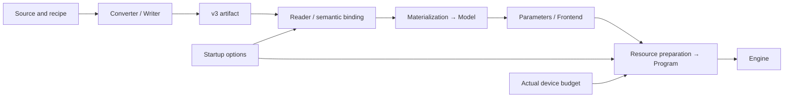

# NInfer Engine Architecture

This document is the maintainer authority for the global architecture, the request lifecycle
and the cross-module commit relations. It is written in English.

Top-level sections:

1. Product execution model: one GPU, one resident model, concurrency 1 to 8, a bounded FIFO
   queue, no preemption. Includes the Flash-Next family note.
2. The four execution boundaries: Gateway, Frontend, Engine, Program.
3. Single ownership: each fact has one owner: Scheduler, ResourceManager, Program, Engine
   lifetime, native parameters.
4. Request and resource lifecycle: request states, logical lane states, capacity, continuation
   and session.
5. Workers and scheduling: the single mutation owner.
6. The two commit transactions.
7. Terminal, cancellation, and failure.
8. Top-level constraints of physical execution.
9. Core invariants.
10. Implementation locations and neighboring authorities.
11. Adaptive expert tiering.

## 1. Product execution model

The NInfer Engine for the Generation purpose always runs:

- one GPU;
- one resident model instance;
- `max_concurrency=1..8`, fixed at startup;
- one bounded FIFO waiting queue;
- no preemption of an active request;
- each decode round forms all decode-ready requests into one compact batch.

Text, Vision, prefix reuse, MTP, DFlash/DFlash2, the CLI and HTTP serving all go through the public `ninfer::Engine` route.
MTP, DFlash and DFlash2 are execution backends inside the Program. They do not create a second request-scheduling or result-publication mechanism.
An artifact must provide Text; the private weights and resources of Vision, MTP, DFlash and DFlash2 may be absent.
Startup selects Vision independently, and none or one spec backend, and binds and prepares resources only for the selected features and their shared dependencies.

The same public Engine also provides the CausalScoring purpose, fixed at startup. It serves offline text scoring only:
`CausalScoreCore` calls the Program serially. A window uses temporary empty State and Main KV, and creates no request, continuation,
checkpoint or cache replica, and does not enter the Scheduler or the ResourceManager. Generation and CausalScoring
are not switched at runtime, and scoring-only staging is allocated only when CausalScoring starts.

`max_concurrency` limits the number of simultaneously active requests. It does not divide the shared KV capacity evenly among lanes. A request enters Active only after the Program
proves that its full execution resources are secured. After it enters Active, it does not lose the ability to complete because of another request or
because of the retention of an inactive cache.

This document does not cover multi-GPU placement, active request preemption, priority/QoS, a context store shared across Engines,
or large-scale continuous batching. Those workloads need a redefined admission and fairness contract. They cannot be extrapolated directly from the current
low-concurrency model.

### Flash-Next family

`Qwen3_8FlashNextForCausalLM` is a separate fixed 125B-A6B implementation under
`src/models/qwen3_8_flash_next` and `src/models/qwen3_8_flash_next_125b_a6b`. Its v3 loader binds
selected components and maps the PLE table across payload shards. The Engine selects the family
at the closed registry boundary and carries family-specific prepared prompts and Programs in
opaque alternatives. Flash-Next owns its frontend, state, Text/Vision/MTP schedules, pressure
planner and CUDA Graphs; it does not specialize the Qwen3.5 runtime. Both families implement the
same common scheduling and publication contracts. Its exact mathematics and binding requirements
are in the [model](qwen3.8-flash-next-125b-a6b-model.md) and
[artifact](qwen3.8-flash-next-125b-a6b-artifact.md) references.

### 1.1 Architecture and weight instances

Model code owns the mathematical formulas, the call order, the component handover and the state transitions. The config supplies instance parameters such as layer count, dimensions, the Attention/GDN
distribution and expert geometry. The current standard architecture entry points are `Qwen3_5ForCausalLM` and
`Qwen3_5MoeForCausalLM`; a training instance and its physical weight allocation enter the matching implementation as data.

A V3 artifact holds the configuration, the physical objects, the Binding of logical parameters, the Use of each site, and the Frontend resources.
The converter owns source mapping, quantized or value-preserving import, fused storage, packing and layout conversion. The loader validates, reads and uploads the original bytes
according to the actual bindings. The same architecture with a supported configuration, replacing the training weights or combining existing representations, reuses the same model code.



`metadata.name` supplies the public instance name, defaulting to the architecture name; serving may override the public alias with `--model-id`.
These names and the conversion provenance identify the data and its source. Execution selection depends on the architecture, the configuration and the actual bindings.

The file and reference contract is in [Artifact Container](artifact-container.md). The numerical interpretation of weights and the planes are in
[Tensor Formats](tensor-formats.md) and [Storage Layouts](storage-layouts.md).

---

## 2. The four execution boundaries

The request path has exactly four layers:

```text
Gateway
  │ product/protocol input
  ▼
Frontend
  │ PreparedPrompt / OutputSession
  ▼
Engine
  │ request order / lifecycle / publication
  ▼
Program
    physical resources / model execution
```

### 2.1 Gateway

The Gateway is the CLI, the HTTP server or another product entry point. It owns:

- protocol parsing, connections and the streaming transport;
- conversion of messages, tools and media into the common input;
- URL, path and data acquisition;
- response schema, usage and product-side errors;
- the Gateway's own concurrency and connection lifecycle.

The Gateway does not choose request order, cache source, active lane or KV page.

### 2.2 Frontend

Frontend owns the model family's input and output semantics:

- tokenizer, chat template, Vision preprocessing and MRoPE prompt construction;
- the owning `PreparedPrompt` and its content identity;
- stop, thinking/content channel, detokenization, final text and model-private structured output;
- prefix-execution boundaries in model output that the history renderer can reconstruct exactly;
- the `OutputSession` owned exclusively by each request.

Frontend may preview the semantic effect that one model output will produce, but only the Engine
may publish that effect after it commits. Frontend does not own the wait queue, the cache catalog,
or physical model state.

In the Qwen3.5 family, compiled grammars for GBNF, JSON, JSON Schema, choice, regex and tool
constraints are shared per vocabulary inside the Frontend, and each request's `OutputSession` owns
its matcher. The Engine compiles on the submitting thread before enqueueing; the Program borrows the
round's mask provider and feeds the masks to GPU sampling and speculative acceptance. The matcher is
previewed and committed together with the output and keeps its committed state for the request's
whole life. The Flash-Next family has no token-mask execution and refuses explicit constraints.
Execution timing and semantics are defined in [Constrained decoding](constrained-decoding.md).

### 2.3 Engine

The Engine is the request control plane. It owns:

- outstanding capacity, the FIFO queue and request deadlines;
- request records, active slots, cancellation and response events;
- the Scheduler and the ResourceManager;
- the orchestration of admission, prefill, decode, control, capture and terminal;
- the order of model commit, output commit and response publication;
- Engine-wide failure cleanup;
- Engine availability, which the Gateway may read; its facts are still owned only by the EngineCore failure/lifecycle state.

The Engine understands requests, budgets, finish reasons and publishable outputs. It does not interpret transformer layers, KV planes or the allocator.

### 2.4 Program

The Program is the physical execution entry point of the model instance. It owns:

- the active sequence and the complete continuation state;
- the State/KV stores, the allocator, replicas, references and reservations;
- prefill, ordinary decode, MTP/DFlash/DFlash2 and forced control;
- provisional model state and the commit or rollback of an accepted prefix;
- the resident prefix identity, the shortlist digest and the committed execution provenance;
- resource feasibility, physical transitions and `ResourceResult`;
- workspaces, CUDA Graphs and fixed model calls;
- the temporary State/KV of a CausalScoring window and the `lm_head`/logprob staging.

The Program does not maintain the FIFO, the SessionIndex, cache-retention value or user-visible output.

---

## 3. Single ownership

| Fact or decision | Single owner |
|---|---|
| config, bindings, Use, weight backing and read-only resources | Model |
| native execution parameters from the same source as the bindings | the ModelInstance's const Parameters; borrows the Model |
| protocol, connection, transport | Gateway |
| prompt and output semantics | Frontend |
| waiting queue, request record, response event | EngineCore |
| Engine availability | EngineCore; the Gateway only reads it and maps it to external readiness |
| FIFO head, backfill, prefill/decode order, round membership | Scheduler |
| logical lane, cache catalog, session binding, retention policy | ResourceManager |
| model-output reconstruction-boundary semantics and preview state | Frontend |
| committed resident prefix execution provenance | Program; the Engine only validates and carries metadata |
| physical State/KV, reservation, placement, model state | Program |

Other components may read a stable summary that the owner publishes, but they may not copy a separately mutable state of the same kind.

### 3.1 Scheduler: decides only who runs when

The Scheduler maintains:

- the current FIFO head;
- staged-prefill owner;
- the fairness gates for admission, prefill and decode;
- the compact execution members of each round;
- backfill protection for a blocked head.

The Scheduler does not read checkpoint payloads, victim lists, resource vectors or allocator state.

### 3.2 ResourceManager: decides only which logical context to retain

The ResourceManager maintains:

- logical lane state;
- private/shared checkpoint catalog;
- the SessionIndex and the prefix candidate index;
- retention classes, hit observations and logical claims;
- the cache policy for admission, capture and finish.

It hands requests and cache candidates to the Program for evaluation, and adopts the complete physical result the Program returns. It does not maintain a copy of
Device/Host bytes, page refcounts or allocator free space.

### 3.3 Program: decides only whether and how execution is physically possible

The real stores and allocators in the Program are the only authority for physical facts. The Program:

- computes occupancy, sharing, reclamation and phase peaks from the complete candidate end state;
- seals an opaque `ResourcePlan` bound to the current `resource_revision`;
- performs the single physical transition;
- returns the complete result that lets the ResourceManager update its logical catalog.

The Program does not decide cache value from the session, the FIFO position or the user identity.

### 3.4 The model instance and the Engine lifetime

The Engine interprets the logical requirements of the selected features from the standard architecture and config, and the binder maps them to the artifact's objects and Uses.
The Materializer establishes stable backing and uploads the original bytes, producing the read-only Model. The ModelInstance holds the Model,
forms the const Parameters from it, and hands read-only resources such as the resolved tokenizer to the Frontend.

The Planner and actual execution borrow the same Parameters. The Planner queries the requirements of each layer and of the selected backend for the startup scope,
builds the capacity curve, resolves the KV capacity against the Device headroom left after the weights are resident, and then constructs the Program's final layout.
GenerationCore or CausalScoreCore uses it once instance preparation completes.

The model configuration, bindings and weight addresses are fixed while the instance lives. Each Program exclusively owns its own mutable State/KV,
workspace and Graphs. Destruction first ends the Engine core and any outstanding device work, then destroys the instance's Program,
Frontend and Parameters, and finally releases the Model backing. The Reader and the upload staging belong to the load lifecycle.

Weight, State/KV backing, block-table matrices, workspaces and CUDA Graph resources are
established before the Engine starts accepting requests. At runtime, ownership, mapping, frontier and replica placement change, but these large Device allocations are not rebuilt.

### 3.5 Fixed execution and native parameters

The logical parameters, the physical objects and the number of Op parameters are decided by the mathematics, the storage and the actual entry point respectively. For example, the current Dense Attention
projection has two implemented forms:

| Actual binding | Fixed model call |
|---|---|
| one Q4 parent holds Q/K and another Q5 parent holds gate/V | prepare two weight parameters and use the two-weight projection entry |
| one complete FP8 or NVFP4 parent holds Q/K/gate/V in order | prepare one weight parameter and use the single-weight projection entry |

Views retain the full parent geometry, planes, and element ranges; native preparation interprets
those references as each entry requires. Shared objects are resident once, and each use site keeps
its own Use. Activation policies are `A16Only={A16}`, `AllowA8={A16,A8}`, `AllowA4={A16,A8,A4}`,
and `AllowA16={A16}` (BF16 activations only, for W4A16 expert banks); a fused call takes the
permission intersection of the relevant Uses and handles the required auxiliary values.

Model code directly maintains the finite set of call forms, cross-Op fusion and phase relations; the closed computation and its shape and format dispatch belong to the Op.
The Reader, the binder, native parameter preparation, capacity queries, warmup and actual execution each check the contract they consume.
The executable range of a valid artifact depends on its actual consumers; conversion does not require a complete weight combination to be registered in advance.

The mathematical formula, the weight representation value and the implementation precision are interpreted separately. Different quantization, prefill, batch or speculative routes may
produce different results; numerical and state correctness is verified against the [Op contract](op-development.md) and the matching independent oracle.

---

## 4. Request and resource lifecycle

### 4.1 Request states

A request advances through these stable states:

```text
Waiting
  -> Materializing
  -> Prefill
  -> DecodeReady | ControlReady
  -> TerminalPending
  -> Finished
```

- **Waiting**: holds only the owning prompt and output state; it has no Program sequence.
- **Materializing**: the resource transition has taken its logical claim; the source stays valid until commit or abort.
- **Prefill**: the request is Active and is consuming the prompt suffix.
- **DecodeReady**: the request may join the next compact decode round.
- **ControlReady**: the Frontend asks for the canonical forced-control suffix to be committed.
- **TerminalPending**: model execution has ended, but active resources have not finished their retain or release.
- **Finished**: resources and output are committed and the response may complete.

### 4.2 Logical lane states

The ResourceManager's lane states are:

```text
Free -> Materializing -> Active -> TerminalPending -> Free
```

A request enters Active only after both the physical and the logical result of its materialization are adopted successfully. A terminal request
must keep its active ownership until the complete checkpoint is published or every active resource is released.
A streaming request publishes `GenerationStart` once, after the admission choice commits and before any output delta; the
prompt tokens and reused-prefix tokens in it are committed resource-selection facts, and it does not wait for prefill to finish.

A control lane, a StateImage slot, a KV execution row and a decode batch row are different identities:

- a lane is the Engine's long-lived active-request position;
- the State/KV execution resource is allocated by the Program;
- a compact row is only the index of the current GPU unit.

They must not derive ownership from one another.

### 4.3 Gateway and Engine capacity

The Gateway may take its own request lifetime before prepare or media acquisition. Engine outstanding capacity
starts when a request with nonzero output submits successfully, and two independent facts release it:

```text
response_done       the worker has formed the final result or error
consumer_released   the wait has ended, or the GenerationHandle was abandoned

release_capacity =
    response_done && consumer_released && !capacity_released
```

The two may happen in either order, but capacity is released exactly once. Abandoning the request handle only sets cancellation and
`consumer_released`; it never calls the Program from the consumer thread.

### 4.4 Continuation and session

An active continuation is writable model state; a published checkpoint is immutable reusable state. A reusable
checkpoint must prove the complete State, Main KV, selected backend KV and everything the continuing execution needs at the same frontier.
metadata.

A session key is only a lookup hint and owns no continuation. Each request takes a monotonic
`publication_order` when it enters the Engine; only a completion result with a later update order may replace the SessionIndex binding.

---

## 5. Workers and scheduling

### 5.1 The single mutation owner

Only the Engine worker modifies the request record, the Scheduler, the ResourceManager and the Program. Ingress, consumer
and transport threads interact through queues, cancellation flags and response events; they do not change model state directly.

One worker boundary processes, in semantic order:

1. receive the timeout or cancellation of a waiting request;
2. advance a resource transition that has already started;
3. finish a TerminalPending request that can be settled;
4. freeze the active cancellation snapshot;
5. attempt one admission when the fairness gate allows it;
6. choose staged prefill, forced control or compact decode;
7. run at most one model execution unit;
8. commit the model, budget and Frontend output state;
9. publish response events and observations.

The exact loop decomposition may change, but this order may not:

- an in-flight GPU unit must reach a stable boundary before its resource mapping changes;
- the Program commit must precede publication of user output;
- a resource result must be adopted before a lane may change its visible state;
- while one global resource-topology transition is unsettled, no other transition may start.

### 5.2 Admission order

The Scheduler first fixes the single waiting request it may attempt, and the ResourceManager then chooses the cache and resource end state for it.
Resource conditions may not change FIFO ownership in the reverse direction.

When the FIFO head is temporarily blocked by active incumbents, the Scheduler records the protected head and the donor set that must end.
A later request may backfill only when the Program proves this condition:

> while the borrower keeps its complete active reservation, ending the fixed donor set still lets the head
> enter with root and with every inactive cache released.

This proof uses no timing assumption that the borrower will finish first. A transition that changes the global resource topology advances
`resource_revision`, and a later backfill must prove its condition again.

### 5.3 Prefill and decode

The Scheduler guarantees:

- at most one request owns staged prefill, and at most one more is parked for a yield (§5.5);
- running decode work is not starved by a prefill: after each prefill chunk, decode rounds run
  until they have taken `prefill_decode_share_percent` of the chunk's time, and at least one round;
- a decode round contains every decode-ready request and only those;
- a batch uses the exact `B` and is not padded with inactive lanes to `max_concurrency`.

The Program receives a compact `SequenceHandle[B]` and per-row budgets. Prefix reuse only reduces
materialization or suffix prefill; it does not create another scheduling path.

### 5.4 Admission invalidation

Only a fact that could change the admission conclusion triggers the check again:

- a change of the waiting queue or the FIFO head;
- release of a lane;
- a change of the staged-prefill gate;
- a resource transition reaching a terminal state;
- a change of the Program's global resource revision.

Ordinary decode-frontier advance, output publication and statistics updates do not scan the cache catalog and do not run the pressure planner again.

### 5.5 Long prefills beside running requests

A prefill is compute-bound: on GB10 a 60K-token prompt takes about 28 s at a 4096-token chunk,
against about 46 ms for a decode round. Three rules divide the GPU between a long prefill and
the requests around it.

- **Long prefills wait for running requests.**
  - A FIFO head that is otherwise ready waits while another request is runnable (prefilling or
    decode-ready), if its prefill after prefix reuse exceeds one prefill chunk.
  - It is admitted once nothing else runs, or once it has waited `long_prefill_wait_ms` since
    submission, so it cannot starve behind a long answer.
  - A lane release re-arms admission as in §5.4, and the worker re-arms it when the wait limit
    passes.
  - The wait limit must be shorter than `pending_timeout_ms`, so a deferred request is admitted
    before its queue deadline.
- **Running requests keep decoding during a prefill (decode share).**
  - After each prefill chunk, decode rounds run until they have taken
    `prefill_decode_share_percent` of the chunk's time, and at least one round.
  - At the default 50, a prefill beside decode takes about 1.5 times as long, and a running
    request keeps about a third of its decode rate instead of one round per chunk. Its largest
    gap stays one chunk's prefill time.
  - Zero restores one round per chunk.
- **Short requests go ahead of long prefills.** A short request is one whose prefill after reuse
  fits one chunk.
  - *Behind a deferred head:* short requests backfill around it under the persistent-backfill
    proof of §5.2, with the deferred head as the protected head. Longer requests keep FIFO
    order behind it.
  - *During a staged prefill:* admission is attempted while a prefill is staged, for a short FIFO
    head only. The staged prefill parks at its chunk boundary, the short request materializes
    and prefills, and the parked prefill resumes once no other request owns staged prefill.
  - A staged prefill yields only after it has run at least one chunk since it was staged or
    resumed, and never while its own capture is pending. So a stream of short requests can at
    most halve its progress.
  - Prefill state is per sequence in the Program, so the parked sequence resumes unchanged; the
    real-artifact Engine test checks both outputs against their solo runs.
- **Counters:** these throughput-log counters record the rules: `admission_deferred_long_prefill`
  counts deferrals, `admission_short_backfills` short requests admitted around a deferred head,
  and `admission_prefill_yields` staged prefills parked for a short head.

---

## 6. The two commit transactions

The Engine orchestrates two transactions across modules, and neither substitutes for the other.

### 6.1 Resource transition

A resource transition changes global resources or ownership at these boundaries:

- waiting request materialization;
- active checkpoint capture;
- terminal retain or release;
- placement or removal of an inactive checkpoint.

A path that needs planning, allocation or transfer follows this order:

```text
logical choice
  -> Program seals ResourcePlan
  -> RunningTransaction
  -> ResourceResult
  -> ResourceManager adopts result
```

A `ResourcePlan` is bound to the Program `resource_revision`. A plan that expires before Start may be replanned with no side effects;
after start the source, the victim and the stage order may not change. Abort must also return the complete end state, so that every claim, pin and committed
safe demotion has exactly one interpretation.

The resource candidates, the feasibility formulas, the cost model and the bounded search are defined by
[Resource Scheduling and Context Cache](resource-scheduling-and-context-cache.md).

### 6.2 Model-unit transaction

Prefill finalization, decode and control execution may produce a move-only `PendingBatch`:

```text
frozen sequence membership
provisional tokens
per-row produced extent
per-row accepted-prefix execution metadata
Program-owned provisional state
```

The Engine previews each row of output through the Frontend, forms the accepted-prefix decision, and then consumes the whole batch with one
`Program::commit` or one `Program::abort_pending`. The Program commits or rolls back, together, the Main/backend KV, the recurrent state, the RNG and the speculative state
that belong to that prefix.

A non-cancelled row follows:

```text
1 <= accepted_tokens <= produced_tokens
nonterminal -> accepted_tokens == produced_tokens
terminal    -> accepted_tokens may be a produced prefix
```

A cancelled row uses zero accepted tokens and becomes terminal. The Engine does not allow a row-by-row abandonment of a
`PendingBatch`.

### 6.3 Output publication order

The visible order of one model output is:

```text
Frontend preview
  -> Program commits accepted model state and resident prefix execution provenance
  -> terminal resource result, when required
  -> generation budget and scheduler accounting
  -> OutputSession commits preview
  -> publish stream/aggregate event
```

The consumer therefore never sees a token that is not committed, and never sees a continuation that disagrees with the Program frontier.
Forced control uses the same commit order, but the Frontend supplies the token; it does not call the sampler and does not advance the sampling RNG.

Boundary metadata produced by the Frontend describes only a relative position inside the current accepted span. The Engine verifies that it falls inside that span and carries it with
its row; it does not interpret the delimiter and does not modify the resident identity. The Program uses the pending row base frontier
to convert it to an absolute position, and commits it atomically with the accepted token, the Main/backend state and the prefix digest. If the Program commit fails,
the `OutputSession` preview state is not committed either; ordinary, MTP, DFlash and forced control share this ownership chain.

---

## 7. Terminal, cancellation, and failure

### 7.1 Terminal

A successfully terminated Active request first enters TerminalPending:

```text
choose retain or release
  -> Program publishes one complete checkpoint or releases the sequence
  -> ResourceManager adopts the terminal result
  -> optional SessionIndex update
  -> lane becomes Free
```

The logical publication slot of the checkpoint was already reserved at activation. If retention cannot form a complete continuation,
the deterministic end state is release; the request is not left in TerminalPending.

### 7.2 Cancellation

Cancellation takes effect at a stable boundary of the Engine worker:

| State when cancellation is observed | Result |
|---|---|
| Waiting | no Program state is created; the request ends directly |
| Materializing | abort the resource transition and adopt its complete result |
| Active | after the current GPU unit is stable, enter TerminalPending and release |
| PendingBatch | commit through the cancelled row decision, or abort the whole batch |
| committed but not yet adopted | adopt the committed result first, then take the terminal path |

Cancellation does not modify an in-flight mapping, and it does not publish a checkpoint from an unfinished active state.

### 7.3 Request-local rejection

Before any Program mutation, the current request alone may be rejected:

- queue timeout, overload or waiting cancellation;
- input beyond the public context contract;
- a prompt or generation request that cannot be represented;
- a single request that is infeasible even with a root source and every inactive cache released.

### 7.4 Engine-wide failure

The following situations indicate that the shared physical state can no longer be
safely interpreted, and the whole Engine must fail:

- after a GPU mutation, neither commit nor a stable abort can be formed;
- `PendingBatch` membership or disposition is inconsistent;
- handle owner/generation mismatch;
- a resource, checkpoint completeness, or noexcept adoption invariant is broken.

The cleanup order must first terminate the pending resource/model transactions in the
Program, then release active state, and finally clear the ResourceManager and complete
every request response. Internal invariant errors must not be downgraded to a cache
miss, a wait, or a retry.

Worker-layer failure taxonomy:

- Transient allocation failure (`std::bad_alloc`): the worker first synchronizes the
  compute stream (draining the in-flight round kernels), then runs `fail_all_cleanup`
  and the ResourceManager clear, and verifies the Program is quiescent (no pending
  transaction, no active lane continuation, and every continuation and shared-prefix
  slot Free). When the check passes, the active and materializing requests end with a
  retryable Overloaded error and the pending FIFO retries, bounded by the
  consecutive-recovery cap; when it does not, the whole Engine fails.
- Internal invariant error (`std::logic_error`): the whole Engine fails immediately,
  without entering the recovery path.

---

## 8. Top-level constraints on physical execution

The following constraints belong to the Engine architecture; the Program and lower-level documents
define their concrete implementation:

- the Program establishes a fixed number of control/state/table resources at startup;
- growing KV is backed by shared paged pools, and an active request holds its complete growth
  reservation;
- the State/KV mapping stays stable within one GPU execution unit;
- CUDA Graphs are built per legal exact-`B` topology; request identity and page IDs are stable input
  data, not graph keys;
- ordinary decode runs no catalog scan, pressure search, or background replica scan;
- the workspace is one backing planned at Program startup; Vision, Text and speculative schedules
  use its internal regions with mutually exclusive lifetimes.

Capacity queries consume the same per-layer parameters and Uses as execution. An allocation scope
serves both layout computation and actual execution; sequentially exclusive scratch counts at its
peak, and data that stays live across phases counts over its complete lifetime. The Vision handoff
is retained until the last consumer among Text and the selected MTP; speculative pending features
and verify records are retained until the corresponding commit boundary.

Prefill cost selects measured values by hardware class and by the `prefill_signature` derived from
the actual Text/Vision configuration, bindings and Uses; without a matching value it uses the
generic cost. Cost guides plan selection; physical feasibility is still decided by the Program's
actual layout and occupancy.

Serve warmup uses the same public Engine execution route, but its request-level context cache is
always disabled. Warmup may establish runtime state for CUDA Graphs, libraries and the allocator;
afterwards it must leave no continuation that external requests could hit and occupy no checkpoint
catalog entry.

MTP, DFlash and DFlash2 units execute as two CUDA Graph stages, Forward and Finish. Between them the
CPU prepares constrained token masks, overlapping the target forward; both stages share one
resource reservation and one commit boundary, and an unconstrained batch launches them back to
back. Token masks live in fixed-address pinned Host and Device buffers planned at startup, so a
captured graph reads whatever the latest fill uploaded. A row whose constraint reaches a position
with no legal token fails alone (`CommitDisposition::FailedReleased`) while the other rows of the
batch commit normally.

---

## 9. Core invariants

1. Request order is decided only by the Scheduler.
2. Logical cache policy is decided only by the ResourceManager.
3. Physical occupancy, reservation, feasibility and model state are decided only by the Program.
4. A complete continuation and a complete reservation must exist before Active publication.
5. There is at most one global resource-topology transition at any moment.
6. One `PendingBatch` must be consumed completely by one Program commit or abort.
7. Model output becomes visible to the consumer only after the Program, the Frontend and the budget have all committed.
8. The active ownership of the request may not be released or reused before TerminalPending ends.
9. Cancellation may change request state only at a linearized worker boundary.
10. Every accepted request, resource transaction and model transaction has a finite and single end state.

---

## 10. Implementation locations and neighboring authorities

| Responsibility | Main location |
|---|---|
| public Engine facade | `include/ninfer/engine.h`, `src/runtime/engine/engine.cpp` |
| Engine worker and request lifecycle | `src/runtime/engine/engine_core.h`, `src/runtime/engine/request_record.h` |
| Scheduler | `src/runtime/engine/scheduler.h`, `admission_policy.*` |
| instance construction and lifetime | `src/runtime/engine/model_instance.*` |
| ResourceManager and materialization planner | `src/runtime/engine/context_cache/` |
| request, execution, resource and timing contracts | `src/runtime/contract/` |
| model config, bindings and read-only data | `src/models/qwen3_5/config.*`, `load/`, `model.*` |
| native parameters and fixed model calls | `src/models/qwen3_5/execution/` |
| Program planning, storage and transactions | `src/models/qwen3_5/program/` |
| Frontend and model state layouts | `src/models/qwen3_5/frontend/`, `state/` |
| device primitives, tensors/views, checked layouts, arenas, graph RAII, physical KV, raw transfers | `src/core/` |
| generic `.ninfer` framing, descriptors, binding primitives, materialization | `src/artifact/` |
| semantic Ops | `src/ops/`, `include/ninfer/ops/` |
| shared JSON/message-to-owning-input adapter | `src/product/prompt_input/` |
| media URL/path/data acquisition | `src/product/media_acquire/`, CLI and serving |
| media decode from already-owned bytes | `src/media/decode/` |
| HTTP Gateway | `src/serve/` |
| source adaptation, recipes and conversion methods | `tools/convert/` |
| Python container reading, encoded output and the writer | `tools/artifact/` |

These paths locate the current authority; they do not fix a file split as an external interface.

`include/ninfer/engine.h` and `include/ninfer/types.h` are the opaque Engine interface and owning host values
that in-tree applications use; NInfer does not currently install or export a C++ SDK. `include/ninfer/ops/` holds
repository-internal semantic Op contracts. `.ninfer` is the only C++ product artifact; no other format is loaded through extension detection,
a compatibility shim or a second product entry point. The CLI, the server and the inference benchmark reach inference only through the public Engine;
the converter provides no Python model-inference route.

The artifact layer owns the generic file and residency contract, the model implementation owns the mathematics and the state operations, the runtime owns the common runtime contract and
the Engine publication policy, and product/serving owns input acquisition and protocol translation. Every semantically closed Op (including fused,
fixed-shape and device-specialized implementations) belongs to `src/ops`.

## 11. Adaptive expert tiering

When a Flash-Next artifact carries a tier plan, each MoE layer holds a hot device tier and
a warm pinned-host tier plus three pieces of tier state: the always-armed per-expert
activation counters, the residency table (bit 31 marks the warm tier, the low bits the
compact rank), and the pinned warm mini-bank. The tier machinery lives in
`src/runtime/engine/flash_next/` and `src/ops/sparse_moe/flash_next/`; it reorders expert
placement only - a predictor may never change what is computed.

The request-aware policy (`tier_policy.h`, hosted by the EngineCore) works per workload
class: the class key is a coarse signature of the prompt's token distribution (the two
most-populated vocabulary regions plus a length bucket), so prompts of the same kind share
a class and a domain shift re-keys it. Per request:

1. At admission, a cached class prefetches its previously used warm experts into the hot
   tier (the burst budget covers a new class's first requests). Residency tables are read
   with one batched device-to-host copy per pass - per-layer synchronization costs
   measurably more.
2. At terminal settlement, all 48 layers' activation counters are read and reset in one
   batched enqueue and attributed to the class. The usage ledger halves every
   `NINFER_TIER_AGE_EVERY` requests, so faded experts leave the ranking.
3. On the pin interval, the globally most-used warm experts are promoted and protected -
   the protect set is the union of the global top-K and every cached class's expert mask,
   so one class's demotion never evicts another class's promoted experts.

The swap primitive (`ops::swap_expert_tier`) is capacity-neutral: the promoted expert's
pinned block lands in the demoted expert's device slot first, the demoted block overwrites
the vacated warm slot, and the residency rewrite is stream-ordered after the copies. The
caller-supplied-residency variant (`ops::swap_expert_tier_with_residency`) removes the
per-swap device-to-host readback and synchronization when the caller already holds the
residency table. The remaining per-swap cost is the block copy itself, at pinned-host to
device bandwidth.

Tier-state anomalies surface as per-request rejections with the reason in the message; the
serving knobs are documented in the HTTP serving guide.

### 11.1 Design decisions and rejected alternatives

The choices below were settled by measurement or by a live failure, not by preference.
They are recorded so the next change does not re-derive them.

- **The class key is the two dominant vocabulary regions plus a length bucket.** A
  presence-vector signature over the same regions was tried first and rejected by live
  validation: short prompts scatter tokens across regions by birthday collision, so turn
  two of a conversation flipped the class. The dominant-region form is stable across the
  turns of one conversation and separates kinds.
- **A sequential hash cannot recognize a prefix relationship.** A 15-token turn and a
  25-token turn hash differently no matter how the shorter is padded, because the longer
  turn's real tokens occupy the slots the shorter padded. Multi-turn turns are therefore
  distinct classes until a client-provided session id exists.
- **Divergence splitting measures but does not store.** The classification must precede
  the prefill while the expert vector is only known at terminal, and the original
  fingerprint re-key cannot bridge that gap: a fingerprint entry is keyed by a completed
  request's count vector, which a *submitting* request does not have yet, so
  `tier_prefetch` — which only looks up the session key — could never hit it. The
  entries were pure LRU pollution (up to 48 per atypical request against a 64-entry
  cache, plus a centroid underflow on layer>0 entries). Removed in 17fb5db2: the split
  stays as a per-request metric and log line; storage remains the coarse class only.
- **The demote protect set is the union of all cached classes plus the global top-K.** A
  protect set limited to the current class let one class's prefetch demote another class's
  promoted experts (measured: 30 of 120 promoted experts later demoted; the union cut it
  to zero in the ordered timeline).
- **Counter and residency readbacks are batched into one stream synchronization per
  pass.** Per-layer synchronization measured ~0.65 ms and ~115 ms respectively for 48
  layers; the batched forms measure ~0.4 ms and 3-6 ms. The same stall shape is documented
  in SGLang's expert-distribution-recorder optimization.
- **The swap op has a caller-supplied-residency variant because its per-call entry
  readback synchronized the stream.** With the entries in hand from pass one, a 96-swap
  pass drops from ~146 ms to the copy floor (~103 ms, 96 x 3.3 MB at pinned-to-device
  bandwidth).
- **Swap/compute overlap is deferred, not forgotten.** The wait must land at the MoE
  kernels, which requires an execution-view ABI change plus program-side plumbing; the
  benefit is confined to a class's ratchet phase. The burst knob covers the trade-off
  until a serving SLO demands the rest.
- **The policy mutex exists because the submit and worker threads race the policy.** The
  submit thread prefetches while the worker attributes; an unsynchronized observe torn an
  unordered_map rehash. Every public policy method takes the mutex.

Neighboring documents:

- [Resource Scheduling and Context Cache](resource-scheduling-and-context-cache.md): resource vectors, checkpoint
  capability, pressure planning and physical transitions;
- [Paged KV Context Store](paged-kv-cache.md): typed pools, logical pages, replicas, block tables
  and the consumer address contract;
- [Op development](op-development.md): Op correctness and performance admission;
- [CLI](../cli.md) and [HTTP serving](../serving.md): external behavior.
