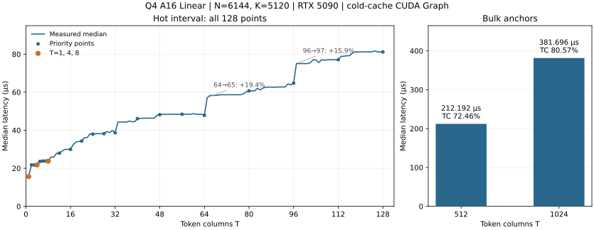

# Q4 Linear performance report: N=6144, K=5120

Re-measured on 2026-09-26. This document records the complete Linear Op performance for this shape
after this stage's cleanup, as a reference for evaluating the shape and for later tuning.

## What was measured, and under what conditions

| Item | This measurement |
|---|---|
| Weights | `Q4_G64_FP16`, row-split layout; each 64 weights share one FP16 scale |
| Mathematical shape | `W[6144,5120] × X[5120,T] → Y[6144,T]` |
| Input, output and policy | BF16 input, BF16 output, `A16Only` |
| GPU / driver | NVIDIA GeForce RTX 5090; 617.14 |
| Build / CUDA | Release, `sm_120a`; runtime 13.4, `CUDART_VERSION=13010` at benchmark compile time |
| Timing entry | `ninfer::ops::linear`; each CUDA Graph contains one complete Op call |
| Cache / sampling | 256 MiB L2 flush before each sample; 5 warmups, 30 measurements, median reported |
| Input fixture | the public bench's Q4 packed-weight and BF16 activation fixtures; the numerical check separately uses non-uniform weights and scales |
| Coverage | every integer T from 1 to 128, plus 512 and 1024; 130 points in total |

Every measured call has one Graph kernel node and zero external workspace. The measured scope is the
pure Linear Op. This round reused an incremental build product; the `cuda_runtime` field in the bench
log comes from a compile-time macro, so the loaded runtime version was queried separately.

## Final latency curve



The left panel carries all 128 measured points. The circles mark the priority T values, and orange
marks T=1, 4 and 8. The line joins adjacent measured points only. The right panel shows 512 and 1024
separately. The TC percentage uses the logical-compute definition below.

## Logical bandwidth and Tensor Core utilisation

The weights hold `6144 × 5120 / 64 × 34 = 16,711,680` bytes of code and scale. The definitions follow
[the Linear metric definitions](../linear-tuning.md#5-logical-metrics):

```text
model_bytes = 16,711,680 + 2 × 5120 × T + 2 × 6144 × T
logical bandwidth GB/s = model_bytes / seconds / 1e9
bandwidth utilisation = logical bandwidth / 1792 GB/s × 100%

effective compute TFLOP/s = 2 × 6144 × 5120 × T / seconds / 1e12
TC utilisation = effective compute / 209.5 TFLOP/s × 100%
```

The denominators come from the bench's fixed RTX 5090 specification constants. T=1 uses GEMV, and its
TC utilisation is shown as `—`. Every current path at T≥2 uses dense MMA with BF16 input and FP32
accumulation, which corresponds to the **209.5 TFLOP/s** peak. The bench's Q4 rows leave the TC field
unfilled, so this document computes it from the formula above. The computation adds no decode,
padding or extra tile work. These are logical-workload utilisations, not hardware-counter
measurements, and the remaining percentage is not all recoverable time.

At T=1 the logical bandwidth is **1069.4 GB/s, a nominal bandwidth utilisation of 59.68%**. Against
the separate 1674.5 GB/s sustained-read reference the bench lists, it is **63.86%**, which is the
`READ_%` definition.

| T | latency µs | logical bandwidth GB/s | bandwidth utilisation | effective compute TFLOP/s | TC utilisation |
|---:|---:|---:|---:|---:|---:|
| 1 | 15.648 | 1069.4 | 59.68% | 4.02 | — |
| 2 | 21.792 | 768.9 | 42.91% | 5.77 | 2.76% |
| 3 | 21.696 | 773.4 | 43.16% | 8.70 | 4.15% |
| 4 | 21.792 | 771.0 | 43.02% | 11.55 | 5.51% |
| 5 | 23.552 | 714.3 | 39.86% | 13.36 | 6.38% |
| 6 | 23.808 | 707.6 | 39.49% | 15.86 | 7.57% |
| 7 | 23.808 | 708.6 | 39.54% | 18.50 | 8.83% |
| 8 | 23.744 | 711.4 | 39.70% | 21.20 | 10.12% |
| 12 | 27.936 | 607.9 | 33.92% | 27.03 | 12.90% |
| 16 | 29.984 | 569.4 | 31.77% | 33.57 | 16.02% |
| 20 | 34.304 | 500.3 | 27.92% | 36.68 | 17.51% |
| 24 | 37.952 | 454.6 | 25.37% | 39.79 | 18.99% |
| 28 | 38.208 | 453.9 | 25.33% | 46.11 | 22.01% |
| 32 | 38.656 | 451.0 | 25.17% | 52.08 | 24.86% |
| 40 | 46.112 | 382.0 | 21.31% | 54.58 | 26.05% |
| 48 | 48.192 | 369.2 | 20.60% | 62.66 | 29.91% |
| 56 | 48.416 | 371.2 | 20.72% | 72.77 | 34.73% |
| 64 | 47.840 | 379.5 | 21.18% | 84.17 | 40.18% |
| 80 | 60.704 | 305.0 | 17.02% | 82.91 | 39.58% |
| 96 | 64.800 | 291.3 | 16.25% | 93.21 | 44.49% |
| 112 | 77.088 | 249.5 | 13.92% | 91.41 | 43.63% |
| 128 | 81.184 | 241.4 | 13.47% | 99.20 | 47.35% |
| 512 | 212.192 | 133.1 | 7.43% | 151.81 | 72.46% |
| 1024 | 381.696 | 104.2 | 5.82% | 168.78 | 80.57% |

## Reading the curve, and verification

[The shape implementation](../../../src/ops/linear/projection/q4/shapes/n6144_k5120.cu) chooses
between GEMV, sliced-K inside the CTA, and plain MMA. The source is the authority for the exact
configuration.

- T=1 to 2 rises from 15.648 to 21.792 µs (+39.26%). This is the largest adjacent step in the hot
  region, and it corresponds to the switch from single-token GEMV to sliced-K.
- T=64 to 65 rises from 47.840 to 57.120 µs (+19.40%); T=96 to 97 rises from 64.800 to 75.072 µs
  (+15.85%). These steps at production-route boundaries remain. Steps also occur inside one route,
  for example +14.57% at T=32 to 33. The figure keeps every measured change.
- T=512 is **212.192 µs, 151.81 TFLOP/s and 72.46% TC utilisation**; T=1024 is **381.696 µs,
  168.78 TFLOP/s and 80.57% TC utilisation**. This round re-measured only the two large-T anchors;
  129 to 511 and the other large-T boundaries were not re-measured.

Numerical qualification uses `ninfer_linear_projection_test --format q4`. It decodes the packed Q4
codes and the FP16 scales independently, uses an FP64 matrix multiply as the oracle, and checks the
public route, representative boundaries, output guards, input preservation and CUDA Graph replay
after the input changes, to the existing A16 standard. This round refreshed timing and the document
only; it did not re-run the numerical test.

## Reproduction

```bash
cmake --build build/rtx5090-dev -j --target ninfer_linear_bench

./build/rtx5090-dev/bench/ninfer_linear_bench \
  --qtype q4 --policy a16 --n 6144 --k 5120 \
  --sweep 1:128:1 --execution graph --graph-calls 1 \
  --warmup 5 --repeat 30 --flush-mib 256 \
  --csv-out profiles/bench/q4_report_20260926/hot.csv
./build/rtx5090-dev/bench/ninfer_linear_bench \
  --qtype q4 --policy a16 --n 6144 --k 5120 \
  --sweep 512:1024:512 --execution graph --graph-calls 1 \
  --warmup 5 --repeat 30 --flush-mib 256 \
  --csv-out profiles/bench/q4_report_20260926/bulk.csv
```

For later tuning, choose candidates, verify numerically and settle dispatch according to
[the Linear tuning and report rules](../linear-tuning.md). This report describes this shape under the
measurement conditions above only. It does not describe other shapes or end-to-end inference
performance.
