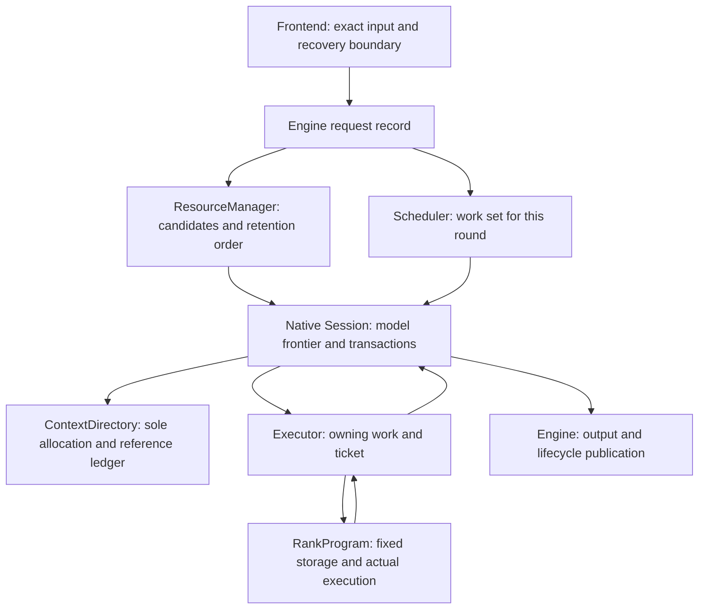
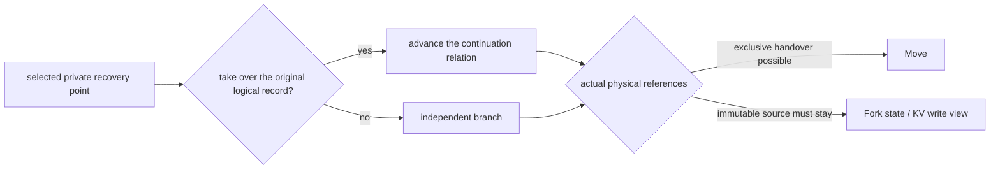

# NInfer resource scheduling and context cache

This document explains how Generation coordinates request execution, context reuse and preemption
recovery within limited device memory and Host RAM. It is the design authority for these policies.
The global execution and publication relations are in [Engine architecture](engine-architecture.md).
The physical layout of the KV cache, the page table and the consumer constraints are in
[Paged KV](paged-kv-cache.md).

## 1. Core idea

The current product runs through LocalExecutor on one rank, one GPU, one resident model and a
startup-fixed set of 1–8 resident lanes. A hybrid model reuses one prefix, and that reuse needs the
complete recurrent state at the position and a contiguous KV coverage. KV can be shared page by
page. A recurrent state is a complete recovery image of one position. Cache management therefore
uses three units at the same time:

- **Continuation records** manage the recovery positions of one history, its named entry points and
  its real reuse eligibility.
- **Checkpoints** express an exact position that can be recovered, the StateImage and the KV
  coverage of each backend.
- **Physical objects and replicas** carry the actual occupancy, sharing, transfer and release.

Ordinary execution reserves resources incrementally for the next unit. When the working set grows so
that it cannot stay resident together, the Engine pauses the younger requests and advances the older
requests first. Recovery separately takes a complete permit that covers the old frontier and the
first new unit. It returns the balance only after new progress. The committed history and the output
semantics of a request survive a pause. The device binding can be rebuilt.

The cache mainly serves multi-turn dialogue, agent tool round trips, input retries and shared
prefixes. Save opportunities come from the input semantics and the request lifecycle. A prefill
chunk only splits the scheduling work. It does not save state automatically. Demand evidence from
real adoption and repeated computation decides the heat. Reclamation compares the real recovery loss
against the currently scarce resource within the finite physical actions that Native reports.

<a id="ownership"></a>
## 2. Ownership and call relations

| Part | Facts and decisions it owns |
|---|---|
| Frontend | template, token/position/media identity, typed rewrite, exact recovery positions and shared markers |
| Engine request record | original ticket number, input/output objects, budget, cancellation, first time and the continuation relation across a pause |
| Scheduler | execution membership, fresh scan and bounded overtaking, prefill/Replay rotation, preemption and recovery gating |
| ResourceManager | private continuations and public entry points, prefix index, wait references, demand evidence, source ordering and reclamation authority |
| Native Session | model ledger, Main/backend frontiers, complete recovery points, work demand, logical commit and recovery mathematics |
| ContextDirectory | State/page/history/row identity, space allocation, coverage, references, reader leases, Host extents and reservations |
| Executor / RankProgram | execution quota and ticket, physical backing, COW/transfer/page-table actions, computation, Graph and completion events |



Runtime asks the Session for the occupancy and the releasable amount in the directory. A rank does
not select the cache source or the physical page number again. Several logical entry points can
share one copy of the content. Releasing one entry point can release zero bytes. A checkpoint owner
protects the recovery eligibility. A reader lease protects the replica that is actually read until
the computation or the transfer completes. A retention level does not mean that the whole history is
pinned.

The control thread advances the policy, the Session transactions and the reference settlement.
RankProgram owns the fixed Device/Host backing, frames, workspaces and Graphs. ContextActions carry
only value identity, ranges and mapping arrays with a lifetime. The contract for the directory and
the physical storage is in [Paged KV](paged-kv-cache.md). The model ledger and the output commit are
in [Engine architecture](engine-architecture.md).

<a id="capacity"></a>
## 3. Capacity and execution permits

### 3.1 Startup capacity

The Device prepares Main KV, the selected backend KV, StateImage, workspace and Graph space from the
actual layout of the model. A Main KV page holds 64 tokens. The physical byte count of each KV kind
comes from its layer count, geometry and storage format.

| Setting | Current meaning |
|---|---|
| `max_context` | the logical context limit of one request |
| `kv_capacity` | the token-equivalent capacity of the Main KV physical pool, rounded by page. The startup device-memory budget can also solve it automatically |
| `max_concurrency` | the limit C on execution bindings in use at the same time, range 1–8 |
| `context_cache.extra_state_slots` | the number of extra slots beyond the C base Device StateImages. The default is C |
| `context_cache.host_capacity_bytes` | the pinned Host byte capacity shared by StateImage, Main/backend KV, paused snapshots and transfer destinations |

The page-count lower bound of the Main KV capacity curve is `max(ceil(max_context / 64), C)`. The
upper bound is `C × ceil(max_context / 64)`. The lower bound satisfies two geometric requirements:
one request that holds the maximum context alone, and C minimal pages. Native also computes the
layout of the selected backend, state, workspace and MoE backing. The Graph rebuild cost is
calibrated after the weight load, and it is deducted separately from the remaining device memory as
described in [startup lifecycle](engine-architecture.md#34-the-model-instance-and-the-engine-lifetime).
An explicit or an automatic capacity must fall within this curve and satisfy the budget. The
capacity is not divided equally between the lanes.

The pool directory of the Session is fixed at startup. `KvPoolId` identifies a specific pool. The
directory gives the geometry, the Device capacity and the Host page stride. The name is for
diagnostics only. The model keeps the Text/MTP/Draft Full roles internally. The demand, shortfall,
occupancy and released amount of Runtime use `ContextResources<N>`: State slots, KV page groups
indexed by pool ID, and Host allocated bytes. `N` is declared by the native architecture. An
ordinary execution query allocates no dynamic container. Each reclamation addresses one specific
shortfall. A free page in another pool cannot satisfy it. The existing capacity curve and the
recovery permit policy stay. Transfer demand and observation also record image count, page groups,
payload bytes and copy operations. The first two are content extents. Host allocated bytes include
the allocation alignment. Payload bytes are the actual DMA amount.

The default Host capacity on RTX 5090 is `8 GiB + 8 × the Host StateImage size of the current
model`. The Host capacity on DGX Spark is fixed at zero. It uses Device prefix reuse and Replay. The
Host pool is one shared backing. The separate occupancy of State and KV is for observation. You
cannot add them again into an extra quota. A transfer destination is charged from the moment of
reservation. Publication only changes its state. It does not reduce the occupancy. State replicas
and transfer destinations hold the Host allocation directly. The allocation that a capture reserves
is used directly for the transfer. Complete images on the Device and on the Host use the same
internal layout. The alignment gaps of a copy count as real transferred bytes. The allocator manages
the split of a Host extent, the release of the last reference and the merge.

Required request input, the token ledger, prepared media, Responses storage and the Frontend media
cache each have their own lifecycle and their existing count, length or media budget constraints.
The Host context capacity does not cover these memories, and it does not limit the total process
RAM. The physical capacity also limits the size of the Native metadata. Empty logical records and
index branches are deleted promptly. PreparedSession builds the directory, the checkpoint catalog
and the control containers before the final startup budget check. It hands them to the Session on
success. The unified-memory accounting on Spark includes this Host metadata. A capacity rebuild
releases the control owner first, then the rank backing, and observes each reclaimed amount
separately.

### 3.2 Execution and recovery permits

The Session computes the typed KV coverage for Prefill, Replay, Decode/Verify, Control or Normalize
from the actual binding state. The coverage includes the speculative peak and the backend needs.
State and the missing replicas are acquired separately. The tail-page COW that a write conflict
needs counts in the binding or unit permit. The requests for several typed pools of one unit succeed
together. A failure returns this partial reservation and reports the specific shortfall. In
addition, the Executor acquires a frame and the quota for the following
decision/commit/discard. The Session enters the irreversible active-directory preparation only
after it holds this complete permit. A later exception is an execution instance failure. It does not
return to admission selection as an ordinary resource shortage.

The Engine acquires resident unit permits by recovery first and original ticket number second, and
forms a runnable subset. A row that is short for now does not block other permitted rows from
running. Fresh admission uses the remainder. It cannot spend the existing permits. An ordinary unit
settlement releases the unused reservation. Later growth keeps requesting on demand. An in-flight
page and row that trim removed from the logical references stay until DeviceRetired. The growth
reservation that the next unit needs is completed after these pages actually return. It does not
hold two capacities temporarily for the old and the new permit. An operator does not select the
cache victim internally.

If a synchronous reclamation already changed the capacity, retry the current permit in place. Return
to the scheduling round only when a transfer completion must be awaited.

Pause recovery takes, in one step, the complete State, the missing KV, the tail page and the
coverage that rebuilds to the old frontier plus the first real new unit. The Session holds the real
reservation that is not yet materialized across Replay chunks. Reaching the old frontier or
completing the backend history alignment does not end the protection. The recovery permit ends only
after a new prefill commit, a generation/control commit of new tokens, or the request entering a
terminal state.

One request can hold most of the KV temporarily. After it reclaims the optional cache and pauses the
other requests, if the only request still cannot acquire a legal unit, the Engine reports a capacity
contract error. It does not wait for a releaser that does not exist.

<a id="checkpoints"></a>
## 4. Continuation records and complete checkpoints

### 4.1 Private recovery positions

A private record keeps one generation end point E, one input-side recovery point and at most four
explicit private long anchors.

| Position | Purpose |
|---|---|
| E | the committed generation end point. It serves a continuation that includes the previous round's output |
| typed R: `ResponseReplay` | before the current assistant response starts. It expresses the rewrite upper bound for a retry, a structured tool call and a normalized history |
| typed R: `TurnClosure` | before the first assistant that follows the current real user. It expresses the rewrite upper bound that a new user turn applies to the open turn |
| `recovery_frontier` | the input position whose State is actually retained. It can equal R, or it can sit at an earlier content boundary where the closing structure can be recomputed exactly |
| P | the raw/token input end point without a typed rewrite |
| explicit private anchor | the other finite recovery positions that the caller names |

The Frontend selects the typed R from the template rendering and the next-user probe. It then
decides the actual recovery position separately. For example:

```text
[user header][body] C [template closing structure] R [assistant generation header] P
```

Save C in fact only when provenance shows that the C→R range is purely the template closing
structure with no missing content or media. That range sits immediately before R, next to a
User/System/Developer message. C must also map to an exact token frontier. Recompute the closing
tokens after recovery. Otherwise save R. This choice comes from the message structure that the
typed R belongs to. It does not depend on the position of the automatic shared marker in this
request. Input planning and the source carry check use the same recovery position.

`rewrite_execution_frontiers` separately constrains the split of the mathematical execution. It can
sit after the assistant header. Moving the actual recovery position earlier, or an optional save
failure, does not change these mathematical boundaries.

When recovery starts from a deeper E, Native carries the input point that is still exactly
compatible. When a later position is needed, the old point can retire before the new destination is
requested. A failed new save does not restore the old point. An earlier state cannot be derived
backwards from a deeper state. Each generation does not store a separate fixed P image. Uses at the
same position can share the physical state. An anchor updates in place. When the limit is exceeded,
it replaces the oldest published point. If it cannot replace safely, this save is abandoned.

### 4.2 Completeness and identity

A checkpoint contains the exact input identity, the Native frontier, the immutable StateImage
and the required typed KV coverage. The model declares the StateImage. It contains the GDN/conv
state, the continuation hidden state, and the fixed state of the architecture and the selected
backend. For Qwen4Exp it also contains the QSA raw tail and coordinates, the PLE conv history,
and the conditioning when MTP is enabled. The PLE raw-ID tail is stored with the frontiers in
the continuation metadata. The Main, MTP and DFlash frontiers are interpreted separately. The
model code guarantees that they are compatible. The native Continuation stores the image
identity. It also stores the execution frontier, the RoPE offset, the valid range of each
history and the validity of the tail hidden state. Freezing and copying do not change the
content version. Only a completed mathematical write advances the version. An unfinished branch
destination cannot be published as a checkpoint.

An ordinary generation usually has:

```text
execution_frontier = the length of the computed KV/state
ledger_frontier    = execution_frontier + 1
ledger[execution_frontier] = the committed token that the next input will use
```

An exact hit can sample the anchor with the saved tail hidden state. The stable MTP boundary is
`Main=F, MTP history=max(F-1,0)` for both models. The round generates drafts, then runs
Verify/Decision/Commit. It does not carry the drafts that the previous round generated in advance.
After it adopts A outputs, Main is F+A and the MTP history is F+A−1. The history is rebuilt with the
real target conditioning. Prefill, Replay and Control share the same alignment rule. The native
model performs the DFlash context append and each accepted-prefix fold. A suffix that is not yet
committed does not become a recovery point.

The digest of the prefix index narrows the candidate range. Before adoption, the Engine still checks
the tokens, the position, the media and the execution identity. A state and a KV that came from an
independent recomputation cannot be joined just because the tokens are the same. A shared page and a
copy across media keep their real content identity.

### 4.3 Shared uses and automatic boundaries

A public shared entry is an independent entry point from which several requests can fork. When it
sits at the same position as a private actual recovery point, both logical uses stay and the
physical objects are shared by reference. The Frontend resolves up to four caller markers into exact
frontiers, merges the ones at the same point, and offers save opportunities in order. An earlier
position can still serve a suffix that changes later.

The product entry selects the automatic marker. The Frontend checks its actual serialization
boundary:

- OpenAI selects the end of the last cacheable source part by default. A structured tool call uses
  its message boundary. When it has no message content, it can use the tools boundary. When the body
  keeps growing, the earlier source part can be reused if its token prefix stays the same.
- The automatic hint merges with an explicit marker at the same point. When the four explicit
  positions are full, the automatic hint yields. An explicit message boundary is still interpreted
  at the position that the caller names. It is not changed to a content boundary.
- Responses expands the stored history and normalizes this input before it applies the policy. The
  original stored input carries no new automatic marker.
- For other inputs that allow an automatic structural position in the model, the Frontend can offer
  the limited opportunities of the leading instructions, the tools and so on.

Source provenance, the exact frontier from the tokenizer and the complete media range together
decide whether a position is valid. Appending a string can change the trailing BPE token. A
source-part position must therefore still pass a real prefix match. The protocol parameters are in
[Serving](../serving.md).

## 5. Saving and physical handover

### 5.1 Save opportunities

A save comes from an actual input recovery point, an explicit anchor, a shared marker, a normal
generation end point, or the execution snapshot that a real preemption needs. The end of a
Prefill/Replay chunk alone does not produce a save opportunity.

Before it crosses a semantic frontier, the Engine calls Native to prepare the destination state
and the checkpoint description. A private input point can first retire the input points of this
record that are already stale. It then tries a Device slot. It uses the Host when the capacity
is short. A private save and a public save both hold a `HistoryPrefix`. A read-only prefix does
not copy the tail page. Records with different uses at the same position can share one
StateImage and the same KV content.

When one point has both a private use and a shared use, the private point can stay even if the
shared part is short. A capture is an optional cache write. Reclamation must pass the admission
check of the added recovery benefit against the content it replaces, and it does not preempt an
active request. If there is no suitable space, skip the save and continue the required execution. An
existing compatible input point is carried directly. Optional capture is skipped while a complete
recovery permit is in effect. The required mathematical boundaries still run.

### 5.2 History, Move and Fork



A private record that is not active and that allows its entry point to be updated can be taken over.
When an independent request already holds the relation, or when the case crosses named entry points,
keep the parent record and build a branch. A public alias or a physical reader decides whether a
Fork is needed. It does not require an extra private parent record.

E, the input points and the anchors of one history reference one KV directory and their own
coverage. Saving an internal input point does not copy the whole KV, and it does not copy the tail
page separately just because the point sits in a partial page. When it recomputes from an earlier
input point, the binding first checks the resources that are actually available after retirement.
After admission it retires the deeper private point that it is allowed to replace, then trims to the
remaining protected range. A saved prefix does not occupy the writer. When there is no other writer
and the write range does not cover the retained content, it can take over the original history. When
a write conflict exists, the binding builds an independent directory and copies the partial tail
page. It also branches when an active history falls back before the retained frontier. The quote
explicitly accounts for the prefix references that this authorization retires and consumes. The
feasibility check does not modify the original source.

The immutable state is separate from the active writer. An exclusive E moves directly. When the
source must stay, a Fork can complete the state transfer with the next computation. The local copy
that the backend needs still runs. When the Device slots are tight and a Host copy exists, the Host
content can keep the old identity and the Device slot goes to the new active identity. When only the
Device copy exists, complete the D2H first. When saving and execution cannot both be served,
abandoning the optional recovery point is allowed. A reader lease always stays. The Host space that
the binding frees when it retires an old point can also save an input point.

A normal end freezes the legal execution state into a new E. Cancellation can remove the optional old
cache that this request took over. Other independent owners stay valid. The product session key is a
lookup hint and a named entry point. An older request that finishes late cannot override a newer
`publication_order`. An unnamed history can still be reused by exact content.

<a id="sources"></a>
## 6. Source query and binding

An admission query or a Replay recovery query hits the private and public complete points on the
path, and it includes the root. Native checks each one for the exact match, the largest permitted
frontier, the private points it can carry and the physical handover mode.

The candidates are ordered by recovery transfer cost plus remaining prefill cost. When the cost
is equal, it applies this order: moved bytes, the deeper reuse position, the legal session hint,
the private use, the newer publication order and the stable sequence number. Duplicate
candidates with the same Native handle, the same takeover mode and the same carry point are
merged. Positions with the same semantics that came from an independent computation are still
handled separately.

The source cost model compares the current recovery transfer against the remaining computation. The
KV DMA work comes from the address-free KVTransferProfile that the rank exports after preparation.
The directory does not guess the pitch or the plane merge mode. The machine transfer and the
artifact prefill calibration affect the ordering. They do not decide whether the content can be
recovered. Cache reclamation uses the real recovery coverage loss instead, and it does not estimate
the probability of future requests. Native requests the actual permit.

The source evaluation is read-only. Native computes the Move/Fork of the source, the compatible
carry points and the old points it is allowed to retire. It checks the State, the missing KV, the
growth pages and the tail-page demand against the first legal unit. Pause recovery still checks the
complete recovery permit. A real reclamation can change the replicas and the capacity, so the facts
are read again afterwards. A failed binding attempt does not retire the old points related to the
candidate.

When a valuable source is temporarily blocked by the occupancy of a resident request or of in-
flight work, the request keeps the source and waits. The first chunk of the root is small. It is
not a reason to abandon an existing recovery position. The request can select again when the
source becomes invalid or is revoked. It can also select again when the real cost order changes
or the required page count of the binding path exceeds the capacity of the physical pool. When
there is no real releaser and legal reclamation is still short, try another source. If the root
of an isolated request also cannot acquire a legal first unit, report a capacity contract error.
Its own complete Snapshot is honored first. It is not dropped because another source is cheaper.
A Snapshot builds the binding directly from its own checkpoint and the carry point of this
request.

Waiting requests reference the same Native checkpoint and carry the compatible input recovery points
and the finite anchors of this request. A wait allocates no new State/KV and occupies no lane or
later execution permit. It does extend the lifetime of the existing resources. After the directory
is replaced, the wait references still keep completeness. A point that only a waiter retains does
not become a new public directory entry. A query, a retention and a wait produce no usage heat and
no cache hit.

The wait protection allows the Device/Host replicas to migrate. It is separate from the reader lease
of an actual read. An optional cache write cannot delete a complete point that a waiter holds. Fresh
admission can revoke only the protection of a younger waiter. It cannot revoke a paused snapshot.
The required advancement and the legal recovery of an admitted request can revoke the wait
protection when ordinary reclamation is short. Reclamation first selects the complete physical
action that fills the real shortfall, and it checks all holders. A shared reference is not charged
twice. When a revocation is needed, it prefers the younger waiter. The revocation record makes the
affected requests select again.

The binding separates the logical takeover from the physical consumption. The wait reference of the
request itself can hand over directly. The other waiters stay external retainers. The
wait-revocation authority that a Move grants is honored only when the complete binding can succeed.
When the original owner already advanced or changed generation, the old waiter builds an independent
branch. A new query also cannot take over a record whose publication order is later than this
request. The old checkpoint that it holds exclusively can still Move.

Before the commit, Native prepares the request metadata. It checks and uses the real resources
that retiring the old points can release. It then acquires the read protection and the
reservation, and it performs the ownership handover. After a successful admission it does not
try other sources. The state is installed after the move and its dependencies complete. Only
then does the ResourceManager record the actual use and the takeover relation. A wait reference
is released on adoption, reselection, cancellation, timeout or shutdown. An in-flight reader is
released after the Native transaction completes or aborts. A request that is cancelled after
admission can still lose the optional old cache that it already retired.

<a id="retention"></a>
## 7. Retention and reclamation

### 7.1 Real demand and two-part retention

A private record and a public entry each have a normal/reuse level. The private owner stores the real
demand time together with the actual adopted position `proven_frontier` as a pair. Consume resets
this pair to this source. A Fork child record takes the time and the position of this adoption. When
a Fork starts from an earlier position of the parent record, the parent keeps its existing pair of
evidence. The parent record updates only when the source already covers the proven position of the
parent. A public use updates the public entry separately. A completion, a save alone, a move and its
own pause recovery do not refresh the evidence.

There is also a demand summary of at most 256 entries. It records the digest, the frontier, the
identity tag and the real request observation of the finite candidate positions. When it adopts a
nonzero cross-request source, it records the repeated demand of that exact adopted position. When a
new prefill **commits and crosses the candidate position**, it records the computation demand. One
request records one position only once. The real computation of two different requests can also
prove repeated demand. Even if no physical replica could be hit before, a later capture can still
acquire the reuse eligibility of that position. Rendering, a candidate query, polling, its own
Snapshot/Replay recovery and a save alone produce no observation. A summary hit affects retention
and admission only. It does not add to the cache-hit or reused-token statistics, and it holds no
State/KV. When the input recovery point raises the private owner because of this real
repeated-demand evidence, it also sets the proven position to that input point.

The reuse segment is ordered by the most recent actual adoption or repeated-demand time. Its soft
target is 3/4 of the capacity of each physical pool, and it demotes the older records. The charge
uses the unique physical footprint. One newest large record can exceed the soft target. The level
decides the reclamation order. It does not promise permanent retention.

### 7.2 Finite physical actions

Native enumerates the finite demotion and drop actions from the actual State/KV references. Each
action carries the real holder set, the releasable amount and the required transfer. All optional
holders of shared content must satisfy the admission together. An active/transfer reader separately
limits whether the content can be touched. An action that releases zero of the currently scarce
resource does not join the comparison.

Qwen3.5 and Qwen4Exp share the recovery scoring and the physical holder algorithm. The native
Session maintains an exact prefix forest by checkpoint publication, retirement and generation.
Aliases with the same identity/frontier share a semantic node, and each still holds its own actual
State/KV references. The digest and the identity tag only shortlist. An ancestor relation needs the
same backing, or a complete token, position and Vision/rewrite identity proof. The index holds no
snapshot, resource reference or reader lease.

Each synchronous evaluation also fixes the recovery points that Runtime actually publishes, the
current State/KV holders, the residency and the pins. Only a checkpoint that a wait reference holds
and that is not published can be a physical holder. It cannot be a lookup fallback. Migration, drop,
the Host destination precheck, the protection decision and the write benefit share these facts. The
evaluation runs again after a resource or reference change or after returning to the scheduling
round. The identity index can be reused across rounds. An old evaluation cannot be used across a
checkpoint revision. The commit still checks the complete holders, the content version and the pins,
then takes the real reservation.

The private heat protection corresponds to its proven adopted position. An earlier recovery
point of the same owner can really survive and still cover this position. That point must be
exactly compatible. When it is, a deeper new suffix that is not yet proven can be handled as an
ordinary marginal loss. An input point that is too early cannot stand for a deep position that
was actually adopted. An independent Shared heat owner still protects the complete physical
action that involves it. Demotion and drop use the same protection decision.

Own-source demote-then-restore compound. The protection above is written from the admitting
candidate's point of view, and the pages and StateImage it protects are that candidate's own
reuse source. For its own source only, the candidate accepts a deferrable compound: a
demotion-only pressure decision on the own source (Device→Host StateImage demotion and KV page
demotion) is eligible even though the source is protected, because demotion is a move that keeps
the source catalogued and recoverable, and the candidate's own materialization restores the
demoted replicas through the Host→Device fallback (Host-resident KV pages via the Device-replica
restore, a Host-only checkpoint state via the Host fork). Drops of the own source (checkpoint
drop, eviction, Device-replica drop) stay rejected: they would destroy the reuse the candidate
exists for. The candidate's own source therefore joins the pressure victim domain with a
demote-only maximal outcome and never with an eviction; every other request's protected pages,
states and hot owners keep the full protection, and a third party's pinned pages stay
ineligible. The compound relies on the materialization transaction ordering: the pressure
transition (the D2H demotions) settles before the prefix fork pins the source pages and before
the H2D restores are submitted, so a restore always reads the post-demotion Host state.

Each comparison uses the typed shortfall that is currently being handled. Inside the Device it
handles State first, then the Main/backend KV. The Host destination is prechecked separately.
Runtime orders within this scarce unit:

1. Normal content comes before reuse content.
2. A normal action compares the marginal recovery token loss against the released amount that is
   useful for this shortfall. Equal scores follow the retention order.
3. A reuse action follows the most recent real demand time and handles the older content first.

The drop loss is computed from the real surviving fallback after the action. Let R be the legal,
deduplicated set of handles to drop. Let S be the published recovery points that are not in R.
`s ≼ r` means that s is an exactly compatible prefix of r. For each dropped semantic node, define:

```
d(r, S) = frontier(r) - max({frontier(s) | s ∈ S, s ≼ r} ∪ {0})
loss(R, S) = Σ[b ∈ maximal(R)] max({d(r, S) | r ∈ R, r ≼ b})
```

`maximal(R)` is the deepest semantic node of each dropped branch. One branch takes the largest
degradation, and independent branches add up. A shared ancestor joins the maximum of each successor
branch. Aliases with the same semantics count one loss. A surviving alias can still recover that
point. Aliases that are dropped at the same time cannot serve as each other's fallback. The result
does not depend on the slot, the handle or the input order, and a deeper state cannot recover an
earlier position. For example, drop 100 and 200 on one chain and keep 150. The loss is 100. Drop the
common 100 and two 200 branches, and each of the two branches keeps 150. The loss is 200, not the 100
that only the end points would give.

After the index is ready, scoring the drop of R visits only R and the ancestors that are removed.
The ordering cost is `O(|R| log |R|)`. It no longer scans S one by one or compares long token
prefixes repeatedly. Adding a new identity to the index and collecting the physical holder relations
are separate preparation costs. You cannot mix them with the complexity of the scoring query. Many
shared holder relations or many new identities can still need quadratic work and the corresponding
metadata.

The joint Host selection updates the physical holder count by handle insert and rollback. The
released amount counts only when the last real holder leaves. The scoring and the protection facts
are cached by interdependent semantic branch. The protection proof of one owner merges its related
branches. Each round compares the current total loss and the real released amount of all candidates
again, and recomputes only the part that this round's choice affects. An independent single-point
candidate needs one score per point. Related branches are still computed over their affected set. It
does not promise that the whole selection is linear in any shared topology.

A Device→Host demotion fixes the required Host victims before the ordering. The net loss of the
complete action includes these drops. It is zero loss only when no complete recovery content must be
dropped. It does not come first just because the Device source is preserved. The same victim set is
checked again before the commit. A change leads to a new quote.

When only a few pages are short, the demotion selects the finite page group that fills the shortfall.
State and another typed pool do not all move just because they belong to the same history. When a
complete Host copy exists, it releases the Device copy directly. Otherwise it quotes and requests a
Host destination. It checks the content and the references again before it starts the action, and
it queries the real shortfall again after it completes.

Inside one KV pool, the migration groups selected in reclamation order can share one
transaction. An intermediate drop candidate can release some target Device pages. The migrations
selected before it can already cover all of them. In that case it adds no capacity this time, so
this alternative can be skipped. The decision rests on the complete physical page identity in
Native, not on the checkpoint name or the nominal page count. Other drop actions, and migrations
that need a Host victim, end this batch. Runtime checks the authority of each group and of the
complete batch. Native trims the strict prefix to the real shortfall and the Host remainder. It
commits only after all destination and source lease reservations succeed. A Device page that
already has a complete Host copy is released at the commit. The other pages are released after
the copy completes. The original candidate list stays. When the batch reservation fails, it can
still try the single migrations and the drop alternatives in order.

### 7.3 Required execution and optional writes

Required execution can reclaim the permitted optional content in the order above. Its own source and
its in-flight reader always stay. An optional capture, and a Host write-back that keeps existing
content, owns only its own admission eligibility.

A new capture separates the repeated demand of the exact candidate position from the retention heat
that the owner inherits. The first comes from the real cross-request adoption of the candidate or
from the demand observation of a repeated commit. When the working set is replaced by repeated
demand, it uses the candidate's own demand time. It cannot borrow the newer heat of the owner.

| Request and victim content | Admission condition |
|---|---|
| A new capture with no repeated demand of the candidate itself | the retention level of the owner defines the replaceable range. The fixed added recovery coverage benefit must exceed the accumulated drop loss. Inherited heat does not exempt the budget either |
| A new capture with the candidate's own repeated demand | replace normal content or older reuse content by the real demand time of the candidate. The added coverage length does not limit the working-set replacement |
| Host write-back of existing content | admit by the eligibility of the retained content itself and its recovery coverage benefit |
| Paused Snapshot | optional cache, then consider the paused snapshots with a later ticket number |

A new capture without the candidate's own repeated demand fixes the added recovery coverage budget
against the surviving fallback when the decision starts. The stepwise Host and Device drops share
the budget and accumulate the recovery coverage already sacrificed. Dropping the fallback cannot
raise the benefit of the requester again. The stepwise loss uses a conservative accumulation. It can
abandon points that a more complex combination could have kept.

After the admission, the overall retention heat of the private owner can still inherit the real
adoption eligibility. That does not give an equally replaceable right to a new capture position that
no one has needed twice yet.

The Host victim set of a demotion must satisfy two authorities at the same time: the retention
authority of the migration source and that of the outer optional capture. The remaining capture
budget also binds it. The Device space that required execution needs does not transfer its
authority to a cold cache that is trying to save. When a save has no sufficient benefit or
space, skip it. It does not block required execution.

The Host first releases the safe duplicate replicas, then runs a complete precheck over the finite
physical actions. It drops only when the actual release union is sufficient and the joint holders
can all be replaced by this request. The nominal size of a Shared reference does not add up again.
After the precheck, the allocator must still satisfy the complete StateImage and the contiguous
extent geometry. A failed allocation can abandon the save. A completed drop does not roll back.

<a id="scheduling"></a>
## 8. Scheduling, preemption and recovery

### 8.1 Normal round

Each round first handles transfers, terminal states and cancellations. On a real capacity event it
tries the complete recovery of the oldest paused request. It then requests resident unit permits row
by row, recovery first and original ticket number second, keeps the runnable subset, and tries fresh
admission with the remainder. It runs the permitted compact Control/Decode set and one
Prefill/Replay chunk. A row that Control committed acquires the Decode permit again in the next
round. The Graph uses the actual member count and the execution profile.

The fresh queue keeps the FIFO ticket numbers. At most C younger requests can overtake each blocked
request successfully. Each scan checks the head of the queue and at most C later candidates. A
failed check spends no quota. An unfinished scan continues by ticket number. When no lane is free,
it can still keep the selected recovery source. A queue change, a real capacity release, a completed
move and a reference revocation trigger a scan. A request that already failed under the same event
is not quoted again. An ordinary decode does not reopen the scan. The wait of a paused request
constrains only itself. A free lane and free capacity can serve a fresh request that can enter.

### 8.2 Pressure and complete recovery

```text
unit shortfall → optional reservation and ordinary cache reclamation → revoke wait protection and paused snapshots when needed
               → take back younger residents for the oldest required work, or pause a young row that cannot advance by itself
```

A request that is materializing, has ended, or holds a complete recovery permit is not a preemption
target. A pause happens at a stable Native commit boundary. It does not interrupt a kernel. The
other permitted requests keep running. The batch does not have to fit completely before it runs.

The paused queue tries recovery by original ticket number. When an older resident exists, the paused
request tries only free space and optional cache space. It must not pause a young borrower
repeatedly just to probe a recovery. After the older resident leaves, the oldest paused request can
take back the lane and the capacity that a young request occupies. Fresh admission does not preempt
a resident on its own.

At most one request holds a complete recovery permit at a time. That request rebuilds the old
history first and completes the first real new unit, while the other runnable units keep running.
Optional capture is skipped during recovery. Native holds the real capacity across chunks. Runtime
uses `recovery_pending` to decide when the protection ends. Reaching the old frontier, completing
the MTP history alignment or only reading a Snapshot back does not count as new progress. Only a new
prefill, a generation/control commit or a terminal state ends the protection.

The boundary of a Prefill chunk gives the resident requests a rotation opportunity. When all lanes
are in use, a new request still waits until some resident ends, is cancelled or pauses because of
resource pressure. A shorter chunk alone does not let it enter earlier. A short request can
therefore queue across several chunks of a long request. To analyse this kind of latency, check the
lane admission and the time of each execution unit separately.

The Engine consumes the ticket decision/result/retirement and the context events within the round. A
completed binding enters the permit and the semantic capture flow in time. A round keeps the members
that it already scheduled. A result event does not reopen the whole Decode. After Control/Decode it
refreshes only the Prefill/Replay permits that this round has not run yet. There is still one
compact decode batch and one prefill turn. ResultReady can trigger an output preview. Only
DeviceRetired allows the related frame, row and transfer storage to be reused.

A completion, a cancellation, a permanent reduction, and a younger request that pauses and releases
resources provide recovery opportunities. A failed recovery waits locally for the next event. A
request that just paused does not recover immediately because of its own release. When no real
execution or transfer can release resources, the oldest request must advance through reclamation and
a legal permit. If the capacity contract is not satisfied, it reports an error.

### 8.3 Snapshot and Replay

The input and output objects, the budget, the first time and the continuation relation of a request
persist. The paused state in Native keeps the committed ledger, the frontier, the sampling and the
backend recovery information. After the lane returns, the request still holds this information.

| Recovery route | What it keeps and does |
|---|---|
| Snapshot | the complete execution position and its State/KV references. It reads back the missing Device replicas and then resumes execution |
| Replay | it keeps the commit ledger and the input and releases the device execution state. It recomputes to the paused frontier and then resumes the original phase |

A Snapshot save completes the required backend normalization first, and it copies only the unique
content that the released Device lacks. Immutable pages that other active requests use can keep
being shared. When the save resources are short, it uses a destructive pause that adds no Device
allocation and converts to Replay. It does not preempt another request recursively to save one
victim.

A paused snapshot can be revoked. A revocation releases the references of the whole execution
snapshot and converts to Replay. The earlier input recovery points and anchors still live by their
own completeness and cache rules. When an existing snapshot does not fit for now, wait for a real
capacity event. Do not drop the snapshot just to reduce the recovery volume.

Replay does not publish the old outputs again, does not charge the budget again and does not sample
the historical tokens again. Penalty counts recover from the committed outputs and the forced
control that was actually counted. The RNG keeps the logical position, the seed and the purpose.
Replay advances across chunks. It adds no cross-request reuse heat.

The drafts of this round that MTP did not adopt do not enter the paused snapshot. After recovery it
generates new drafts from the stable Main/history frontier. DFlash/DFlash2 keep their own context
and local state rules. Vision keeps the prepared media, the media identity and the MRoPE. An invalid
visual handoff is encoded again on demand. These recovery constraints use the same model mathematics
implementation as ordinary execution.

<a id="transfers"></a>
## 9. Transfer and cancellation

A Session has at most one context operation at a time. It can run a binding, a capture, a demotion
or a pause. It uses a separate Context frame, apart from the Compute frame. Work that already holds
a permit and does not depend on this source can keep running. The transaction follows:

```text
determine the source and the physical set → acquire the source lease and the destination reservation → submit the copy
                → wait for the completion event → publish the replica/handover → release the releasable source
```

A first binding also acquires the first-unit permit. A pause-recovery binding acquires the
complete recovery permit. An independent binding reservation that is not yet committed can be
revoked. An accepted ordinary computation directory preparation and a submitted DMA must run to
retirement. A cancellation only changes the intent to adopt the result. The irreversible
ownership handover of a binding is bounded separately by the adoption commit point. An
incomplete replica cannot become a query source. SessionEpoch, SequenceId, ResidencyId, the
ticket/frame generation and the command order prevent a late completion from using a new
binding. The State/page/history identity inside the directory also has its own generation. A
device error enters the unified failure cleanup of the Engine. An ordinary resource shortage
returns to the policy layer. ContextTransaction keeps the control-side source/destination.
ContextMigration keeps the actual execution events and the pinned mapping staging. A cancelled
transaction still occupies the original execution slot. It publishes or discards only after the
copy completes. A partial commit can be not yet recorded at the fence. In that case the rank
drains the actual stream and keeps the first error. It then allows the control side to release
the leases.

Recovery acquires the complete destination space. A case can arise where the final residency
distribution fits but the swapping intermediate states do not fit at the same time. For example, B
is on the GPU and A is on the Host. The complete destination for the recovery of A and the Host
write-back target of B can compete for the same remainder. When no other releaser exists, it can
drop the optional B and advance. Finite page-group reclamation reduces excess moving. It does not
provide a streaming segmented recovery.

<a id="examples"></a>
## 10. How the rules act in a request chain

| Scenario | Result from input to execution |
|---|---|
| the agent adopts the previous round's E, then the client normalizes the tool call | normal continuation Move/Fork of E. When a deeper position mismatches, it adopts the actual input recovery point that the typed R belongs to and recomputes the suffix |
| the private input recovery point and the public marker sit at the same point | one state can have two uses. The private record takes over and advances, and the public entry keeps living by its own references and heat |
| the prefix α and the prefix α+β both have explicit markers, and a later request uses α+γ | both positions have a save opportunity. The earlier α can still be a complete source |
| a hot predecessor produces several one-time branches | each branch carries its actual adoption time, and a completion adds no heat. When the total footprint exceeds the soft target, it demotes the older records |
| a long input has no semantic save point | it yields the execution opportunity by chunk, and a chunk saves no state. It adopts Snapshot or Replay only when pressure causes a pause |
| only a few pages of Main KV are short | compare the finite physical actions of this scarce unit and select the page group that is needed. The backend KV and the State do not all move automatically |
| the Host is zero and the Device state is minimal | an optional input point or a shared save can fail. Required execution reclaims space, and Replay advances under a complete recovery permit |
| a long request pauses and another older resident exists | the long request waits locally. Short requests that fit the remainder keep entering. After the older resident ends, it recovers by original ticket number |
| several requests recompute the same candidate that was not retained | the new commit observations form repeated-demand evidence, and a later save can enter the reuse segment. The cache-hit statistics still count only the actual reuse |

<a id="observability"></a>
## 11. Observability and performance limits

The log and the [TTFT tool](../../tools/bench/ttft/README.md) report the request result, the hits
and the real work, the physical moving, the preemption recovery and the user-visible latency
separately. The first prefill and Replay are counted separately. A cancellation counts only the work
that already ran. `GenerationStart` and the first admitted/first-token publish only once. A pause
does not recompute the ingress timeout.

The evaluation order is this. First check whether a complete recovery point that should exist was
lost. Then look at the serious degradation and the stalls in the stream. Finally analyse the copy,
the recomputation, the CPU scheduling and the protocol preparation cost of the single scenario. A
complete hit can also need a large H2D. A low TTFT can also come with an output gap after a long
pause. The two are reported separately.

Finite recovery points cannot cover arbitrary history rewrites. Whole-record retention, the
competition for a new shared save, the fixed typed pools, the complete recovery destination space,
Replay and Vision re-encoding can all produce real costs. Throughput, TTFT, completion time and the
maximum output interval describe the result together. A single sample describes only that trace, and
it does not establish a latency distribution guarantee.

Implementation entry points:

- [Scheduler](../../src/runtime/engine/scheduler.h), [ResourceManager](../../src/runtime/engine/context_cache/resource_manager.h): members and policy.
- [EngineCore](../../src/runtime/engine/engine_core.h): transaction orchestration, lifecycle and publication.
- [Qwen3.5 Session](../../src/models/qwen3_5/session/session.h), [Qwen4Exp Session](../../src/models/qwen4_exp/session/session.h): native recovery, model frontiers and transactions.
- [ContextDirectory](../../src/models/common/context/directory.h): sole allocation, references and migration reservations.
- [Executor](../../src/runtime/executor/executor.h): execution permits, commit and completion. The [physical action slot](../../src/models/common/context/transfer.h) handles the rank storage handover.
